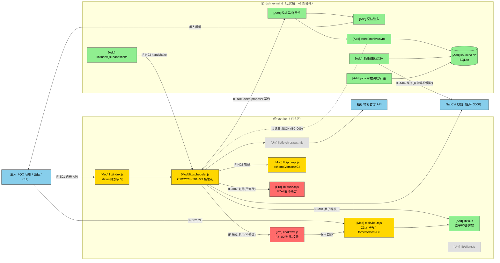
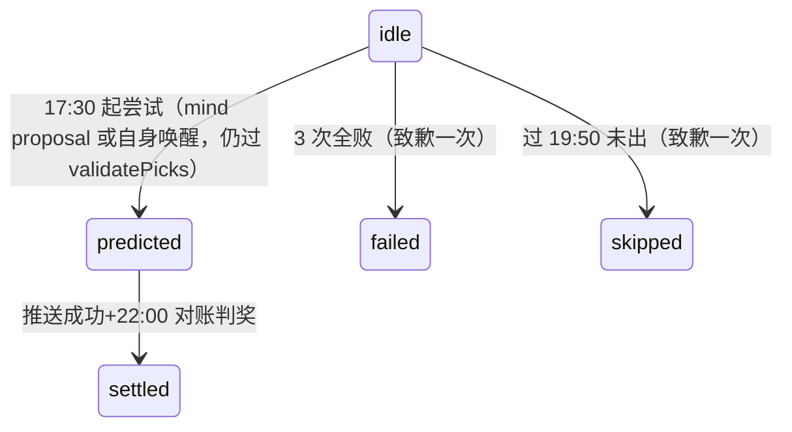
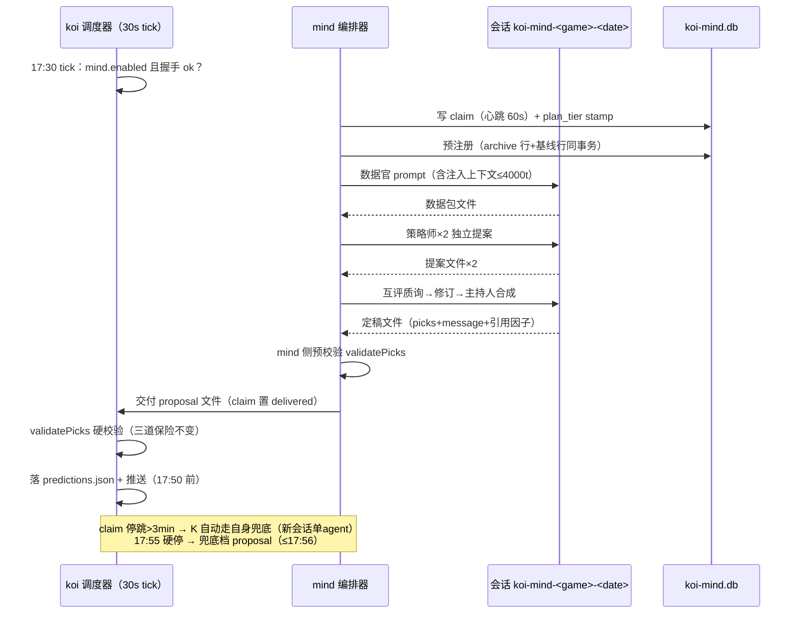
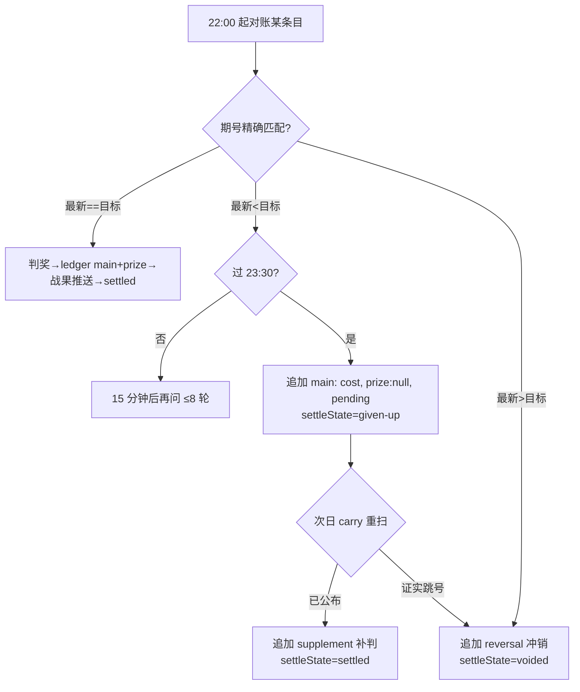
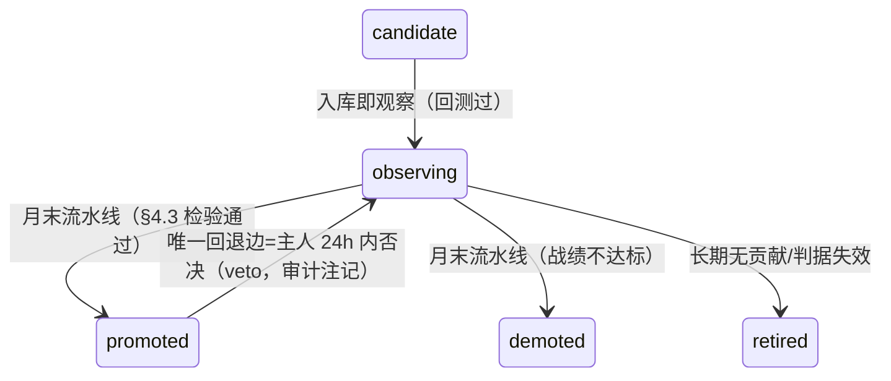

## §1 设计概要

### 1.1 实现思路

**总思路：改造不重写。** 以 docs/12 v1.1.2 为唯一需求权威（⚠C 同步注记：v1.1.2 = 设计时所依 v1.1.1 + §5.9 五条增量口径注记，正文条目语义一致），把工作拆成两层：

1. **v1.1 修复包（上线门槛，对应 docs/12 FR-001~009）**：全部落在 dsh-koi 的变更带内（scheduler/tools/tests/io 新模块），冻结区 FZ-1~6 零触碰——判奖/校验/回环断言/相位机/面板既有契约/三 JSON 旧字段语义全部不变；所有修复对既有契约都是「加字段」。细节见 §2.2.1。
2. **v2 认知层（dsh-koi-mind，独立插件）**：自持 SQLite 单库（纪律不变量用触发器钉死），对 v1 三 JSON **只读**；通过 **claim 心跳 + proposal 交付**两组文件契约在出号流水线内接管「研究」环节（ADR-9），koi 保留相位机、硬校验、predictions.json 独占写权与推送；总开关 `mind.enabled` 建在 koi 配置读取路径上（禁用 = 纯 v1.1），版本握手不匹配拒启用。细节见 §2.2.2。

数据流一句话：**mind 想（只读三 JSON + 自有库）→ proposal 文件交付 → koi 校验落盘推送对账（三 JSON）→ mind 从三 JSON 派生结算与归因回写自有库**。认知层任何组件死亡，系统自动回到纯 v1.1 行为（FR-023 回退契约的可演练形态）。

文档分工：docs/08 讲「要什么」（v1 部分继续有效，v2 被 docs/12 取代）、docs/09 讲「接在哪」、docs/10 讲「改什么、契约是什么」、**本文讲「怎么实现、为什么这样设计、失败了会怎样」**。跨文档引用为主，不重复。

### 1.2 设计决策

<!-- 只记关键决策；ADR-1~8 沿用 v1.0 文档（全部仍然有效），ADR-9~14 为本轮新增。 -->

| # | 决策 | 类别 | 内容与理由 | 放弃的替代方案 |
| --- | --- | --- | --- | --- |
| ADR-1 | AI 产出走**文件契约**，绝不解析自由文本 | 数据流 | 可硬校验、失败可见、打回重写有明确抓手（`scheduler.js:117-130` 现状验证有效） | 解析消息文本（不可靠，放弃） |
| ADR-2 | 推送**直连 NapCat HTTP** | 集成 | onebot 插件只管收信；直连零侵入；回环断言保安全（FZ-4） | 改造 onebot 插件 |
| ADR-3 | v1 用 JSON 落盘、v2 才引 SQLite | 存储 | 数据量小（10 年 <5MB 级，docs/11 v1.0 估算）、人可读、零依赖 | v1 就上 SQLite（对单人运维过重） |
| ADR-4 | 进程内 30s tick 状态机 | 调度 | 与宿主同生命周期、状态落盘可恢复（FZ-5） | 系统 cron（跨进程状态共享复杂化） |
| ADR-5 | 复式拆注逐注判奖 | 正确性 | 与官方判定语义完全一致（FZ-1） | 按最高奖级×注数近似 |
| ADR-6 | AI 全程出号，随机只做兜底 | 定位 | 诚实条款 + 18:00 承诺两全（v2 各档位仍是此原则的延伸） | 纯算法随机 / 纯 AI 无兜底 |
| ADR-7 | agent 运行全局串行（inFlight） | 资源 | 单会话约束；预测与加餐不撞车（`scheduler.js:103`） | 并发会话 |
| ADR-8 | 认知层**独立插件** koi-mind | 架构 | v1 稳定不动、v2 激进迭代、文件契约解耦（docs/12 §5.2 Q10 前置决定） | 塞进 dsh-koi 单插件 |
| ADR-9 | mind⇄koi 接管走**文件契约**（claim 心跳 + proposal 交付），不依赖宿主跨插件服务 | 架构 | DSH 跨插件服务调用能力未验证（宿主源码不在仓库）；文件契约与 v1 会话交换场同姿势；claim 停跳即自动回退 v1.1 行为，正是 FR-023 的可演练形态（B-08） | 宿主服务注入（未验证）/ mind 全包（违反 BC-009：predictions.json 只能 koi 写） |
| ADR-10 | 账本补判/作废走**追加条目模型**（main/supplement/reversal + 指针） | 数据 | BC-002「账本修正=追加+指针」；与 M4 append-only 迁移零语义转译；ledgerTotals 扩展对旧数据行为不变（21/21 模拟含兼容断言，B-03） | 原条目就地回填 prize（与 BC-002 冲突，M4 迁移需转译） |
| ADR-11 | mind 单 SQLite 库，**纪律不变量用触发器钉死** | 数据 | DC-001 禁 UPDATE/DELETE 与「开奖后追加结果」并存：预注册列禁 UPDATE、outcome 列仅 NULL→值单次、更正走 correction 追加行（B-20）；纪律做成数据库层不变量而非应用层自觉 | 应用层自觉（自欺风险正是产品要防的） |
| ADR-12 | 后台作业**单槽互斥 + 错峰窗口守卫** | 资源 | 2核2G + BC-012（17:00–22:30 禁重计算）+ AC-034「任一时刻至多一个后台作业」由单 worker 队列结构性保证（B-11） | 多作业并发+锁协调（复杂且省不出资源） |
| ADR-13 | token 计量**双路径**：运行时 feature-detect usage，未命中降级定额估算+账单对账 | 成本 | FR-045 P0 前置（宿主 usage 接口本阶段无法验证，A-26/B-10）；两路径都设计好才不阻塞 M3 | 单赌一路（赌错即返工） |
| ADR-14 | 站点白名单/议程模板**入代码版本控制** | 安全 | BC-015 禁运行时改白名单；AC-019 要求议程版本 stamp（B-15） | 配置文件白名单（直接违反 AC-035） |

## §2 架构设计

### 2.1 架构变更

#### 2.1.1 变更总览

图例：🟢新增 [Add] / 🟡修改 [Mod] / 🔴保护 [Pro]（有调用但本轮禁改）/ ⚪不涉及 [Unt]。IF 编号见 §6.2。



被 mind 只读的三个 JSON（`$DSH_HOME/koi/*.json`）与 koi-work/ 未画出（⚪不涉及改动，FZ-3 契约见 docs/10 §5.1）。

#### 2.1.2 模块变更

**v1.1 修复包（变更 C1~C8 + C10，映射 docs/12 FR-001~009）**：

| 模块 | 变更 | 变更点（函数级） | 对应需求 | 约束 |
| --- | --- | --- | --- | --- |
| lib/scheduler.js | 修改 | ① `settleOne` 放弃分支：追加 ledger main 条目（cost、prize:null、pending）+ predictions 条目 `settleState:'given-up'`；② 补判分支：追加 supplement 条目 + `settleState:'settled'`；③ 作废分支：期号跳跃检测（§4.5）→ 追加 reversal 条目 + `settleState:'voided'`；④ 跨天重建 carry 扫描扩为全部未结清条目；⑤ 推送重试 60s→5 分钟 + 分类终止线 + repushQueue（§3.2）；⑥ 休市日过滤（跳过出号段/对账段/致歉）；⑦ 写盘统一走 lib/io.js | FR-001/002/003/005/006 | FZ-5 相位机与转移语义不动（`settled` 布尔字段语义不变，只加 `settleState`）；FZ-3 只加字段 |
| lib/io.js | 新增 | `readJson(p, fallback)` + `writeJsonAtomic(p, o)`（temp+rename，与 scheduler 现行 `writeJson` 同语义抽出共用） | FR-003 | 调度器行为不变（签名一致替换） |
| tools/koi.mjs | 修改 | ① 裸 `writeFileSync` ×3（settle 两处 `koi.mjs:82,84`、ledger reset `koi.mjs:101`）→ `writeJsonAtomic`；② `settle --force`：重开 given-up 条目、带 manual 审计注记；③ `deps` 增新鲜度探针（>7 天 ✗）；④ 新增 `selftest`（判奖金样本） | FR-003/007/008 | 与宿主共用同一份 lib 与数据 |
| lib/draws.js | 修改 | 仅 `ledgerTotals` 扩展：作废期按 reversal ref 键排除、期数按 main 计、奖金含 supplement 聚合（§5.1） | FR-001 | **仅此一函数**；FZ-1（judge/enumerateBets/stakesOf/comb）与 FZ-2（validatePicks/randomPicks）零触碰；无新字段时输出与现行逐位一致（已模拟验证） |
| lib/prompt.js | 修改 | 交卷 JSON 契约顶层加 `"schemaVersion":1` | FR-004 | 文件契约其余不动 |
| lib/index.js | 修改 | status 响应附加字段：`holiday`、`repushQueue`（数量）、`mind:{enabled,handshake}` | FR-002/005/023 | FZ-6：只增字段不改既有字段 |
| tests/*.test.mjs | 新增 | `tests/judge-golden.test.mjs`：历史真实开奖构造覆盖全奖级的假想投注回归（SSQ 1~6 等、DLT 1~9 等、P3 直选+未中） | FR-007 | 内嵌固定夹具，无网络 |
| docs/05 部署节 | 修改 | sed 范围 `lib/*.js`→`lib/*.js tools/*.mjs`；验收三步→五步（杀 NapCat、对账中途重启） | FR-009 | 由 D 阶段同步落纸 |

**v2.0 认知层（新插件 dsh-koi-mind）**：

| 模块 | 变更 | 职责 | 对应需求 |
| --- | --- | --- | --- |
| dsh-koi-mind 整插件 | 新增 | 见 §2.2.2 模块详情 | FR-011~054（v2 全部） |
| lib/scheduler.js（M3 追加） | 修改 | runPredictFlow 前置接管判定：`mind.enabled && handshake ok` 时识别新鲜 claim → 等待并消费 proposal（仍过 validatePicks）；claim 停跳 → 走自身兜底；自身兜底会话改每期新开（`koi-daily-<game>-<issue>`） | FR-020/023/054 |
| lib/prompt.js（M3 追加） | 修改 | 单agent 兜底路径注入模板段（mind 关闭时用 v1 原样） | FR-028/054 |

### 2.2 模块详情

#### 2.2.1 v1.1 关键实现：放弃→补判→作废三态（C1）

- 负责职责：让「官方公布晚于放弃线」与「休市漏维护」两种场景都不漏账（BC-006 账本唯一口径），且补判/作废全程 BC-002 合规。
- 功能性设计：
  1. 放弃（23:30 仍未公布）：ledger 追加 `main` 条目（cost=当期投入、prize:null、`pending:true`）；predictions 条目 `settled:true`（语义不变）+ `settleState:'given-up'` + `settleNote:'放弃待补'`。（FR-001）
  2. 结清：carry 扩展扫描（FR-006）把 given-up 条目持续带入每日对账；公布后按正常判奖追加 `supplement` 条目（cost:0、prize、grades、`ref:{game,issue,date}`），predictions `settleState:'settled'`；`settle --force` 走同一分支并加 `manual:true`。
  3. 作废（S-011）：对账时若官方最新期号 > 目标期号（§4.5，跨年单调已验证）→ 追加 `reversal` 条目 + predictions `settleState:'voided'`；作废期投入不计入口径（ledgerTotals 排除）。
- 非功能设计：三态迁移幂等（settleState 守卫防重复补判）；台账行只增不改（ADR-10）。（NFR-004/FR-003）
- 风险与缓解：ledgerTotals 扩展回归风险 → 兼容断言先行（21/21 模拟通过 + 既有 29 例不回退）；三 JSON 并发写 → C3 原子写统一（koi.mjs 与调度器同语义）。

#### 2.2.2 v2.0 dsh-koi-mind 模块详情

| 子模块 | 负责职责 | 关键设计 | 对应需求 |
| --- | --- | --- | --- |
| index.js + handshake | 生命周期、注入 sessionController、启动 mind 调度（30s tick）、版本握手、**双向总开关** | ① 启动时校验三 JSON schemaVersion ≥1 与 koi 版本 → 写 `koi-mind/handshake.json`（§5.4）；不匹配 `status:'rejected'` + 原因（FR-024）；② `mind.enabled` 为**双向闸**（B-21）：mind 侧每轮 tick 现读，false 时跳过 claim/编排/全部自主 LLM 活动（CLI 手动命令 backfill/health/report 等不受限，但同样计量）；true 时 koi 才消费 proposal——koi 与 mind 读同一份配置，杜绝「开关只闸半边」的中间态 | FR-023/024、BC-013 |
| store.js | SQLite 打开/迁移/事务 | 单库 `$DSH_HOME/koi-mind/koi-mind.db`；schemaVersion 表驱动迁移，只加不改不删（DC-009）；WAL 模式 | DC-009、§5.2 |
| sync.js | 三 JSON 只读监视 | 增量开奖入库从 predictions 条目 `result` 字段派生（**零独立抓取**，FR-013/AC-017，B-06）；每日 06:00 期号连续性校验、断档补拉（错峰）；settlement 镜像 | FR-011/012/013 |
| archive.js | 预测档案 append-only | proposal 被采纳即落预注册行（与基线同事务，B-12）；更正走 correction 追加行+指针；触发器强制（§5.3） | FR-014/025、BC-002 |
| baseline.js | 随机基线 | **独立代码路径**：与 picks 生成无共享状态（独立模块+独立随机源调用），同投注结构同注数（DC-002）；同事务同刻落库 | FR-015、BC-003 |
| orchestrator.js | 多 Agent 编排 | 每期每彩种单会话顺序角色 prompt（B-17）：数据官→策略师×N→互评→主持人；角色输出走文件契约（`koi-mind-work/roles/<archiveKey>/`，消费后即删，§5.4）；**全记录落盘** = orchestration_log 表逐角色逐轮记 at/role/round/content（§5.2，B-22，FR-016/AC-019 的落点）；tier 降级链（§3.1）；单角色失败剔除（FR-019） | FR-016~021 |
| inject.js | 记忆注入 | 候选=活跃因子+近 30 期同彩种局势+已验证教训（DC-013）；排除 demoted/retired；每角色 ≤4000 token 裁剪（§4.4）；失败→跳过并 `injection_note` 标注 | FR-028~031、FR-030 |
| attribution.js | 代码化归因 | 按因子预注册命中判据计算（§4.1），LLM 只叙述；引用因子 ID 必须存在于因子库（防幻觉） | FR-034、BC-014 |
| reports.js | 周报/月报 | 周日 22:40 生成（B-11）：战绩 vs 基线（同结构展开）、五条纪律自评（yes/no+证据指针）、健康节（**未结清口径 = settleState='given-up' 且超 7 天报红；voided 单列历史作废累计计数、无报警阈值**——B-24，防终态条目永久报红）；月报+晋升月末 23:45 | FR-032/035/049 |
| promotion.js | 月末晋升流水线 | 唯一状态变更时点（BC-008）；检验算法 §4.3；否决窗口 24h 状态机（pending→active/vetoed），veto 回退 observing 带审计注记 | FR-035、DC-004 |
| backtest.js | 回测引擎+金样本 | 因子=纯函数；金样本=植入已知规律数据（§4.2）；错峰窗口外批量跑 | FR-039/040 |
| ingest.js | 书籍摄入 | PDF/EPUB/TXT/MD → 结构化卡片 + **LLM 批量语义判重**（§4.7，B-29）+ 全文检索（SQLite FTS5 词法层）；图片版 PDF 最低优先级；**摄入任务一律入 jobs.js 队列**（错峰守卫+单槽，B-30——主人在禁算窗口投喂时排队至窗口外执行，面板/日志可见排队状态） | FR-038/041、BC-012 |
| networking.js | 网络学习 | 白名单代码常量（ADR-14）；抓取内容只作引用数据（模板里进「材料」区不进「指令」区，AC-035）；只提炼方法不搬运原文 | FR-044、BC-015 |
| metering.js | token 计量与预算 | 双路径（ADR-13）；月度分项汇总=硬顶判定唯一来源（DC-011）；**activity 归类映射**（B-30）：出号流水线内全部调用=predict、博弈角色互评=deliberation、摄入/判重/网络学习=learning、周月报与归因叙述=review；降档状态机 §4.6 | FR-045/046/047、BC-013 |
| jobs.js | 后台作业单槽调度 | 串行 worker + 错峰守卫（17:00–22:30 拒绝重计算入队，延迟到窗口外；**书籍摄入等事件触发任务同样入队**，B-30）；job_runs 表留痕 | BC-012、NFR-002 |
| pushx.mjs | mind 侧推送 | 复制 FZ-4 语义的自持模块（B-09）；沿用 FR-005 统一重试参数（周/月报/告警同基准） | FR-005/036 |
| tools/mind.mjs | 运维 CLI | `backfill / health / migrate / report / backtest / veto / lesson add\|rm / budget`（B-18） | FR-048/049、BC-008 |
| client.js | 面板节 | settings.section 新 slot（order 8）：mind 开关状态、健康摘要、token、因子库概览（只读展示） | FR-023 |

### 2.3 功能影响

```text
- 锦鲤系统
  - 出号送达管理
    - 定时出号推送            [改] v1.1：统一重试参数+补发队列；v2：mind 编排接管
    - 加餐出号                [不变] v1 单agent 档路径、失败不重试（显式例外）
    - 晚到/放弃致歉           [改] 致歉同走统一重试，超线转补发
  - 对账记账管理
    - 开奖对账与战果推送      [改] 放弃分支记账；战果推送纳入重试
    - 放弃补判/休市作废       [增] 三态结清（B-03）
    - 休市顺延                [增] 休市日历（B-04）
    - 多日宕机恢复            [改] carry 全量扫描未结清（C8）
    - 手工补账                [改] settle --force（带审计注记）
  - 数据地基
    - 历史回填与口径核对      [增] M1
    - 期号连续性校验          [增] 断档自动补拉
    - 增量同步（零重复抓取）  [增] 挂接对账
    - 预测档案与随机基线      [增] M1 起 append-only 预注册
  - 认知出号
    - 记忆注入                [增] 模板化、token 上限、失败跳过
    - 多 Agent 博弈编排       [增] 标准档起步、全记录落盘
    - 超时降级与角色容错      [增] 25 分钟预算、四档降级链
    - 成本护栏与降档          [增] 计量、预警、硬顶、月度重置
  - 知识宫殿
    - 书籍摄入拆卡            [增] 四格式+语义去重
    - 因子化回测              [增] 预注册判据+金样本
    - 网络学习                [增] 白名单周更（P2）
  - 复盘与治理
    - 周报/月报               [增] 含纪律自评与健康节
    - 代码化归因              [增] 判据代码算、LLM 只叙述
    - 因子晋升与主人否决      [增] 月末流水线+24h 否决窗口
    - 健康告警与体检扩展      [增] 三类告警+六类体检
    - 备份与出箱              [增] 周备 8 份+月度出箱
  - 回退与升级
    - mind 总开关             [增] koi.config.json，面板可见
    - 版本握手                [增] 不匹配拒启用
    - schema 迁移             [增] 只加不改+迁移命令
```

| 功能 | 变更 | 变更点 | 对应需求 |
| --- | --- | --- | --- |
| 定时出号推送 | 改 | 重试 60s→5 分钟、分类终止线、补发队列 | FR-005 |
| 放弃补判/作废 | 增 | ledger 三类条目 + settleState 三态 | FR-001 |
| 休市顺延 | 增 | holidays 配置 + 调度过滤 | FR-002 |
| 原子写 | 改 | lib/io.js 统一 koi.mjs 三处裸写 | FR-003 |
| schemaVersion | 增 | 三 JSON 顶层 + picks 契约顶层 | FR-004 |
| carry 全量扫描 | 改 | 跨天重建扫描所有未结清条目 | FR-006 |
| 判奖回归 | 增 | judge-golden 测试 + selftest 命令 | FR-007 |
| 新鲜度探针 | 增 | deps >7 天报红 | FR-008 |
| 认知出号全链 | 增 | mind 插件（编排/注入/护栏/回退） | FR-016~031/045/046/054 |
| 复盘治理全链 | 增 | 归因/周月报/晋升/备份/体检 | FR-032~049 |
| 对账回填职责迁移 | 改 | M4：prize/grades/归因迁档案；`result` 字段保留（B-07） | 破坏性变更（docs/12 §3.1） |

### 2.4 运行视图

#### 2.4.1 状态机（FZ-5，语义不变）



pushed 相位说明（v1.0 遗留事实）：代码中推送成功只落 `pushedAt` 不改 phase，对账过滤器同时接受 `predicted|pushed`（`scheduler.js:347`）。v2 新增的是 `settleState`（predictions 条目级 given-up/settled/voided 三态，§5.1），**不是**新相位。

#### 2.4.2 v2 出号编排时序（标准档示例）



#### 2.4.3 对账三态流程



### 2.5 部署视图

| 层 | 内容 |
| --- | --- |
| systemd `dsh` | 宿主进程（koi / koi-mind / 鲸鱼 / onebot 四插件），崩溃 5s 拉起 |
| Docker | NapCat 容器 `restart=always`，回环 3000 |
| 文件 | `$DSH_HOME/koi.config.json`（含 `mind.enabled`）+ `koi/` 三 JSON + `koi-work/` + **`koi-mind/`（db/handshake.json/reports/work，v2 新增）** + `backups/` |
| 端口 | 宿主 3080、NapCat 3000 均仅回环；SSH 隧道访问 |
| 插件安装 | `/opt/dsh-plugins/dsh-koi` 与 `/opt/dsh-plugins/dsh-koi-mind` 各自 `dsh plugin --profile web add link:`；`mind.enabled` 默认 false，**M1 部署验收（AC-004/005/017）通过后开启**（B-21）——M1 期 mind 仅有 sync/archive/baseline（无编排 LLM 大头），开启即开始合法积累预注册档案（FR-014 要求自 M1 首期生效）；M3 起编排/注入上线；禁用语义见 §5.4（双向闸：koi 不消费 proposal 且 mind 零自主 LLM 活动、claims 目录零新增） |
| 回退 | 关 `mind.enabled` + restart = 纯 v1.1；`dsh plugin --profile web remove dsh-koi-mind` 不动 koi 数据 |

## §3 核心流程

### 3.1 出号流水线降级链（S-014/FR-018）

总预算 25 分钟（docs/07 P1-C）。内部时刻表（B-08）：17:30 流水线启动 → 各档切片超时即降档（单角色超时/不合规即剔除，FR-019）→ **17:55 硬停** → 17:56 前交付兜底档 proposal（随机号，via='fallback'）→ koi 30s tick 消费+推送，18:00 承诺保有 ≥3 分钟裕量。正常目标 17:50 前送达（NFR-001）。

| 档位 | 阵容 | 适用 | 降级触发 |
| --- | --- | --- | --- |
| 满配 | 数据官+策略师×N+质询者+主持人（多轮辩论） | 仅 ssq/dlt；拉前条件=连续 4 周无降级 且 月 token<70% | 切片超时 → 标准 |
| 标准 | 数据官+策略师×2+主持人 | v2.0 起步档（ssq/dlt） | 切片超时 → 轻量 |
| 轻量 | 数据官+单策略师 | p3 起步档（Q6 混合档） | 超时 → 单agent |
| 单agent | 单会话（v1 路径） | 保底档 | 仍失败 → 兜底 |
| 兜底 | 随机号（零 LLM） | 最终保底；月预算耗尽的当月终态 | —（照发+透明标注，BC-005） |

降档与触顶事件推送告知主人（S-016）；剔除场景档案记录被剔除角色与最终参与角色集（AC-006）。

### 3.2 推送统一重试（FR-005，C10）

覆盖三类时效推送（预测/战果/致歉）+ v2 全部推送（周报/月报/健康告警）：

1. 间隔 5 分钟（config `push.retryMinutes`，默认 5）；加餐显式例外（不重试，号在面板，v1 语义）。
2. 终止线：预测至 `catchUpEnd`（19:50）；战果/致歉至 `settleGiveUp`（23:30）；**v2 推送（周报/月报/健康告警）deadline = 生成时刻次日 12:00**（B-26，对齐 FR-036「次日补发可接受」）。
3. 超终止线 → `state.repushQueue`（上限 20、不过期、跨天携带，B-05）；通道恢复后补发，送达时已过终止线的消息加【补发】前缀；**溢出处理 = 同类合并**（kind+game+issue 相同只留最新并累计次数，B-31）——跨类目仍超上限时立即推送「补发队列已满，最早 N 条将放弃」告警（本身走 FR-005 通道），不静默丢弃。
4. 现状缺口证实：预测推送 60s 无上限（`scheduler.js:27`）、战果/致歉推送**只试一次无重试**（`settleOne` 内单次 `pushText`）——C10 同时修复两处。
5. 失败原因 `pushErr` 面板可见（既有），队列长度进 status 附加字段。

### 3.3 每周时刻表（交付物规格，B-11）

互斥机制 = 单槽 worker（ADR-12）；「禁重计算窗口」= 17:00–22:30（BC-012）。

| 时刻 | 作业 | 窗口合规 | 说明 |
| --- | --- | --- | --- |
| 每日 06:00 | 期号连续性校验 + 断档补拉登记 | ✓ | FR-012；补拉本身再按批错峰执行 |
| 开奖日 17:30–17:55 | 出号流水线（编排/校验/推送） | 窗口内业务必做（非重计算） | §3.1 |
| 开奖日 22:00–23:30 | 对账（15 分钟/轮 ≤8 轮）+ 结算镜像 + 归因入档案 | 窗口内轻量 | 归因为代码计算非重计算 |
| 周日 22:40 | 周报生成+推送（23:00 前送达） | 窗口内轻量 LLM | 周日三重叠加错开：17:30 出号 → 22:00 对账 → 22:40 周报 |
| 周一 04:00 | 网络学习抓取+提炼（S-006） | ✓ 错峰 | 白名单 2–3 站；候选技巧进卡片流水线（低信任级） |
| 周三 03:00 | 全量回测批次（新卡片+基础因子复核） | ✓ 错峰 | FR-039/040；金样本先行 |
| 周五 03:30 | 周备份打包（三 JSON+认知层库+卡片/因子/档案→保留 8 份） | ✓ 错峰 | FR-048 |
| 月末 23:45 | 月报+因子晋升流水线（否决窗口 24h 至次日 23:45） | ✓ | FR-035；唯一状态变更时点 |
| 每月 1 日 05:00 | 月度重置（token 计数归零、档位自动恢复配置档） | ✓ | FR-046 |
| 每月第一个周六 | 备份出箱（拉出主机一份，主人协作） | 运行手册 | FR-048 |
| 季度 | 人工审计清单四事项 | 人工 | FR-037/BC-016 |
| （M1 一次性） | 全量回填（约 1.3 万期，分批） | 手动触发、窗口外执行 | FR-011 |

### 3.4 因子晋升状态机（DC-004）



promoted 因子晋升在否决窗口期满后生效；`factor_state_log` 记录每条边的 actor/时间/注记（AC-024）。

## §4 算法设计

### 4.1 代码化归因（FR-034/BC-014）

**目标**：把「哪些因子押中哪些位」从 LLM 叙述改为代码按预注册判据计算，杜绝被审计者写审计报告。

**核心逻辑**：对档案条目的每个 `factor_id`，取该因子入库时定死的 `judge_spec`（纯函数：`f(game, 当期局势快照) → 命中预测`），对官方开奖逐期求值 → 输出 `{factorId, hitPositions[], hit bool}` 附加到档案 outcome；推送/周报中的归因叙述由 LLM **只读该计算结果**生成。

**输入**：档案预注册行（picks、factor_ids、situation_snapshot）+ draws 表官方开奖。**输出**：归因 JSON（追加至档案 outcome 列）。**复杂度**：O(期数×因子数)，单机小数据量亚秒级。**边界**：引用的 factor_id 不在因子库 → 该条目归因标 `unknown-factor` 并触发健康告警（防幻觉因子，AC-009）。

### 4.2 回测引擎与金样本（FR-039/040）

回测 = 对全量历史逐期求值因子判据并聚合：「命中分布 vs 同结构随机基线期望」+ 结论（含「与随机无异」如实入档）。**前视偏差防护**：判据求值只用该期之前的数据（TC-014）。**金样本**（AC-012）：构造植入规律的数据集（如固定奇偶比序列）验证引擎能识别；再用纯随机数据集验证引擎不报告虚假规律。

### 4.3 晋升显著性检验（FR-035，B-16）

**目标**：把「样本外显著优于基线」变成可判定算法。

对因子 f 与其预注册命中判据：观察窗口 ≥30 期（A-01）；n = 窗口期数，k = 因子判据命中数，**p₀ = 按 DC-002 同构展开的组合概率闭式计算**（B-28：判据命中空间可枚举——如红球单号命中 p=6/33、组合判据对展开注空间精确计数），非基线经验频率（否则非精确检验，且经验估计留事后解释空间）；单侧精确二项检验 P(X≥k | n,p₀)，p 值 × 当月受检因子数（Bonferroni）< 0.05 且方向为正 → 晋升候选；月度上限 2 个（A-01）。p₀ 计算式随 judge_spec 一并预注册（事后不可追加解释，BC-004）。**诚实预期**：独立随机事件下检验的预期结论是「不显著」——晋升是罕见事件，这正是 BC-001 豁免条款下「纪律检验而非优化目标」的含义。

### 4.4 注入候选构造与 token 裁剪（FR-030）

候选集 = 活跃因子（observing/promoted）∪ 近 30 期同彩种局势摘要 ∪ 教训白名单（仅 `verify_status='oos_verified'` 或预注册验证通过者，DC-013）。过滤：demoted/retired 永不回注；未验证教训丢弃并计数。裁剪：模板渲染后估算 token（保守按字符数/4），超 4000/角色按「教训 > 活跃因子近期战绩 > 局势摘要」优先级截断；模板带版本 stamp（DC-010）。

### 4.5 期号跳跃检测（S-011 作废判定）

官方最新期号 `latest.issue` 与目标 `entry.issue` **按数值比较**（两套期号格式均以年份为前缀、跨年单调递增）：`Number(latest) > Number(target)` → 目标期证实不存在（休市/取消）→ 作废；相等 → 已公布正常对账；小于 → 继续等待。跨年场景（2026153→2027001、26153→27001）已模拟验证（21/21）。

### 4.6 预算判定与降档状态机（FR-046/BC-013）

月度累计（token_usage 分项汇总，DC-011）达 70%/90% → 预警推送；达 100%（500 万硬顶，N2 拍板）→ 允许档位封顶逐级下压（满配→标准→轻量→单agent）；单agent 档仍触顶 → 当月出号改兜底档（零 LLM）+ 复盘/学习类活动暂停；自然月切换自动恢复。降档事件全部推送告知。计量双路径见 ADR-13：优先读 prompt() 返回的实测 usage；否则按「模型×活动类别」定额表估算，误差由 FR-047 首月重算与账单对账校准收敛。activity 归类映射见 §2.2.2 metering 行（B-30）。

### 4.7 语义去重（FR-038 底线组件，B-29）

**目标**：卡片入库前判重——本地嵌入模型默认关（NFR-002），FTS5 仅为词法检索，须给出不依赖嵌入的语义去重机制。

**核心逻辑**：两级漏斗——① FTS5 粗筛：新卡片的名称/规则归一化分词后检索既有卡片 top-K（K=10）候选；② **LLM 批量判重**：新卡片 + K 条候选同批送 LLM，要求输出每对「重复/相似/无关 + 理由」，判重调用走 `activity='learning'` 计量、经 jobs.js 错峰执行（B-29/B-30）。判「重复」→ 拒绝入库并回指既有卡片 ID（graph_edges 记 `duplicate_of` 边）；判「相似」→ 入库并记 `similar_to` 边供月报矛盾对筛查（FR-042）。

**输入**：新卡片结构化字段。**输出**：入库/拒绝/相似关联。**复杂度**：每张新卡 1 次 LLM 调用 + 1 次索引查询。**边界**：LLM 不可用 → 判重降级为「跳过判重、标记 `dedup_pending` 待补」，绝不静默重复入库；补判由 jobs 队列自动重试。

## §5 数据模型

### 5.1 v1 三 JSON 契约增量（C1/C4/C10，只加字段）

| 文件 | 新增字段 | 类型/值 | 说明 |
| --- | --- | --- | --- |
| predictions.json | `schemaVersion` | 顶层，`1` | FR-004；读取方容忍未知字段，写入前校验已存版本 ≤ 已知版本（docs/10 §6 规则 2） |
| predictions.json | `entries[].settleState` | `'given-up'\|'voided'\|'settled'` | 三态结清；既有 `settled` 布尔语义不变（兼容判断写法：未结清 = `!settled || settleState==='given-up'`） |
| ledger.json | `schemaVersion` | 顶层，`1` | FR-004 |
| ledger.json | `entries[].entryType` | `'main'`（缺省）\|`'supplement'`\|`'reversal'` | ADR-10；缺省即 main，旧数据零迁移 |
| ledger.json | `entries[].{pending, ref, note}` | bool / `{game,issue,date}` / string | main 的待补标记；supplement/reversal 指向主条目；审计注记（--force 补账 manual:true） |
| state.json | `repushQueue` | 数组 ≤20 | B-05；跨天重建显式携带（现行重建丢弃未知顶层字段，此处为必需改动点） |
| koi.config.json | `holidays` | string[]（YYYY-MM-DD） | FR-002/DC-007 |
| koi.config.json | `push.retryMinutes` | number，默认 5 | FR-005 |
| koi.config.json | `mind.enabled` | bool，默认 false | FR-023 总开关（B-13） |

**ledgerTotals 扩展口径**（唯一改动的既有函数）：`voided` = reversal 条目 ref 键集合；聚合集 = （entryType≠reversal 且 ref 未作废的 main）∪ supplement；cost 求和于 main、prize 求和于 main∪supplement、期数 = main 计数。无任何新字段的旧文件输出与现行函数逐位一致（已验证）。

### 5.2 koi-mind.db schema（v1，schemaVersion=1）

```sql
schema_info      (key TEXT PRIMARY KEY, value TEXT)                          -- schema_version=1
draws            (game TEXT, issue TEXT, date TEXT, numbers TEXT/*JSON*/,
                  prize_grades TEXT, PRIMARY KEY(game,issue))                -- 全量历史，sync.js 派生入库
predictions_archive (
  id INTEGER PRIMARY KEY AUTOINCREMENT,
  game TEXT NOT NULL, issue TEXT NOT NULL, issue_date TEXT,
  category TEXT NOT NULL CHECK(category IN ('daily','quickpick')),           -- DC-001 业务键含类别
  seq TEXT NOT NULL DEFAULT '0',                        -- ⚠v2.0.1（B-23）：daily 恒 '0'；quickpick = 落盘时刻戳——
                                                        --   v1 允许同期同彩种重复加餐（scheduler.js:143-149 每次 push、
                                                        --   docs/12 §3.1 保留声明④队列上限 20），业务键须含 seq 才可实现 FR-052
  at TEXT NOT NULL,                                     -- 预注册时刻（与基线同事务，B-12）
  picks TEXT NOT NULL, message TEXT NOT NULL,           -- 号 + 完整推理文本
  factor_ids TEXT, card_refs TEXT,                      -- JSON 数组；可空=如实为空（DC-001 必填语义）
  confidence_tier TEXT CHECK(confidence_tier IN ('low','mid','high')),       -- BC-007：禁数值置信度
  situation_snapshot TEXT, plan_tier TEXT, exec_tier TEXT,                   -- 计划/执行档位（FR-033 告警基准）
  inject_tokens INTEGER, stage_timings TEXT,            -- ⚠v2.0.1（B-22）：注入 token 实测/估算、各阶段耗时 JSON（FR-045/AC-007）
  agenda_version TEXT, baseline_id INTEGER, injection_note TEXT,
  proposed_via TEXT,                                    -- mind 档位产物来源
  -- outcome 列（开奖后由 sync.js 单次 NULL→值 填充，§5.3 触发器强制）：
  result TEXT, grades TEXT, prize REAL, cost REAL,
  attribution TEXT, pushed_result INTEGER, corrected_by INTEGER,
  UNIQUE(game, issue, category, seq))
baselines        (id INTEGER PRIMARY KEY AUTOINCREMENT, game TEXT, issue TEXT,
                  picks TEXT/*同结构同注数, DC-002*/, at TEXT NOT NULL, UNIQUE(game,issue))
factors          (id TEXT PRIMARY KEY, name TEXT, spec TEXT/*可执行规格*/,
                  judge_spec TEXT/*预注册命中判据，事后不可追加*/,
                  status TEXT CHECK(status IN ('candidate','observing','promoted','demoted','retired')),
                  version INTEGER NOT NULL, backtest_ref TEXT,
                  created_at TEXT, state_changed_at TEXT)
factor_state_log (id INTEGER PRIMARY KEY AUTOINCREMENT, factor_id TEXT,
                  from_status TEXT, to_status TEXT, at TEXT, actor TEXT, note TEXT)  -- 否决回退边带审计注记
technique_cards  (id TEXT PRIMARY KEY, name TEXT, source TEXT, source_type TEXT,
                  games TEXT, rule TEXT, computable INTEGER,
                  trust_level TEXT CHECK(trust_level IN ('low','mid','high')),     -- DC-003 枚举
                  last_reviewed_at TEXT, backtest_ref TEXT, status TEXT, created_at TEXT)
lessons          (id TEXT PRIMARY KEY, content TEXT, source_ref TEXT,
                  verify_status TEXT CHECK(verify_status IN ('prereg_verified','oos_verified')),
                  collected_at TEXT, collected_by TEXT)                       -- DC-013 白名单
token_usage      (id INTEGER PRIMARY KEY AUTOINCREMENT, at TEXT,
                  activity TEXT CHECK(activity IN ('predict','deliberation','review','learning')),
                  model TEXT, prompt_tokens INTEGER, completion_tokens INTEGER,
                  estimated INTEGER DEFAULT 0, call_ref TEXT)                 -- DC-011 唯一计量来源
reports          (id INTEGER PRIMARY KEY AUTOINCREMENT, kind TEXT CHECK(kind IN ('weekly','monthly')),
                  period TEXT, content TEXT, created_at TEXT, push_state TEXT)
agenda_versions  (version TEXT PRIMARY KEY, file_hash TEXT, activated_at TEXT, retired_at TEXT)  -- DC-010/FR-021
job_runs         (id INTEGER PRIMARY KEY AUTOINCREMENT, job_name TEXT, started_at TEXT,
                  finished_at TEXT, status TEXT, detail TEXT)                 -- ADR-12 单槽互斥留痕
orchestration_log (id INTEGER PRIMARY KEY AUTOINCREMENT, archive_id INTEGER NOT NULL,
                  role TEXT, round INTEGER, at TEXT, content TEXT,            -- ⚠v2.0.1（B-22）：编排全记录
                  agenda_version TEXT, FOREIGN KEY(archive_id) REFERENCES predictions_archive(id))
                 -- FR-016「全记录落盘」/AC-019「角色轮次/时间戳」的 schema 落点；append-only
graph_edges      (src_type TEXT, src_id TEXT, dst_type TEXT, dst_id TEXT,
                  rel TEXT, since_issue TEXT)                                 -- FR-053 外键自 M2 持续记录
```

与 docs/10 §5.7 v1.0 预留版的差异（更新原因 = docs/12 为权威）：`confidence REAL` → `confidence_tier` 枚举（BC-007/DC-008 禁数值置信度）；`kind` → `category` 并入业务键（DC-001「每期每彩种每类别一条」+FR-052 加餐入档）；新增 plan_tier/exec_tier/agenda_version/baseline_ref（DC-001/DC-010、FR-033）、lessons（DC-013）、token_usage（DC-011）、agenda_versions/job_runs/reports（FR-021/AC-034/FR-032）。

### 5.3 纪律不变量的触发器强制（ADR-11）

```sql
-- 预注册列禁改：picks/message/factor_ids/at/… 一经写入不可 UPDATE
CREATE TRIGGER archive_no_prereg_update BEFORE UPDATE ON predictions_archive
WHEN NEW.picks <> OLD.picks OR NEW.message <> OLD.message OR NEW.at <> OLD.at
     OR NEW.factor_ids <> OLD.factor_ids OR NEW.confidence_tier <> OLD.confidence_tier
BEGIN SELECT RAISE(ABORT,'预注册列不可改写（BC-002）'); END;
-- outcome 列仅允许 NULL→值 单次填充
CREATE TRIGGER archive_outcome_once BEFORE UPDATE ON predictions_archive
WHEN OLD.result IS NOT NULL AND NEW.result <> OLD.result
BEGIN SELECT RAISE(ABORT,'outcome 已落定，更正走 correction 追加行'); END;
-- 因子状态机仅月报流水线事务可写（应用层以专用连接+事务标记保证，state_log 同事务强制）
```

更正协议：任何界面无改写入口（FR-025）；`correction` 行带 `corrected_by` 指针（AC-009）。**M4 迁移语义**：archive 从「镜像」升为对账回填的权威记录，predictions.json 保留 `result`（官方开奖对象，B-07——保 FR-013 共用抓取），prize/grades/归因/推送结果迁至档案；迁移命令由 tools/mind.mjs 提供（docs/10 §6 规则 3）。

### 5.4 mind⇄koi 契约文件（B-08/B-13）

| 文件 | 写方 | 读方 | schema |
| --- | --- | --- | --- |
| `koi-mind/handshake.json` | mind（启动/版本变更时） | koi（消费 proposal 前逐次校验） | `{mindVersion, koiSchemaVersion, status:'ok'\|'rejected', reason, at}` |
| `koi-mind-work/claims/<game>-<date>.json` | mind（领取时；心跳 60s 更新 `updatedAt`） | koi（30s tick 检查新鲜度 ≤3min） | `{status:'claimed'\|'delivered'\|'consumed'\|'aborted', tier, updatedAt, drawIssue}` |
| `koi-mind-work/proposals/predict-<game>-<date>.json` | mind（编排定稿/兜底档时） | koi（**写序固化**：koi 先写 predictions.json 成功 → 置 claim `consumed` → 再删 proposal 文件，B-27） | `{schemaVersion:1, issue, picks, message, execTier, factorIds[], agendaVersion, via:'ai'\|'fallback', injectionNote}` |
| `koi-mind-work/roles/<game>-<date>/<role>-<round>.json` | mind（编排各角色中间产物） | mind（消费后即删，正文已入 orchestration_log，B-22） | 角色各自的文件契约（数据包/提案/质询/定稿） |

失效语义全部显式：claim 过期 → koi 走自身兜底；proposal 缺失至 17:55 → mind 出兜底 proposal；proposal 校验失败 → koi 自身兜底 + 档案留痕；handshake rejected/缺失 → koi 视 mind 不存在（纯 v1.1）；`mind.enabled=false`（双向闸，B-21）→ koi 不消费 proposal **且** mind 跳过 claim/编排/全部自主 LLM 活动（claims 目录零新增、token_usage 零新增，CLI 手动命令不受限）；**mind 缺席跨开奖**（17:30 至开奖间整体宕机，B-25）→ 该期**不补建**档案与基线（恢复后补档=开奖后造基线，违反 BC-002/003），缺口期清单进健康节与月报如实呈现，sync 恢复后仅镜像开奖不入预测档案；**koi 消费崩溃窗口**（S-024 不重复不遗漏，B-27）：写 predictions 前崩溃 → proposal 未删、claim 未 consumed → 重启后重消费一次；写 predictions 后、置 consumed/删文件前崩溃 → claim.consumed=true → 重启后不再重复消费。koi-work/ 既有文件契约（predict-*.json 交换场）不变。

## §6 接口设计

### 6.1 外部接口（增量）

| 名称 | 变更 | 描述 | 请求/用法 | 返回增量 |
| --- | --- | --- | --- | --- |
| GET /dsh-koi/api/status | 改（只增字段，FZ-6） | 面板轮询 | — | `holiday: bool`、`repushQueue: number`、`mind: {enabled, handshake}` |
| 其余 3 条面板 API | 不变 | quickpick×2 / test-push | — | —（FZ-6 保护） |
| `koi.mjs settle --force [--date]` | 改 | 重开 given-up 条目补判，带 manual 审计注记 | CLI | 不触碰 voided 条目 |
| `koi.mjs selftest` | 增 | 判奖金样本回归（TC-013 部署验收用） | CLI | 全奖级断言，退出码表成败 |
| `koi.mjs deps` | 改 | 增数据新鲜度探针（>7 天 ✗） | CLI | FR-008 |
| `mind.mjs backfill/health/migrate/report/backtest/veto/lesson/budget` | 增 | mind 运维（B-18） | CLI | health 六类异常逐项报红（AC-025） |

### 6.2 内部接口

| 名称 | 变更 | 描述 | 调用方→提供方 | 契约要点 |
| --- | --- | --- | --- | --- |
| IF-N01 | 新增 | claim/proposal 契约 | koi.scheduler ⇄ mind.orchestrator | §5.4；失效语义四条全显式 |
| IF-N02 | 改 | 唤醒提示词组装 | scheduler → prompt | picks 契约加 schemaVersion（FR-004） |
| IF-N03 | 新增 | 版本握手 | mind.handshake ⇄ koi.scheduler | §5.4；不匹配拒启用（FR-024） |
| IF-N04 | 新增 | mind 推送 | mind.reports/alerts → NapCat | 自持等价 pushx（FZ-4 语义复制，B-09）；FR-005 统一重试 |
| IF-M01 | 改 | 写盘 | scheduler/koi.mjs → lib/io.js | 原子写统一（FR-003） |
| IF-R01/02 | 复用 | validatePicks / pushPrivate | koi 内部 | FZ-2/FZ-4 零修改复用；mind 预校验同函数 |

### 6.3 配置接口（增量汇总）

| 名称 | 变更 | 描述 | 类型 | 默认值 | 来源 |
| --- | --- | --- | --- | --- | --- |
| koi.config.json `holidays` | 增 | 休市日期列表 | string[] | `[]` | FR-002 |
| koi.config.json `push.retryMinutes` | 增 | 推送重试间隔（分钟） | number | 5 | FR-005/A-04 |
| koi.config.json `mind.enabled` | 增 | 认知层总开关 | bool | false | FR-023/B-13 |
| mind.config.json `tiers` | 增 | 彩种→起步档（ssq:standard, dlt:standard, p3:lite） | map | 见 §3.1 | FR-017/Q6 |
| mind.config.json `budget.monthlyCap/warn1/warn2` | 增 | 500 万 / 70% / 90% | number | 5000000/0.7/0.9 | N2/A-01 |
| mind.config.json `inject.tokenCapPerRole` | 增 | 注入上限 4000 token/角色 | number | 4000 | FR-030/A-02 |
| mind.config.json `timetable` | 增 | 周时刻表（§3.3 全部可调） | map | B-11 定值 | BC-012 |
| mind.config.json `promotion.{oosN,monthlyCap,vetoWindowHours}` | 增 | 30 期 / 2 个 / 24 小时 | number | 30/2/24 | FR-035/A-01/A-10 |

## §7 DFx 设计

### 7.1 可用性 / 可靠性（失败模式总表）

| 环节 | 失败 | 现行为 | 语义/后续 |
| --- | --- | --- | --- |
| 抓历史 | 接口超时/改版/回验证页 | 出号计 1 次失败（≤3 次/日）；对账下轮再试 | deps 新鲜度探针（C6）+ 期号连续性（FR-012）双保险 |
| AI 产出 | 不写文件/写坏 JSON/号不合规 | 打回重写 1 次 → 随机兜底并标注 | 18:00 承诺不破；v2 下 mind proposal 同受此闸（FR-020） |
| 推送 | NapCat 挂 | **v1.1 改**：5 分钟重试至分类终止线 → 补发队列，恢复后补发+标注 | 面板可见失败原因与队列（AC-015） |
| 对账 | 公布晚于 23:30 | **v1.1 改（原 BUG-K1）**：放弃仍记账 → 补判/作废三态结清 | FR-001；补判自动+CLI --force |
| 对账 | 休市日 | **v1.1 改**：holidays 过滤静默顺延 | FR-002；漏维护退化行为见 S-011 |
| 进程 | 崩溃/重启 | state 恢复续跑；**carry 全量扫描**（C8） | 多日宕机不漏账（已模拟验证现行缺口） |
| 并发 | 手工 CLI 与调度器同写 | **v1.1 改（原 BUG-K2）**：原子写统一 | AC-016 注入中断测试通过（temp+rename） |
| mind 编排 | 单角色卡死/不合规 | 剔除该角色继续；全败才降档 | FR-019；剔除记录入档案（AC-006） |
| mind 整体 | 崩溃/DB 损坏/握手不匹配 | claim 停跳 3min → koi 自动回 v1.1；DB 损坏从备份重建（S-020）；总开关秒级回退 | v1 三 JSON 零接触（BC-009，写方唯一性由代码布局保证） |
| mind 整体 | **缺席跨开奖**（17:30–开奖间宕机，v2.0.1 B-25） | 该期不补建档案/基线（防开奖后造基线，BC-002/003）；缺口期清单进健康节与月报如实呈现；sync 恢复后仅镜像开奖不入预测档案 | 无档案即无战绩期，诚实缺口优于事后补造 |
| koi 消费 proposal | 写盘中途崩溃 | 写序固化：predictions 先写 → claim consumed → 删 proposal（B-27）；两段崩溃窗口语义见 §5.4 | S-024 不重复不遗漏 |
| 记忆注入 | 检索为空/失败 | 跳过继续出号，档案标注；连续 ≥2 期告警 | FR-031/S-015 |
| 预算 | 月耗触顶 | 预警先行 → 逐级降档 → 兜底档收口+复盘学习暂停 → 月度重置恢复 | FR-046/BC-013；事件全部推送 |
| 基线 | 写入失败 | 预测照发 + 「本期基线缺失」标注 | FR-026/E8 |
| 备份 | 恢复演练 | 删库重建 diff 为空（AC-011）；三 JSON 全程无影响 | FR-048 |
| 面板 | 宿主栅栏异常 | 503 fail-closed（不变） | 宁可不可用不裸奔 |

### 7.2 性能

| 指标 | 目标值 | 模块分解 | 来源 |
| --- | --- | --- | --- |
| 出号送达 | 正常 17:50 前、硬承诺 18:00、流水线 ≤25 分钟 | mind 编排 ≤17:55（§3.1 时刻表）/ koi 校验+推送 ≤2×30s tick | docs/12 NFR-001/010、FR-018 |
| 档案/账本查询 | ≤100ms | SQLite 单表小数据量（10 年 <5MB 级）+ 主键/UNIQUE 索引 | NFR-010/A-01 |
| 后台作业 | 互斥、错峰、单槽 | jobs.js 串行 worker | BC-012/AC-034 |
| 内存 | 2G 内共存四插件 | 嵌入模型默认关；FTS5 与回测错峰；无常驻大对象 | NFR-002 |

### 7.3 安全性

| 高风险项 | 类型 | 应对策略 |
| --- | --- | --- |
| 提示词注入（网络内容） | 数据保护 | BC-015：抓取内容只进「材料区」不进「指令区」（AC-035 植入测试）；白名单代码常量（ADR-14） |
| NapCat 无 token | 依赖安全 | 回环断言（FZ-4）双侧自持（koi push.mjs + mind pushx.mjs，语义一致） |
| 面板暴露 | 授权认证 | 回环 + requestRejection 双栅栏 fail-closed（不变）；mind 面板节同样姿势 |
| QQ 号泄露 | 日志审计 | 输出打码 `101****72`（既有） |
| 档案篡改 | 数据保护 | 触发器（§5.3）+ 无改写入口 + 更正走追加（AC-009） |
| 自欺（产品级） | 数据保护 | 五纪律的代码化：预注册触发器、基线独立路径、判据代码化归因、兜底标注、账本唯一口径 |

### 7.4 其他（可测试性/可维护性/可升级性/易用性）

| 目标 | 应对策略 |
| --- | --- |
| 可测试性 | 纯逻辑与 IO 分层延续（draws/stats/归因/判据/检验全部纯函数）；judge-golden 回归 + selftest；FR-022 dry-run 通道留接缝（orchestrator 支持录制夹具输入，P2 实施） |
| 可维护性 | 冻结区 FZ-1~6 全程不动；v1.1 全部改动为加法；解冻须走 docs/10 §2 流程 |
| 可升级性 | schema 只加不改不删 + schemaVersion 单调 + 迁移命令（DC-009/docs/10 §6）；握手拒升级不匹配（FR-024）；上游插件 SHA 锁定 + 升级前回归（docs/06 §9） |
| 易用性 | 主人界面不变（私聊+面板加节）；心跳语义（对账日 22:30 前无消息=异常）延续；运行手册扩充休市维护/季度审计四事项/备份出箱/排障表 |

## §8 附件

### 8.1 里程碑执行计划（M0–M4，可实施粒度）

| 里程碑 | 任务分解 | 验收 | 出口判据 |
| --- | --- | --- | --- |
| **M0 部署 v1.1**（先修后部署，Q1 拍板；⚠B 包版本 0.1.0→0.2.0，B-14） | T1 C1 三态账本（scheduler+draws.ledgerTotals+koi.mjs --force）；T2 C2 holidays；T3 C3 lib/io.js 统一；T4 C4 schemaVersion；T5 C10 推送统一重试+repushQueue；T6 C5 judge-golden+selftest；T7 C6 新鲜度探针；T8 C8 carry 全量扫描；T9 五步验收+部署（含 C7 sed 范围）；**T10 运行手册更新**（koi-lottery 会话上下文检查项[M0–M3]、休市维护流程、季度审计清单骨架、备份恢复步骤——⚠v2.0.1 B-33，FR-054 过渡措施+交付物落点） | AC-001/002/003/015/016 + 29 例不回退 | 五步全过、账本档案无错漏 → 上线 |
| **M1 数据地基**（v2 插件骨架） | T1 mind 骨架（index/store/handshake，`mind.enabled` 默认 false）；T2 全量回填（分批+断档补拉+口径核对报告）；T3 sync.js 增量（零独立抓取，B-06）；T4 archive+baseline（预注册+同刻，append-only）；T5 每日 06:00 连续性校验；T6 **M1 验收后开启双向闸**（B-21，此后 mind 开始合法积累档案） | AC-004/005/017 + 口径报告主人确认 | 档案/基线自首期生效（FR-014） |
| **M2 知识宫殿** | T1 卡片流水线（四格式+**LLM 批量语义判重**[§4.7，B-29]+FTS5）；T2 因子化+回测引擎+金样本；T3 九类基础因子回测入档；T4 graph_edges 外键记录启用；T5 **token_usage 最小写入路径**（定额估算 estimated=1，B-32——M2 摄入/判重 LLM 活动不裸奔，M3 双路径全量落地） | AC-012/023/031（书籍依赖 FR-041：M2 前主人给 ≥1 本） | 回测结论（含「与随机无异」）全部入档 |
| **M3 博弈+注入+护栏** | T1 **spike：宿主 usage 接口验证**（ADR-13 分叉点）；T2 编排器（标准/轻量档+降级链+全记录）；T3 proposal/claim 契约接入 koi（接管点+每期新会话，FR-054）；T4 注入（候选+裁剪+失败语义）；T5 metering+预算降档；T6 mind pushx+统一重试 | AC-006/019/020/021/022/026/027/036 | 18:00 承诺在降级链下不破 |
| **M4 复盘循环+回填迁移** | T1 归因引擎；T2 周报（周日 22:40）+健康告警三类；T3 月报+晋升+否决窗口；T4 体检扩展六项+备份+出箱；T5 **迁移：对账回填职责迁档案**（predictions.json 保留 result，B-07；CLI/面板兼容过渡）；T6 mind 面板节；T7 回退演练（AC-008：双向闸断言——禁用后 mind 零新增 LLM 调用、claims 目录零新增，⚠v2.0.1 B-21） | AC-007/008/009/010/011/013/024/025/028/029/030/033/034（⚠v2.0.1 B-33：AC-014/AC-035 移出 M4——对应 FR-051/FR-044 均 P2 且任务在 v2.1+，与 docs/12 §5.3 范围控制一致） | **DoD（NFR-005）**：三内核连续 4 周无人工干预 + 三场景演练各过一次 |
| v2.1+（延后） | 满配档（拉前条件解锁）、FR-022 dry-run、FR-043 卡片退役、FR-050 文案预算、**FR-051 组选/和值（AC-014）、FR-044 网络学习放量（AC-035：白名单管控+BC-015 注入防御验收）**（⚠v2.0.1 B-33：随任务从 M4 移入） | AC-014/035 | — |

### 8.2 本轮设计验证记录（A2.1，effort=High 必做）

| 项 | 方式与结果 |
| --- | --- |
| 可执行模拟 | `/tmp/koi-b-verify/verify.mjs`（DSH node v24.21.0）：C1 账本追加模型（旧数据兼容/补判/作废三组断言）、期号跳跃跨年检测（5 组）、carry 全量扫描（实证现行仅扫 prevDate 漏 2 条）、基线同构展开（三彩种注数=stakesOf）、全奖级可构造性、schema 容忍 —— **21 pass / 0 fail** |
| 回归基线 | `node --test tests/draws.test.mjs tests/stats.test.mjs` → **29 pass / 0 fail**（文档阶段未改代码，确保后续 D 阶段基线无漂移） |
| 判读方式声明 | 本环境无子代理委派工具，按 sop-verification「委派不可能时直接验证」执行；红队判据（Fact/Omission/Feasibility）自查结论：Fact——模块描述与代码逐文件核对（引用行号见 §2.2）；Omission——触发入口已穷举（30s tick/面板 API/CLI/跨天重建/重启恢复/契约文件六类，§7.1）；Feasibility——全部关键机制有模拟或既有代码证据；**条件通过**，遗留三项不可验证项见下 |
| 未验证项（如实声明） | ① DSH 宿主逐调用 usage 接口（宿主源码不在本仓库）→ ADR-13 双路径 + M3-T1 spike；② 官方 API 单次分页上限（回填按批设计、批大小运行时适配）；③ dsh-auto-memory 宿主级注入的会话级关闭开关名 → M3 spike + 运行手册检查项；④ LLM 时长/token 仅引 docs/06 Q6 估算区间（190–380 万/月，标准档出号+博弈口径） |

### 8.3 与 docs/08/09/10 的冲突刷新清单（以 docs/12 v1.1.2 为准，⚠C 同步）

| 文档·条目 | 冲突/缺口 | 本轮处置（更新原因） |
| --- | --- | --- |
| docs/08 NFR-1「17:40 前送达」 | 与 25 分钟预算矛盾 | 已由 docs/12 §5.4 统一为 17:50/18:00；本文 §3.1 采新口径 |
| docs/08 FR-4.2「60s 重试直至成功」 | 与 FR-005 冲突 | 本文 §3.2 按 FR-005 重写（5 分钟+终止线+补发队列） |
| docs/10 §4 变更计划缺 FR-005 对应项 | C1~C9 无推送重试条目 | **新增 C10**（§2.1.2）；FR↔C 映射已标注 |
| docs/10 §5.7 `confidence REAL`、`UNIQUE(game,issue,kind)` | 与 BC-007/DC-001 冲突 | §5.2 刷新为 confidence_tier 枚举 + category 业务键（原因：docs/12 权威） |
| docs/10 §5.1 迁移清单含 result 字段 | 与 FR-013（共用抓取，P0）冲突 | B-07：迁移清单缩窄，result 保留并加脚注 |
| docs/10 §5.7 baselines 表 | 缺同结构同注数与同刻约束 | §5.2 补 DC-002 约束 + 同事务（B-12） |
| docs/09 INT-2「会话历史跨天保留」 | N5/FR-054 已拍板 M3 起每期新会话 | INT-2 加时点标注（M0–M3 沿用，M3 切换） |
| docs/09 R-2「60s 重试」 | 与 FR-005 冲突 | 统一重试参数表述 |
| docs/09 INT-10 所有权矩阵 | 缺 koi-mind 文件 | 扩充：koi-mind.db/handshake.json/claims/proposals 归属（§5.4） |
| docs/09 INT-11 记忆插件 | 缺宿主级注入管控 | 补 FR-028：出号会话默认关宿主注入、中间喂入格式 |
| docs/10 C2「gamesForDate 排除」 | 实现位置偏离 | B-04：scheduler 层过滤（draws.js 零触碰），已在 docs/10 标注 |
| docs/11 v1.0「FZ-1～FZ-5 五个冻结区」 | 计数错误（实为六区） | 更正为 FZ-1~6 |
| **FR-023（禁用=纯 v1.1）× FR-054（M3 起每期新会话）** ⚠v2.0.1/B-35 | 禁用态下会话策略维度无法「与 v1.1 完全一致」（v1.1 复用 koi-lottery 常驻会话） | **取舍声明：FR-054 对会话策略占优**——M3 起无论 mind 开关，定时出号均每期新开会话；AC-008 一致性判定收窄为「无注入无博弈 + 送达时效一致」，会话策略按 FR-054 执行、不纳入一致性判定（docs/12 §5.9 已回流注记） |
| **FZ-5 冻结对象含 carry × C8 改 carry 扫描范围** ⚠v2.0.1/B-36 | 首轮自查「FZ-5 未触碰」声明不实（FZ-5 括号明列 + carry，C8 恰改其扫描范围） | 更正：C8 属 FZ-5 冻结面内的调整，随 dsh-koi 0.2.0（minor+1，B-14）按 docs/10 §2 解冻流程登记（回归 29 例全过 + 验收五步）；docs/10 FZ-5 行已加注 |

### 8.4 修订记录（v2.0.0，2026-10-24 阶段B设计查漏补缺）

1. **结构**：按 aet-req-design 技能装配模板重组（§1 概要/§2 架构/§3 流程/§4 算法/§5 数据/§6 接口/§7 DFx/§8 附件）；v1.0 内容全部吸收或标注 supersede 处；frontmatter 新增（effort=High）。
2. **v1.1 修复包细化到字段级**（§2.1.2/§5.1）：C1 三态账本（ADR-10）、C10 新增（FR-005）、C2 实现位置（B-04）、C8 扫描语义、ledgerTotals 兼容口径；每项给出函数级落点与代码证据行号。
3. **v2 认知层细化到可实施**（§2.2.2/§5.2~5.4）：mind 模块 17 个子模块职责表、SQLite v1 全量 DDL（对齐 DC-001~013）、纪律触发器、claim/proposal/handshake 三契约 schema 与全部失效语义、接管时刻表（B-08）。
4. **算法设计成节**（§4）：归因、回测金样本、晋升精确二项检验+Bonferroni（B-16）、注入裁剪、期号跳跃检测、预算降档状态机。
5. **周时刻表规格落定**（§3.3，B-11）+ M0–M4 任务/验收/出口判据（§8.1）。
6. **DFx 重写**（§7）：失败模式总表吸收 v1.1 修复与 v2 全部新增故障路径；性能指标全部带来源；安全六项。
7. **docs/08/09/10 冲突刷新**（§8.3，12 条）并同步落纸到 docs/09/10 对应节。
8. **决策链**：全部无人值守默认决策登记于 `docs/decisions/B-默认决策记录.md`（B-01~B-20）；`[[PH:...]]` 占位符 0 个（数值全部定值或引用 docs/12）。

### 8.5 修订记录（v2.0.1，2026-10-24 独立产品经理复核处置）

> 独立 PM 复核对 v2.0.0 提出 20 条意见（4 高/5 中/11 低），逐条核实后 **19 条采纳、1 条部分采纳**（意见 9：PM 判断本环境具备宿主只读检查条件——实际执行只读检查后证实本地无宿主源码、远程服务器被任务硬约束禁止，spike 维持 M3-T1；命令与结果如实记录于 B-默认决策记录处置表）。20 条逐条处置登记于 `docs/decisions/B-默认决策记录.md`「独立产品经理复核处置（第二轮）」节（新增决策 B-21~B-33）。改动点：

1. **里程碑可执行性**（高）：AC-014/AC-035 从 M4 验收集移入 v2.1+（对应 FR-051/FR-044 均 P2，§8.1，B-33）。
2. **双向总开关**（高）：`mind.enabled` 定义为 koi 与 mind 双侧每轮现读的双向闸（B-21）——消除「开关只闸 koi 半边、mind 照常烧 token」的中间态；开启时点 M1 验收后；AC-008 增「禁用后 mind 零新增 LLM 调用、claims 目录零新增」断言（§2.2.2/§2.5/§8.1）。
3. **编排全记录落盘**（高）：新增 `orchestration_log` 表 + `koi-mind-work/roles/` 契约目录（§5.2/§5.4、docs/09 INT-10，B-22）。
4. **加餐 seq 业务键**（高）：`UNIQUE(game,issue,category,seq)`（daily 恒 '0'、quickpick 用时刻戳），化解 DC-001 与 v1 重复加餐现实的矛盾（§5.2，B-23；docs/12 §5.9 回流）。
5. **口径回流权威输入**（中）：B-06/B-12/B-24 的口径重解释以 §5.9 增量修订回流 docs/12 v1.1.2（AC-017/TC-019 消费口径、AC-005/TC-006 档案侧判定、FR-032/FR-049 未结清口径、AC-008 会话策略注记）——设计侧不再单方面改口径。
6. **未结清口径统一**（中）：未结清 = given-up 且 >7 天报红；voided 单列历史累计、无报警阈值（B-24）。
7. **mind 缺席跨开奖**（中）：不补建档案/基线，缺口期清单如实呈现（§5.4/§7.1，B-25）。
8. **幂等写序**（低）：koi 先写 predictions → 置 claim consumed → 删 proposal，两段崩溃窗口语义显式（§5.4，B-27）。
9. **p₀ 闭式定值**（低）：按 DC-002 同构展开的组合概率闭式计算并随 judge_spec 预注册（§4.3，B-28）。
10. **语义去重定值**（低）：FTS5 粗筛 + LLM 批量判重，走 learning 计量、错峰、失败降级 `dedup_pending`（§4.7，B-29）。
11. **摄入归队与计量归类**（低）：摄入任务一律入 jobs 队列受窗口守卫；activity 归类映射表（§2.2.2，B-30）；M2 即建 token_usage 最小路径（B-32）。
12. **补发队列溢出**（低）：同类合并 + 满载告警，不静默丢弃（§3.2，B-31）。
13. **v2 推送 deadline 定值**（低）：次日 12:00（§3.2，B-26）。
14. **schema 缺列**（低）：predictions_archive 加 `inject_tokens`/`stage_timings`（§5.2，B-22）。
15. **FZ-5 解冻登记**（低）：C8 按 docs/10 §2 解冻流程显式登记（§8.3，B-36；docs/10 FZ-5 行加注）。
16. **运行手册 T10**（低）：M0 增运行手册更新任务（§8.1，B-33）。
17. 本文件 frontmatter version v2.0.0 → v2.0.1。

**一句话收束**：v1 的全部价值（按时送达、诚实账本、三道保险）压在 FZ-1~6 六个冻结区上；v2 的全部野心（记忆、博弈、复盘）设计为「只读挂载 + claim/proposal 文件契约接管 + 触发器钉死的纪律库」，不碰冻结区、不碰三 JSON 写路径即可实现，且任何一步失败都自动退回纯 v1.1——这条可演练的回退链是本架构最值得守住的不变量。
