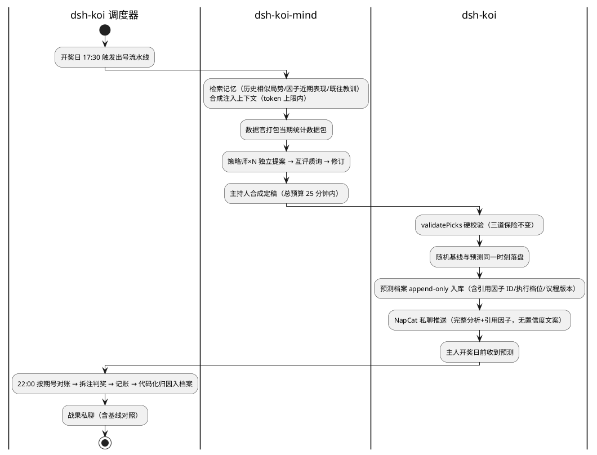

## §1 基本信息

### 1.1 项目背景

需求价值：dsh-koi v1 已实现「开奖日出号 → 私聊送达 → 自动对账 → 诚实记账」的执行层闭环，但只是定时任务，不会变聪明。本需求集在执行层之上加盖认知层（dsh-koi-mind），把每期预测-开奖反馈变成可积累的资产：预测档案、因子战绩、复盘结论、记忆注入，构成 AGI 自我进化的最小试验田。彩票的真值客观（开奖公开不可辩驳）、节奏固定（每周 13 期）、数据完备（三彩种共约 1.3 万期历史，docs/06 估算），是检验「架构是否真的在改进」而无法自欺的领域。同时修复 v1 已知的账本缺陷（BUG-K1 漏账等），保住「诚实记账」这一产品根命题。

需求描述：本需求集 = v1.1 修复包（9 项缺陷修复与加固，上线门槛）+ v2 认知层（数据地基、记忆注入、多 Agent 博弈出号、预注册纪律、复盘循环、知识宫殿、成本护栏）。它**不是**重写执行层——v1 的调度状态机、三道保险、判奖算法、冻结区语义全部保持；也**不是**预测能力承诺——诚实条款（每期独立随机，中奖不是 KPI）贯穿全部需求，成功指标只有架构指标。

**RR 来源**：原讨论会话已不可检索，以 `docs/05-锦鲤预测.md`（v1 需求决定表）、`docs/06-锦鲤心智-方案与待拍板问题.md`（主人 10 个需求点的结构化落盘 + Q1–Q13）、`docs/07-产品经理评审-锦鲤PRD.md`（N1–N6）为原始需求记录（2026-10-24 与主人确认）。全部 19 道拍板题已在本轮需求引出中拍板（记录见附录 5.1）。

### 1.2 结构化信息

|维度|内容|
|-|-|
|Who|主人（单用户，QQ 1017099872，接收全部私聊）；系统角色：dsh-koi（执行层，既有）、dsh-koi-mind（认知层，新增）、dsh-auto-memory（记忆插件，工具级整合）|
|When|每日节奏（开奖日 17:30 出号、22:00 对账）+ 每周节奏（周日晚周报）+ 每月节奏（月末月报与因子晋升）+ 事件触发（主人扔书籍、token 触顶、组件故障）|
|What|按时出号送达（18:00 承诺不破）、诚实对账与记账、预测档案与随机基线预注册、代码化归因、周/月复盘产出、知识摄入与因子回测、token 成本受控|
|Why|AGI 自我进化试验田需要高频真值反馈闭环；v1 的账本缺陷（漏账）直接违背「诚实记账」根命题，必须先修再上线（Q1 拍板）|
|Where|阿里云杭州 2核2G Ubuntu 单机，DSH 宿主进程内（与鲸鱼插件、onebot 插件共存），NapCat 容器负责 QQ 私聊|
|How Much|18:00 前送达率 100%；token 周度硬顶 1000 万（主人拍板 2026-10-24，取代 N2 原 500 万/月，见 §5.10；超限自动降档）；2G 内存（嵌入模型默认关、重计算错峰）；单人零值守运维（心跳语义：对账日 22:30 前无任何私聊 = 系统异常）|
|How|主人日常只看 QQ 私聊（预测/战果/周月报/告警）与 Web 面板「设置 → 彩票」（加餐/体检）；扔 PDF/EPUB/TXT/MD 书籍即触发知识摄入；运维用 CLI（deps/settle/ledger）与 journalctl；人工干预一律走配置文件或 CLI，不从聊天固化|

## §2 核心能力

### 2.1 场景分析

**主成功场景**（每期出号，v2 满配档）

|编号|路径|类别|触发|步骤|
|-|-|-|-|-|
|S-001|主成功|业务|开奖日 17:30 到时|记忆注入 → 数据官打包 → 策略师提案互评 → 主持人合成 → 硬校验 → 基线同刻落盘 → 档案入库 → 私聊推送（17:50 前）|
|S-002|主成功|业务|开奖日 22:00 到时|按期号精确匹配抓开奖 → 拆注判奖 → 账本记账 → 代码化归因（预注册判据）追加档案 → 战果私聊含基线对照|
|S-003|主成功|业务|周日晚到时|汇总各策略/因子战绩 vs 随机基线 + 结构化纪律自评（五条逐条 yes/no+证据指针）+ 健康节（满配率/降级次数/兜底率/注入均值/月 token/未结清条目数）→ 周报私聊|
|S-004|主成功|业务|月末到时|月报生成 → 按预注册规则执行因子晋升/降级/淘汰（唯一状态变更时点）→ 因子库版本化 → 私聊推送|
|S-005|主成功|业务|主人上传书籍|解析拆技巧卡片（语义去重）→ 可计算卡片因子化（预注册命中判据）→ 全量回测（错峰）→ 结论（含「与随机无异」）如实回写卡片|
|S-006|主成功|维护|每周定时|白名单站点抓取 → LLM 提炼候选技巧（只提炼方法不搬运原文）→ 进 S-005 同一流水线（默认低信任级，DC-003）|
|S-007|主成功|操作|主人面板点「现在来一注」|走 v1 单agent 档路径（单会话、不走博弈）→ 推送标注「加餐不记账」；推送失败不重试、号在面板展示（加餐例外语义，FR-005，v1 保持）|
|S-008|扩展|操作|18:10 后出号成功|推送标注「晚到」；19:50（时点源：docs/05 需求决定表）后仍未出 → 放弃 + 致歉一次|
|S-009|扩展|业务|AI 产出两次不合规|随机兜底号照发，消息与档案如实标注「兜底号」（兜底透明）|
|S-010|扩展|业务|排列三开奖后|复盘扩展分析组选/和值玩法（只分析不购买），战绩只进因子统计不进账本|
|S-011|扩展|业务|日期命中休市日历|不出号、不对账、不致歉，静默顺延（v1.1 C2）；日历漏维护的退化行为 = 休市日照常出号、当晚对账按放弃分支记账（FR-001），该孤立条目在官方公布更大期号而目标期号缺席（= 证实休市/取消）时自动转「休市作废」终态：账本追加冲销条目（BC-002 追加+指针，投入不计入口径）、档案标注作废，或经 CLI 人工标记；未结清（放弃待补/作废）条目数经健康节（FR-032）与体检（FR-049）暴露|
|S-012|备选|维护|主人手工补账|`settle --force` 重开已放弃条目；补判奖带审计注记|
|S-013|备选|维护|开奖公布晚于 23:30|放弃分支仍记 cost（prize 空 + 放弃待补）→ 公布后自动/手工补判（v1.1 C1）|
|S-014|异常|业务|博弈流水线超 25 分钟总预算|按档位逐级下降（满配→标准→轻量→单agent，最终保底单agent），单agent 仍失败走兜底档（随机号）；18:00 承诺不破|
|S-015|异常|业务|记忆注入失败/检索为空|注入是增强不是依赖：跳过注入继续出号，档案与日志标注「本期无记忆注入」（单期不推送）；连续异常（≥2 期）经 FR-033 健康告警推送|
|S-016|异常|业务|token 周耗触顶|自动按档位逐级下降（满配→标准→轻量→单agent）；单agent 档仍触顶即当周改走兜底档（随机号照发、透明标注，出号零 LLM 活动）且复盘/学习类活动暂停至周度重置；降档与触顶事件推送告知主人（不只进日志）；自然周（周一 00:00）切换后档位自动恢复至配置档位（预算周期改周度见 §5.10，v1.1.3）|
|S-017|异常|业务|单个角色 agent 卡死/产出不合规|剔除该角色、剩余角色继续合成；全部失败才走 S-014 降级链|
|S-018|异常|业务|随机基线写入失败|本期预测照常发布，消息与档案标注「本期基线缺失」（E8 拍板）|
|S-019|异常|业务|NapCat 推送失败|按统一重试参数集重试（FR-005：间隔 5 分钟、分类终止线），超终止线转入补发队列，通道恢复后补发并标注；致歉消息同走该通道，通道全挂时致歉落日志与面板，由「22:30 无消息 = 出事」心跳语义兜底（docs/08 FR-4.4 边界延续）|
|S-020|异常|维护|koi-mind 数据库损坏|v1 三 JSON 不受影响（隔离不变量）→ 从最近备份重建投影库 → 重建期间出号走无注入路径|
|S-021|异常|维护|官方数据源被拦/改版|分批+错峰重试；新鲜度探针（最新开奖距今 >7 天 = 异常；数值源：docs/07 P0-4 建议，已批量拍板）暴露；期号断档自动补拉|
|S-022|异常|业务|周报/月报推送失败|沿用统一推送重试语义；非强时效，次日补发可接受|
|S-023|异常|维护|mind 插件写脏数据/出 bug|总开关禁用 mind → koi 立即回到纯 v1 行为（注入点建在开关后）；版本握手不匹配拒启用|
|S-024|异常|维护|进程崩溃/重启|v1 状态机从盘上恢复续跑；未对账条目进 carry；v2 流水线当日未完成部分按放弃/降级语义处理，不重复不遗漏|
|S-025|异常|业务|开奖日出号流水线整体失败（历史抓取异常/会话卡死等）|调度器级重试保持 v1 语义（docs/08 FR-1.2/1.4）：间隔 ≥2 分钟、单彩种每日至多 3 次，3 次均失败 → 放弃并发致歉一次；与流水线内 25 分钟预算及降级链（S-014）叠加——降级链走完仍无产出记为一次失败尝试|

### 2.2 业务规则

|编号|描述|原因|影响范围|
|-|-|-|-|
|BC-001|诚实条款：每期开奖是独立随机事件，任何技巧与博弈不改变中奖概率。命中率只作与随机基线对照的观测值，禁止成为任何环节的优化目标。豁免说明：按预注册命中判据执行的晋升/降级裁决（FR-035）属 BC-004 架构纪律检验体系，不属于本条禁止的「优化目标」|产品的存在合法性；防止系统学会自欺|全部认知层组件、月报晋升规则、推送文案|
|BC-002|预注册 append-only：预测号码+完整理由+引用因子在开奖前落盘，只追加不可改写；数据更正 = 追加更正条目 + 指向原条目的指针，永不改写原条目|纪律 1 的物理载体；「不可改」必须包括「记错了也不能改」，否则更正口子会腐蚀预注册|预测档案、账本修正、浮动奖回填|
|BC-003|随机基线同行：每期基线号与预测号同一时刻、经独立代码路径生成落盘；所有战绩永远连同基线一起上报。基线写入失败时预测照发但必须标注「本期基线缺失」|纪律 2 锚点；E8 拍板（照发+标注）平衡时效与纪律|出号流水线、周报/月报统计口径|
|BC-004|无事后选择：复盘只针对事前登记（含预注册命中判据）的假设；事后发现的规律一律标「探索性」，未过样本外验证不得晋升、不得注入出号上下文|防止事后归因污染因子库|归因引擎、因子晋升、记忆注入候选|
|BC-005|兜底透明：随机兜底的号在推送、面板、档案三处如实标注（v1 延续，扩展到 v2 档位记录）|纪律 4|推送文案、预测档案|
|BC-006|账本唯一口径：ledger 只记「每期正式预测都买」的模拟账；加餐、组选/和值扩展分析永不进账本|纪律 5；口径唯一性|对账、周月报、加餐路径|
|BC-007|置信度只入档案不进推送文案；档案内使用离散档位（低/中/高），禁止百分比数字|对独立随机事件显示数字置信度是剧场化误导（N6 拍板 + PM 补充：伪精确数字会被月报统计当真）|预测档案、推送模板、月报|
|BC-008|状态变更唯一时点：因子晋升/降级/淘汰只有月报固定流水线有权执行；周报只观察不裁决；人工干预走 config/CLI，不从聊天固化。唯一例外：主人在否决窗口内经 config/CLI 行使晋升否决（FR-035），其触发的回退边带审计注记（DC-004）|防止自评反自欺与「一时兴起被固化成教训」|因子库状态机、周月报、闲聊会话|
|BC-009|数据所有权分层：v1 三 JSON（state/predictions/ledger）永远是有损保护下的 source of truth；koi-mind 的库是可从三 JSON + 备份重建的投影视像；v2 任何组件故障禁止污染 v1 三 JSON|解耦不变量；回退与重建的根基|存储设计、故障处理、备份|
|BC-010|回退契约：提供 mind 总开关（禁用后 koi 行为与纯 v1.1 完全一致）；mind 启动时与 koi 做 schemaVersion 握手，不匹配拒启用|「可回退」必须是可演练的承诺而非纸面|插件生命周期、版本升级|
|BC-011|时效承诺：开奖日 18:00 前送达是跨 v2 保持的硬承诺；任何认知层增强（注入、博弈）不得以突破该承诺为代价，超时即降级|产品核心承诺 = 按时送达|出号流水线、降级链|
|BC-012|错峰窗口：17:00–22:30 禁止重计算（全量回测、全量爬取、图谱投影）；后台作业（周报/月报/学习/回测）按每周时刻表互斥调度|2核2G 与开奖敏感窗口保护|调度设计、所有后台作业|
|BC-013|成本硬顶：token 周度 1000 万硬顶（主人拍板 2026-10-24，取代 N2 原 500 万/月，见 §5.10；月度数字仅作报告视图），超限自动按档位逐级下降（满配→标准→轻量→单agent），单agent 档仍触顶即当周出号改走兜底档（随机号照发、透明标注，零 LLM 活动）、复盘/学习类活动暂停，自然周（周一 00:00）重置后自动恢复——硬顶的真终态是「当周零新增 LLM 支出」，单agent 不是终点；降档是最后防线，预警线先行（触线推送告知）；计量口径必须唯一且覆盖全部 LLM 活动（出号/博弈/复盘/学习）；分项预算不绝对平均——活动类别之下博弈类按角色权重分项（权重表进 koi-mind 配置，M3-T5 落地）|真金白银花在负期望游戏上必须有硬护栏（N2 拍板 + PM：口径不清则硬顶形同虚设；独立 PM 复核指出「保底单agent」使硬顶机制不成立，v1.1.1 修正；2026-10-24 主人拍板上调为周度 1000 万并要求按角色权重分项）|全部 LLM 调用、月报健康节|
|BC-014|归因代码化：「哪些因子押中哪些位」由代码按因子化时预注册的命中判据计算，LLM 只负责叙述；推送与档案引用的因子 ID 必须存在于因子库|LLM 叙述归因 = 被审计者自己写审计报告（自欺纪律的隐蔽破口）|归因引擎、因子化流水线、推送模板|
|BC-015|网络内容防御：抓取内容只作引用数据、绝不作为指令进入提示词；站点白名单变更只能经代码版本变更生效，禁止运行时修改|提示词注入风险|网络学习流水线|
|BC-016|人工锚：季度人工审计仪式（清单化：抽查档案对照五条纪律、看健康节趋势、复核一次晋升/降级决定）|自动化的自我监控本身会退化，全自举系统需要一个不自举的锚|运行手册、月报|

### 2.3 数据约束

|编号|类别|逻辑名称|描述|
|-|-|-|-|
|DC-001|实体|预测档案条目|每期每彩种每类别一条（类别=正式预测/加餐；同一期加餐与正式预测并存为两条）；必填：彩种、期号、落盘时刻、号码、完整推理文本、引用因子 ID 列表、置信档位（低/中/高）、当期局势快照、计划档位（当期按配置与拉前条件应执行的档位，FR-033 告警基准）、执行档位（五档枚举：满配=数据官+策略师×N+质询者+主持人，多轮辩论；标准=数据官+策略师×2+主持人，v2.0 起步阵容；轻量=数据官+单策略师；单agent=v1 单会话路径；兜底=随机号）、议程版本、基线指针；开奖后追加：结果、奖级、归因结论。业务键唯一（彩种+期号+类别）；禁止 UPDATE/DELETE。「必填」语义 = 字段存在且可解析，值允许为空但须注明不适用原因（单agent/兜底档无议程版本、v1 历史条目无因子/卡片引用为合法空值）|
|DC-002|实体|随机基线条目|必填：彩种、期号、号码、落盘时刻；落盘时刻必须与对应预测条目同刻；生成路径与预测路径相互独立；基线与当期正式预测同投注结构、同注数（如双色球红8+蓝1复式对红8+蓝1复式），保证战绩对照在命中分布层面同构|
|DC-003|实体|技巧卡片|必填：名称、出处、适用彩种、具体规则、可计算标志、信任级（枚举：低/中/高；网络来源默认低、书籍来源默认中、主人手工确认后可升高）、最近复核时间、回测结论指针；入库前语义去重；不可计算卡片长期零引用或超期未复核应可被清理|
|DC-004|实体|因子|必填：唯一 ID、可执行规格、预注册命中判据（因子化时定死，事后不可追加解释）、回测档案指针；状态机 candidate→observing→promoted/demoted/retired 单向流转，仅月报流水线有权变更；唯一回退边：promoted→observing，仅由主人晋升否决（FR-035）触发，须带审计注记；版本号单调递增|
|DC-005|实体|账本条目|每期正式预测一行；必填：投入金额；中奖金额可空（空 = 放弃待补）；奖级注数明细；更正走追加条目+指针（BC-002）|
|DC-006|值域|期号|福彩：四位年+3 位期内序号；体彩：两位年+3 位；跨年进位规则固定；对账匹配 = 期号精确相等，不认「最新一期」|
|DC-007|值域|休市日历|日期列表（YYYY-MM-DD）；官方每年休市公告发布后人工维护一次，运行手册绑定该日历事件|
|DC-008|值域|置信档位|枚举：低/中/高；禁止数值型置信度|
|DC-009|版本|schemaVersion|预测档案与账本顶层版本号单调递增；schema 演进只加不改不删，旧读取方容忍未知字段|
|DC-010|版本|议程/注入模板版本|多 Agent 议程与记忆注入模板必须带版本标识，并 stamp 进每期预测档案（归因可分段）|
|DC-011|计量|token 用量记录|每次 LLM 调用记录：活动类别（出号/博弈/复盘/学习）、角色（博弈类）、实测用量、时刻；周度汇总按类别分项（博弈类内按角色权重，§5.10），作为周度硬顶判定唯一来源；月度汇总仅作月报报告视图（v1.1.3）|
|DC-012|保留|数据保留|预测档案与账本永久保留禁止清理；备份保留 8 份滚动；v2 知识资产（卡片/因子/档案）全部纳入备份清单|
|DC-013|实体|教训白名单条目|必填：教训内容、来源指针（预测档案/复盘报告 ID）、验证状态（枚举：预注册假设验证通过/探索性结论样本外验证通过）、收录时刻、收录人（系统/主人）；禁止收录未过样本外验证的结论（BC-004——教训天然是事后产物，无验证状态不得入白名单）；管理走 config/CLI，不从聊天固化（BC-008）|

## §3 需求列表

### 3.1 功能性需求

|编号|类别|名称|描述|优先级|
|-|-|-|-|-|
|FR-001|v1.1 修复|漏账修复（BUG-K1）|对账放弃分支（23:30 后仍未公布）仍记投入（中奖为空+「放弃待补」注记），公布后自动/手工补判奖；`settle` 命令支持重开已放弃条目；22:00 起 15 分钟/轮、至多 8 轮的轮询节奏保持 v1 语义（docs/08 FR-5.2，代码 `scheduler.js:28-29` 证实）；放弃待补条目不允许永久滞留：或补判奖结清，或证实期号不存在（官方公布更大期号而目标期号缺席，即休市/取消）时转「休市作废」终态——账本追加冲销条目（BC-002 追加+指针）、档案标注作废（S-011，独立 PM 复核补充）|P0|
|FR-002|v1.1 修复|休市日历|配置休市日期列表，命中日期不出号、不对账、不发致歉，静默顺延|P0|
|FR-003|v1.1 修复|写盘原子化统一|CLI 写盘与调度器写盘语义统一：写盘必须原子，任何时刻中断不得出现半写状态，消除并发互覆盖|P0|
|FR-004|v1.1 修复|schemaVersion 落地|预测与账本文件顶层加版本字段，读取方容忍未知字段|P0|
|FR-005|v1.1 修复|推送重试参数统一|统一覆盖三类时效承诺推送（预测、战果、致歉/告警）：重试间隔 5 分钟（N3 拍板建议值）；预测推送重试至 catchUpEnd（19:50），战果与致歉推送重试至对账放弃线（23:30）；超终止线转入补发队列，通道恢复后补发并标注补发；失败原因面板可见。本参数集同时作为 v2 全部推送（周报/月报/健康告警，FR-033/036）的基准语义。加餐推送为显式例外：失败不重试、号在面板展示（v1 语义保留，docs/08 FR-4.3）。本条取代 docs/08 FR-4.2 的「60 秒重试直至成功」无上限语义（v1.1.0 冲突标注，见 §5.4）|P0|
|FR-006|v1.1 修复|对账顺延扫描扩展|跨天顺延从「仅前一日」扩为「所有未结清条目」，防多日宕机漏账|P0|
|FR-007|v1.1 修复|判奖金样本回归|判奖算法以历史真实开奖构造覆盖全部奖级的假想投注做回归测试，纳入部署验收|P0|
|FR-008|v1.1 修复|数据新鲜度探针|体检命令增加：任一数据源最新开奖距今 >7 天判失败（数值源：docs/07 P0-4 建议，已批量拍板）|P1|
|FR-009|v1.1 修复|部署脚本修正|换行符清理范围覆盖 tools 目录；验收从三步扩为五步（增加杀 NapCat、对账中途重启两场景）|P1|
|FR-010|部署时序|v1.1 先行部署|v1.1 修复包回归通过后按五步验收部署上线，再启动 v2 开发（Q1 拍板）|P0|
|FR-011|数据地基|全量历史回填|三彩种历史一次性从官方源拉全（约 1.3 万期），分批+错峰+失败重试；完成后产出统计口径核对报告（期号格式、字段落库规则）供主人过目确认（Q2 拍板）|P0|
|FR-012|数据地基|期号连续性校验|全量回填后及每次增量同步后校验期号连续，断档自动补拉并记录；新鲜度探针只防「全停」，本需求防「漏期」|P0|
|FR-013|数据地基|增量同步|每期开奖后增量入库，挂接对账时点；与 v1 对账共用抓取结果避免重复请求|P0|
|FR-014|数据地基|预测档案升级|预测档案自 M1 建立即生效并 append-only：预注册（BC-002）与随机基线（FR-015）自 M1 首期起在档案上执行；M4 变更的仅是对账回填职责从 v1 JSON 迁至档案（见破坏性变更段，独立 PM 复核澄清 M1/M4 口径）；档案自建立起即记录卡片/因子/期号引用，「完整」= 引用字段在且如实（含如实为空——v1 历史条目无因子/卡片体系，空值为合法，DC-001）|P0|
|FR-015|数据地基|随机基线机制|基线号与预测号同刻落盘、独立代码路径生成；战绩对照以基线为常设参照|P0|
|FR-016|博弈编排|内部编排流水线|每期临时拉会：数据官 + 策略师×N + 质询者 + 主持人，开完散会；全记录落盘（Q5=A 拍板：不进群聊、私聊分析不曝光）|P0|
|FR-017|博弈编排|起步阵容分层|v2.0 起步用标准档（数据官+策略师×2+主持人）跑在降级链内；档位×彩种分配（Q6 拍板混合档）：双色球/大乐透=标准档、排列三=轻量档，满配档仅适用于双色球/大乐透；满配档（数据官+策略师×N+质询者+主持人，多轮辩论）为 P1，拉前条件：连续 4 周（PM 范围建议值，默认决策 A-01）无降级且周 token < 预算的 70%（预警线同 FR-046，默认决策 A-01；预算周期改周度见 §5.10）|P1|
|FR-018|博弈编排|超时降级链|出号流水线总预算 25 分钟（docs/07 P1-C，场景确认采纳）：超时按档位逐级下降（满配→标准→轻量→单agent，最终保底单agent），单agent 仍失败走兜底档（随机号）；18:00 承诺不破|P0|
|FR-019|博弈编排|单角色容错|单个角色失败/超时/产出不合规即剔除，剩余角色继续；全部失败才降级|P0|
|FR-020|博弈编排|产出校验不变|多 Agent 产出仍走 v1 硬校验（picks 契约），不合规打回/兜底语义与 v1 一致|P0|
|FR-021|博弈编排|议程版本管理|议程与角色提示词带版本标识 stamp 进每期档案；议程文件纳入版本控制；议程变更与因子库版本变更不得同期生效，确需同期生效时月报须声明该期归因混杂、不可作单变量归因（原 v1.0.0 表述「尽量不同期叠加」为非决定性措辞，本次改为约束性规则）|P1|
|FR-022|博弈编排|重放测试通道|提供录制回放/dry-run 模式，零 token 演练超时降级链与议程变更|P2|
|FR-023|回退契约|mind 总开关|配置总开关：禁用认知层后 koi 行为与纯 v1.1 完全一致（记忆注入点建在开关之后）；开关状态在面板可见|P0|
|FR-024|回退契约|版本握手|mind 启动时校验 koi 数据版本，不匹配拒启用并明示原因，防止脏数据写入|P0|
|FR-025|预注册纪律|append-only 档案|预测档案只追加；更正走「追加更正条目+指针」协议；任何界面不提供改写入口|P0|
|FR-026|预注册纪律|基线失败语义|基线写入失败时预测照常发布，推送与档案标注「本期基线缺失」（E8 拍板）|P0|
|FR-027|预注册纪律|置信度规格|置信度以低/中/高档位入档案，不进推送文案|P0|
|FR-028|记忆注入|记忆插件整合|dsh-auto-memory 工具级整合（Q3 拍板）：喂入内容由认知层按模板决定（每期档案摘要、复盘结论）；定义独立于插件格式的中间喂入格式，防记忆格式被插件绑架；koi 出号会话默认关闭 dsh-auto-memory 的宿主级自动注入（两记忆插件均会宿主级注入，docs/06），记忆注入统一经认知层模板执行，koi-lottery 闲聊会话不受此限；任何进入出号会话的记忆内容计入 FR-045 计量并受 FR-030 上限约束（独立 PM 复核补充）|P1|
|FR-029|记忆注入|缓存定位|记忆插件定位为缓存/索引层：注入所需全部内容可从预测档案与因子库重建，蒸馏丢数据不致命|P0|
|FR-030|记忆注入|注入候选规则|注入候选 = 活跃因子 + 近 30 期同彩种局势（源：docs/06 §4.1「该因子近 30 期表现」，默认决策 A-03）+ 教训白名单（准入规则见 DC-013：仅收录按 BC-004 过样本外验证的结论，未验证教训不得入注——独立 PM 复核指出原表述与 BC-004 冲突）；已降级/退役因子永不回注；注入上下文上限 = 每角色每次出号会话 4000 token（标准档 4 角色期合计 ≤16000；防上下文爆炸，标准档月耗估算已逼近预警线故从严定值，FR-047 首月实测后可调，默认决策 A-02 及其 v1.1.1 单位口径修正）|P1|
|FR-031|记忆注入|注入失败语义|注入失败或检索为空：跳过注入继续出号，档案与日志标注「本期无记忆注入」；单期不推送（避免每期骚扰），连续异常（≥2 期）并入 FR-033 健康告警推送|P0|
|FR-032|复盘循环|周报|周日晚自动产出并私聊：各策略/因子战绩 vs 随机基线（对照按同投注结构展开计算，DC-002）、结构化纪律自评（五条逐条 yes/no + 证据指针）、健康节（本周满配率/降级次数/兜底率/注入均值/月 token 走势、未结清条目数（放弃待补与休市作废，FR-001，独立 PM 复核补充暴露载体））、下周计划|P0|
|FR-033|复盘循环|健康告警|连续 3 期实际执行档位低于当期计划档位（计划档位由配置与拉前条件判定并 stamp 进每期档案；满配档未解锁期间标准/轻量档即计划档位，设计内差值不告警——独立 PM 复核修正：原「连续 3 期非满配」在起步期会设计性常亮）（PM 建议值，默认决策 A-01）、兜底连续 3 期出现（PM 建议值，默认决策 A-01），或注入连续失败 ≥2 期（FR-031 连续异常口径）时，主动推送告警（不只进日志）|P1|
|FR-034|复盘循环|代码化归因|归因由代码按因子预注册命中判据计算，LLM 只叙述；引用因子 ID 必须存在于因子库（防幻觉因子）|P0|
|FR-035|复盘循环|月报与晋升|月末月报 + 因子晋升/降级/淘汰（唯一状态变更时点）；样本外验证参数：观察期 ≥ 30 期（PM 建议的统计下限，默认决策 A-01），晋升需样本外显著优于基线且带多重检验折扣（该判据属 BC-001 豁免的纪律检验，见 BC-001 豁免说明），月度晋升上限 2 个（PM 建议值，默认决策 A-01）；晋升动作推送后 24 小时否决窗口期满生效，主人可在窗口内经 config/CLI 否决（否决 = 该因子回退 observing，即 DC-004 唯一合法回退边，带审计注记；与 BC-008 人工干预入口一致；PM 可选建议，本轮默认启用，默认决策 A-10）|P1|
|FR-036|复盘循环|复盘推送失败补发|周报/月报推送失败沿用统一重试语义，次日补发可接受|P1|
|FR-037|复盘循环|季度人工审计|运行手册内置季度审计清单，四事项：① 抽查档案对照五条纪律；② 看健康节趋势；③ 复核一次晋升/降级决定；④ 抽 3 期排列三开奖与官方排列三公告逐位核对（验证「排列三=排列五前三位」取数假设，吸收 docs/07 P2-5）；单次约 30 分钟/季（PM 建议的轻量锚定，默认决策 A-01；加项后时长仍在此量级，默认决策 A-11）|P1|
|FR-038|知识宫殿|技巧卡片流水线|书籍/网络材料 → 结构化技巧卡片（名称/出处/适用彩种/规则/可计算标志）；语义去重与全文检索为底线组件，不可省|P1|
|FR-039|知识宫殿|因子化与回测框架|可计算卡片因子化（同时定死预注册命中判据）→ 全量历史回测（错峰）→ 结论回写卡片；回测引擎用构造的已知规律数据做金样本测试（防前视偏差）|P0|
|FR-040|知识宫殿|基础因子集|内置基础因子先行回测：遗漏值、冷热号、和值区间、奇偶比、012 路、AC 值、连号、斜跳号、蓝球周期；结论（含「与随机无异」）如实入档|P0|
|FR-041|知识宫殿|书籍摄入|支持 PDF/EPUB/TXT/MD（图片版 PDF 最低优先级）；M2 启动前主人至少提供 1 本（Q13 外部依赖，任意格式）|P1|
|FR-042|知识宫殿|矛盾处理|矛盾卡片不裁决入库、按样本外战绩排序；主持人采纳一方必须留引用与取舍理由；月报例行报告活跃矛盾对|P1|
|FR-043|知识宫殿|卡片退役|卡片带最近复核时间；月报例行清理超期未复核或长期零引用的非计算卡片|P2|
|FR-044|知识宫殿|网络学习|白名单站点（变更只能经代码版本变更生效，禁止运行时修改）每周抓取一次 → 提炼候选技巧（只提炼方法不搬运原文）→ 进卡片流水线（默认低信任级，DC-003，未过样本外不得注入出号上下文）；首月汇报产出/采纳/爬不到的站清单（Q8 拍板）|P2|
|FR-045|成本护栏|token 计量口径|唯一计量来源（以接口实测用量为准）覆盖全部 LLM 活动（出号/博弈/复盘/学习）；每期档案记录实际执行档位、注入 token、各阶段耗时。P0 前置验证（独立 PM 复核补充）：design 阶段首项核实 DSH 宿主/sessionController 是否暴露逐次调用的实测 token 用量（docs/05–08 无此能力记载，docs/08 NFR-6 仅「记录每次唤醒耗时」；本轮未验证）；若无该接口，降级计量方案 = 按模型×活动类别的定额估算记账 + 定期与账单对账校准，且降级方案须在 FR-047 首月重算时优先核实|P0|
|FR-046|成本护栏|分项预算与预警|按活动类别分项预算（博弈类内按角色权重分项——主人拍板非绝对平均，权重表进 koi-mind 配置、M3-T5 落地，§5.10）；周耗达预算的 70% 与 90%（PM 建议预警线，默认决策 A-01）时推送告知；1000 万/周硬顶（主人拍板 2026-10-24，取代 N2 的 500 万/月）超限自动按档位逐级下降（满配→标准→轻量→单agent），单agent 档仍触顶即当周出号改走兜底档（随机号照发、透明标注，零 LLM 活动）且复盘/学习类活动暂停，降档与触顶事件推送告知；自然周（周一 00:00）切换后档位自动恢复至配置档位，无需人工干预（独立 PM 复核修正：硬顶真终态为兜底档而非单agent，并补月度重置语义；v1.1.3 随拍板改周度周期）|P0|
|FR-047|成本护栏|首月实测重算|上线首月用实测 token 数据重算各档定价与分项分配表，回填预算参数|P1|
|FR-048|备份|周备份与出箱|每周自动打包（三 JSON + 认知层库 + 卡片/因子/档案）到本机备份目录保留 8 份（N4 拍板）；至少每月 1 次（PM 建议值，默认决策 A-01）拉出主机一份（Windows 工作区或对象存储）|P0|
|FR-049|可观测|体检扩展|体检命令扩展覆盖 v2：认知层库可读、记忆插件在线、数据新鲜度、期号连续性、备份最近成功时间、长期未结清条目（放弃待补/休市作废超过 7 天，FR-001，独立 PM 复核补充）|P1|
|FR-050|可观测|推送文案预算|推送模板定长、字段预算化（完整分析+引用因子+诚实基调句），防文案长度失控|P2|
|FR-051|复盘扩展|排列三组选/和值|只分析不购买：判定逻辑同样做金样本测试；战绩只进因子统计与复盘叙事，永不进账本主口径（Q12 拍板）|P2|
|FR-052|档案口径|加餐入档|加餐号进预测档案（标注加餐类别，DC-001 业务键含类别）供复盘取样，但剔出 KPI 与账本口径（PM 建议；原「待主人评审确认」状态按无人值守默认纪律定为生效，P2 低风险且不动账本口径，默认决策 A-09）|P2|
|FR-054|博弈编排|出号会话策略|v2（M3 起）定时出号每期新开会话 + 显式注入模板（人设+近 N 期摘要+当期数据包），旧会话上下文不滚入新期（N5 拍板落点，原 v1.0.0 漏登记为 FR）；koi-lottery 常驻会话仅留主人闲聊；v1.1 部署期（M0）沿用现状复用会话（`scheduler.js:87-92`），运行手册增加 koi-lottery 会话上下文定期检查项作为过渡措施（docs/07 P0-6）|P1|
|FR-053|图谱预留|外键记录纪律|语义时空图与可视化延后（v2.2+），但卡片/因子/期号 ID 外键从 M2 起持续记录，保证历史边数据不丢失|P1|

**破坏性变更（显式标记）**：M4 时预测记录的对账回填职责从 v1 的 JSON 文件迁移至认知层 append-only 档案，v1 的 CLI/面板读取路径需兼容过渡（迁移规则沿用 docs/10 §6：只加不改不删 + 版本单调 + 提供迁移命令）。此为对 v1 现行行为的唯一计划内变更，其余 v1 冻结区（判奖/校验/路径契约/回环断言/状态机相位/面板 API）语义不变。

**v1 既有语义保留声明（v1.1.0 补录，防设计阶段重新发明）**：① 出号调度重试（单彩种每日 ≤3 次、间隔 ≥2 分钟、失败致歉一次，docs/08 FR-1.2/1.4 → 本 IR S-025）；② 对账轮询节奏（15 分钟/轮 × 8 轮，docs/08 FR-5.2 → FR-001）；③ 浮动奖语义（一/二等当晚按 0 计、注数照报并标「含浮动奖」，docs/08 FR-5.3/6.3；次日自动回填维持 docs/08 P2-1 默认不做，如未来启用回填须按 BC-002 追加更正条目+指针，不得改写原条目）；④ 加餐任务内存队列（上限 20、重启即失，docs/08 FR-7.4 已知且接受）。

### 3.2 非功能性需求

|编号|类别|名称|描述|优先级|
|-|-|-|-|-|
|NFR-001|时效|出号送达|开奖日 18:00 前私聊送达率 100%（度量口径：18:00 前完成首次送达的期数 ÷ 当日应出号期数；正常 17:50 前；v1 KPI 跨 v2 保持，降级链保障）。晚到送达（18:00 后，S-008）计入失分；推送通道故障期间（NapCat 不可达且面板红标存续）的补发送达不计入分母，恢复后按 FR-005 补发语义处理并标注——独立 PM 复核修正：原「100%」与 S-008 晚到、S-019 补发并存时既不可达也不可判定（AC-001 杀 NapCat 场景本身产出晚于 18:00 的补发）|P0|
|NFR-002|资源|内存与计算|2核2G 单机约束：本地嵌入模型默认关闭；重计算（回测/全量爬取/图谱投影）禁止在 17:00–22:30 窗口运行；后台作业按每周时刻表互斥（周日=周报+双色球/排列三出号+对账叠加，须错开）|P0|
|NFR-003|成本|token 预算|周度硬顶 1000 万（主人拍板 2026-10-24，取代 N2 原 500 万/月，§5.10），超限自动降档、预算耗尽当周以兜底档收口（BC-013，独立 PM 复核修正）；预警线先行；自然周重置后档位自动恢复；标准档混合使用月耗估算 190–380 万（docs/06 Q6 估算，仅覆盖出号+博弈口径）——周度 1000 万 ≈ 月度 4300+ 万，为该估算的 10 倍以上裕量，主要效果是满配档可常开、学习/复盘更宽裕（诚实条款下不改变命中率）；硬顶仍对全部 LLM 活动生效（FR-045 口径），偏差由 70% 预警线提前暴露并由 FR-047 首月实测重算回填修正（v1.1.1 修正保留；v1.1.3 随拍板改周度）|P0|
|NFR-004|可靠性|故障隔离|认知层任何组件故障（含数据库损坏、插件崩溃、记忆插件离线）不影响 v1 出号/对账/记账；v1 三 JSON 永不被认知层写路径触碰；备份可重建全部认知层数据|P0|
|NFR-005|可靠性|完成定义（DoD）|v2.0 三内核（数据档案/复盘周环/记忆注入）连续 4 周无人工干预稳定运转（PM 建议的稳定性门槛，默认决策 A-01），且降级链三场景演练（杀 NapCat 跑一期、对账中途重启、注入强制失败）各通过一次，方视为达成；DoD 未达不开后续条目。「人工干预」定义（独立 PM 复核补充）：主人对系统的主动操作——config 写入、CLI 执行、面板按钮、聊天触发的出号/加餐/晋升否决——计入干预；只读查看与投喂书籍（FR-041，属系统正常运行输入）不计入；DoD 观测表由系统从操作审计自动生成，主人仅补签|P0|
|NFR-006|安全|攻击面控制|出站新增仅白名单学习站点（HTTPS）；NapCat 回环断言不变；面板路由 fail-closed 不变；网络内容只作数据不作指令；QQ 号在输出中打码|P0|
|NFR-007|可维护性|冻结区与所有权|v1 冻结区 FZ-1~6 语义不变；认知层独占写自有库、对 v1 三 JSON 只读；schema 只加不改；上游插件版本锁定、升级前跑回归验收；面板 API 允许只增字段、既有字段语义不变（对齐 DC-009 与 docs/10 FZ-6——FR-005/023 的新增面板展示由此途径实现，独立 PM 复核补充）|P0|
|NFR-008|可观测性|健康可见|健康节指标集（满配率/降级次数/兜底率/注入均值/月 token/未结清条目数）随周报产出；降级、触顶、基线缺失三类事件当期推送；注入失败单期仅档案与日志标注（不推送，避免每期骚扰），连续异常（≥2 期）经健康告警（FR-033）推送；「对账日 22:30 前无任何私聊 = 系统异常」心跳语义延续|P0|
|NFR-009|兼容性|运行环境|仅服务器真实 Node 进程；桌面 Electron 不适配；单用户单推送目标|P1|
|NFR-010|性能|流水线时限|出号流水线（注入+博弈+合成+校验）总预算 25 分钟内完成；档案与账本查询在单机小数据量（10 年 < 5MB 级，docs/11 估算）下单次查询响应 ≤100ms（原「毫秒级」定性描述占位符化定值：单机 SQLite 小数据量的宽松经验上界，无基准测试来源，design 阶段可复核，默认决策 A-01）|P1|

## §4 验收方案

### 4.1 验收准则

|编号|关联能力|维度|描述|验收标准|
|-|-|-|-|-|
|AC-001|FR-009/010|功能|v1.1 部署五步验收：测试推送、加餐全链路、当晚战果+账本、杀 NapCat 跑一期（验证未送达标记与补发）、对账中途重启（验证不重复记账）|五步全部通过，账本与档案无错漏|
|AC-002|FR-007|功能|判奖金样本回归：历史真实开奖构造覆盖全部奖级的假想投注|回归测试全绿，纳入 selftest 类命令|
|AC-003|FR-001/002/006|功能|放弃分支补账 + 休市顺延 + 多日宕机恢复：模拟公布晚于 23:30 与命中休市日历|放弃期后补判奖成功；休市日不出号不致歉；宕机 2 天后 carry 全部结清；休市孤立条目终态：模拟官方跳号公布（目标期号缺席、更大期号正常公布）→ 条目自动转休市作废、账本冲销生效、健康节/体检可见计数（独立 PM 复核补充）|
|AC-004|FR-011/012|功能|全量回填与期号连续性：三彩种全量入库 + 断档注入测试|期号连续性校验零断档；注入的假断档被自动补拉并记录；口径核对报告经主人确认|
|AC-005|FR-015/026|功能|基线同刻与失败语义：正常期基线与预测落盘时间差在秒级；基线生成路径均匀性以受控随机源离线模拟验证（原「≥30 期历史基线极差 ≤1.5 倍均匀期望」判定因上线初期样本量不足、阈值过紧而不可执行，v1.1.0 重设计，默认决策 A-06）；模拟基线写入失败|正常期对照统计成立（预测与基线落盘时刻差 ≤1 秒）；受控随机源模拟频次核对通过（TC-006）；失败期预测照发且推送/档案带「本期基线缺失」标注|
|AC-006|FR-018/019/031|功能|降级链三场景演练：博弈强制超时、单角色失败、注入强制失败|分别降为轻量档（数据官+单策略师）/剔除角色继续/无注入出号，均在 18:00 前送达且档案记录实际档位；剔除场景档案另须记录被剔除角色与最终参与角色集（供归因分段，默认决策 A-16）|
|AC-007|FR-045/046|功能|token 计量与触顶演练：以实测用量为口径记账，临时调低硬顶触发降档|降档事件推送收到；健康节 token 数字与实测一致|
|AC-008|FR-023/024|功能|回退演练：关闭总开关后跑一期；版本握手注入不匹配场景|关闭后行为与纯 v1.1 一致（无注入无博弈）；不匹配时拒启用并明示|
|AC-009|FR-025/034|功能|append-only 与归因：尝试改写档案被拒；构造已知判据的因子回放归因|更正只能追加+指针；归因结果与手算判据一致，幻觉因子 ID 被拒绝|
|AC-010|FR-032|功能|周报按期产出：任选一周|周报含战绩 vs 基线、五条纪律自评、健康节，周日当夜送达|
|AC-011|FR-048|可靠性|备份恢复演练：删除认知层库后从备份重建|重建后库内容与删除前一致；v1 三 JSON 全程未受影响|
|AC-012|FR-039|功能|回测金样本：构造已知规律数据（如固定奇偶比序列）|回测引擎在金样本上得出预期结论，无前视偏差|
|AC-013|NFR-005|可靠性|v2.0 DoD：三内核连续运行（判定方式 = DoD 观测记录表 + 三场景演练）|连续 4 周无人工干预，健康节无告警；三场景演练（杀 NapCat 跑一期、对账中途重启、注入强制失败）各通过一次|
|AC-014|FR-051|功能|组选/和值判定金样本|判定逻辑回归全绿；账本主口径无组选条目|
|AC-015|FR-005|功能|推送失败语义统一验证：制造 NapCat 故障|按统一重试参数集重试，超终止线转入补发队列，通道恢复后补发并标注；面板可见失败原因|
|AC-016|FR-003/004|功能|写盘原子化与 schema 容忍：向写盘过程注入中断（强杀进程）；读取含未知字段的预测/账本文件|中断后文件要么为完整旧内容要么为完整新内容，任何时刻不出现半写/不可解析状态；含未知字段的文件读取不报错，既有字段解析正确|
|AC-017|FR-013|功能|增量同步挂接对账：任选一开奖日观察 22:00 对账与入库|开奖结果当期增量入库成功；对账与增量同步共用同一次抓取（该数据源当日抓取计数=1，无重复请求）|
|AC-018|FR-014/053|功能|档案 append-only 与外键完整（M4 迁移演练）：执行迁移命令后抽查迁移前后条目|对档案条目 UPDATE/DELETE 被拒；抽查条目的卡片/因子/期号引用字段在且如实（含迁移进来的历史条目；v1 历史条目允许因子/卡片引用如实为空——独立 PM 复核修正「不得缺失」的不可满足表述，DC-001/DC-004）|
|AC-019|FR-016/021|功能|编排全记录与议程版本：跑一期多 Agent 出号；修改议程版本后再跑一期|两期档案均含完整编排记录（角色轮次/发言时间戳/议程版本 stamp 齐全）；议程文件在版本控制内，第二期 stamp 为新版本号|
|AC-020|FR-020|功能|多 Agent 产出硬校验：向策略师输出注入构造的不合规产出（号码越界/字段缺失）|不合规产出被 validatePicks 打回或转兜底档，不合规号码永不送达，档案如实记录该次打回/兜底|
|AC-021|FR-027/BC-007|功能|置信度规格抽查：任取连续 N 期（N≥10）的推送文案与对应档案|推送文案无任何置信度表述；档案置信档位 ∈ {低/中/高}；抽查范围内档案与推送全文无百分比数字置信度|
|AC-022|FR-028/029|功能|记忆缓存定位与喂入格式：删除记忆插件全部数据后触发一次注入重建|注入所需内容可从预测档案+因子库重建（重建后注入上下文可用）；喂入内容按认知层模板生成且为独立中间格式（非 dsh-auto-memory 原生格式）；出号会话注入上下文不含认知层模板之外的宿主级自动注入内容（FR-028，独立 PM 复核补充）|
|AC-023|FR-040|功能|基础因子回测结论：九类基础因子（遗漏值/冷热号/和值区间/奇偶比/012 路/AC 值/连号/斜跳号/蓝球周期）全量回测|九类因子全部有回测结论入档，含「与随机无异」结论如实记录，无一缺结论|
|AC-024|FR-035|功能|月末晋升流水线演练：构造含达晋升标准/降级/淘汰三类的因子战绩数据，执行月末流水线|晋升/降级/淘汰严格按预注册规则执行且仅在月报流水线生效（BC-008）；晋升受样本外显著优于基线+多重检验折扣+月度上限约束；启用否决窗口时晋升在窗口期满后生效；否决后因子状态回退 observing 为唯一合法回退边且带审计注记（DC-004，独立 PM 复核补充）|
|AC-025|FR-008/049|功能|体检扩展演练：逐项构造异常——数据源落后 >7 天、认知层库不可读、记忆插件离线、期号断档、备份超期、存在超期未结清条目（>7 天，FR-049）|体检命令对六类异常逐项报红并指明具体异常项与来源；无异常时全绿|
|AC-026|FR-017|功能|起步阵容与满配拉前条件：v2.0 上线初期抽查档案执行档位；分别模拟拉前条件不满足/满足|起步期执行档位=标准档（双色球/大乐透）、轻量档（排列三，Q6 混合档分配，独立 PM 复核补充）；连续 4 周无降级且周 token < 预算的 70%（FR-017，默认决策 A-01；预算周期改周度见 §5.10）两条件同时满足前，满配档不被启用；条件满足后下一期升满配且档案可见|
|AC-027|FR-030|功能|注入候选规则：构造候选场景（活跃因子+近 30 期同彩种局势+教训白名单（含混入一条未过样本外验证的教训），混入已降级/退役因子）|注入上下文不含已降级/退役因子；未验证教训不入注（DC-013，独立 PM 复核补充）；候选构成与规则一致；单角色注入上下文 ≤4000 token、标准档期合计 ≤16000（FR-030，默认决策 A-02）|
|AC-028|FR-033|功能|健康告警三触发：分别构造实际档位连续 3 期低于计划档位（且非设计内混合档差值）、兜底连续出现、注入连续失败（≥2 期）场景|三类场景均主动推送告警（不只进日志），推送指明类别与已连续期数；设计内档位差值（满配未解锁）不触发告警（独立 PM 复核修正）；健康节对应指标同步可见|
|AC-029|FR-036|功能|周/月报补发：在周报推送时段制造 NapCat 故障至超终止线，次日恢复通道|沿用统一重试语义，次日补发到达且带补发标注，内容完整不重发|
|AC-030|FR-037/BC-016|功能|季度人工审计演练：按运行手册清单执行一次审计（四事项：抽查档案对照五条纪律、健康节趋势、复核一次晋升/降级、排列三前三位核对）|清单四事项全部可执行并留演练记录；单次完成时长约 30 分钟（FR-037，默认决策 A-01/A-11）|
|AC-031|FR-038/041|功能|卡片流水线与书籍摄入：投入 PDF/EPUB/TXT/MD 四格式样例（含重复内容样例与图片版 PDF）|四格式全部产出结构化卡片（或明确标注不可解析及原因）；重复内容语义去重不产生重复卡片；卡片可全文检索；图片版 PDF 按最低优先级处理|
|AC-032|FR-042|功能|矛盾卡片处理：构造两条互斥技巧卡片并触发一次主持人采纳|两条均入库不裁决、按样本外战绩排序；月报活跃矛盾对包含该对；主持人采纳留引用与取舍理由|
|AC-033|FR-047|功能|首月实测重算：首月运行结束后执行重算流程|产出各档定价与分项分配表（重算前后对照留档）；预算参数回填生效，次月预算判定使用新值|
|AC-034|BC-012/NFR-002|可靠性|错峰与互斥调度：在 17:00–22:30 窗口触发全量回测/爬取；同时触发两个后台作业|重计算任务被延迟至窗口外执行；后台作业按每周时刻表互斥，任一时刻至多一个在跑|
|AC-035|BC-015/FR-044|安全|网络内容防御与白名单管控：在抓取内容中植入提示词注入样文本；尝试经配置/运行时接口修改站点白名单|抓取文本仅作引用数据、不出现在提示词指令位；白名单运行时修改被拒绝，仅代码版本变更加载后生效|
|AC-036|FR-054|功能|出号会话策略（M3 起）：连续跑两期定时出号，检查两期会话上下文；另在 koi-lottery 常驻会话闲聊一次|两期出号使用相互独立的会话（第二期上下文不含第一期完整推理文本）；koi-lottery 常驻会话闲聊功能不受影响；v1.1 部署期（M0）不适用本条（现状复用会话，运行手册检查项兜底）|

### 4.2 测试用例

|编号|关联准则|前置条件|操作步骤|预期结果（量化指标/判断条件）|
|-|-|-|-|-|
|TC-001|AC-001|v1.1 已部署，NapCat 在线|面板点「测试推送」→ 点「现在来一注」|手机收到测试消息；1–4 分钟（时长源：docs/05 验收第二步）内收到加餐私聊且标注「加餐不记账」|
|TC-002|AC-001|当晚有开奖彩种|22:00 后等待战果私聊，CLI 查账本|战果私聊到达；账本新增当日条目，投入/中奖与官方奖级一致|
|TC-003|AC-001|v1.1 已部署，NapCat 在线，测试在 17:30–19:50 出号推送窗口内执行|`docker stop napcat` → 等 10 分钟 → `docker start napcat`|面板出现未送达红标；通道恢复后 2 个重试周期（5 分钟间隔 ×2，FR-005）内补发，消息带补发标注|
|TC-004|AC-003|当日预测已出、官方未公布|将配置 `settleGiveUp` 临时改为当前时刻前 1 分钟（配置下一轮 tick 热生效），等待对账分支触发后观察条目；验证完恢复配置|条目记投入、中奖为空、注记「放弃待补」；公布后自动补判或 `settle --force` 补判成功（v1.1.0 起以配置热生效替代「调系统时间至 23:31」——生产宿主改系统时间影响面大，默认决策 A-16）|
|TC-005|AC-006|博弈流水线运行中|向流水线注入人为延迟使总耗时超 25 分钟|当期降为轻量档（数据官+单策略师），18:00 前送达，档案「执行档位」字段记录轻量|
|TC-006|AC-005|正常开奖日；基线生成逻辑已封装、可离线以受控随机源调用|开奖后检查预测与基线条目落盘时刻；另以受控随机源（固定种子）离线批量生成 ≥10000 注模拟基线，按彩种统计每个号码在全部展开注中的出现次数（复式按注展开）|两段落盘时刻差 ≤1 秒（同一提交窗口）；模拟基线频次核对通过：任一号码出现次数 ≥1 且 ≤ 均匀期望 ×3，其中均匀期望 = 号码槽位总数 ÷ 号码空间（红区槽位 = 基线条目数 × 展开注数 × 每注红球数，如双色球 = 期数×28×6；蓝球/后区槽位 = 期数 × 每条目该区号码数）。v1.1.1 修正（独立 PM 复核发现，默认决策 A-21，经本会话模拟实测：10000 注双色球复式红区期望 50909，原「期数÷空间」口径上界仅 909、33/33 必然判负；修正后红区 0 超上界 0 零频次、蓝球期望 625 同样通过）；该判定只能暴露结构性偏差，符合「验证生成路径无系统性偏差」的测试目的；真实基线分布偏差作为月报长期观测项，不设上线门槛|
|TC-007|AC-007|预算周期内任意时点|把硬顶临时改为当前已耗值|触顶降档私聊在下一轮调度前送达；后续期执行档位降为轻量|
|TC-008|AC-008|v2 已启用|配置总开关=false 后触发一次出号|出号路径无注入无博弈，消息与纯 v1.1 无法区分；面板显示认知层已禁用|
|TC-009|AC-009|任一历史期档案存在|用运维命令尝试修改该档案条目|命令被拒绝（无修改入口）；追加更正条目后原条目内容不变、指针正确|
|TC-010|AC-011|备份任务已跑过|删除认知层数据库 → 执行恢复|恢复后条目数与删除前一致；diff 为空|
|TC-011|AC-004|全量回填完成|对库执行期号连续性校验|三彩种零断档；人为删 3 期后校验失败并自动补拉|
|TC-012|AC-010|v2 三内核已上线满一周|周日 23:00 前查看私聊|周报已送达，五条纪律自评逐条有 yes/no 与证据指针，健康节五项数字齐全|
|TC-013|AC-002|v1.1 修复包构建完成|运行判奖回归（selftest 类命令：以历史真实开奖构造覆盖全部奖级的假想投注）|全部奖级判定与官方规则一致，回归全绿；命令纳入 selftest 持续可跑|
|TC-014|AC-012|因子回测框架就绪|注入构造的已知规律数据（如固定奇偶比序列）执行全量回测|回测结论与植入规律一致；命中判据计算仅使用判据时点之前的数据，无前视偏差|
|TC-015|AC-013|v2.0 三内核上线|维护 DoD 观测记录表；执行三场景演练（杀 NapCat 跑一期、对账中途重启、注入强制失败）|观测记录表连续 4 周无人工干预条目（NFR-005，默认决策 A-01）；三场景演练各通过一次；健康节无告警——三项齐备方判 DoD 达成|
|TC-016|AC-014|排列三复盘扩展上线|运行组选/和值判定金样本回归；抽查当月账本|判定逻辑回归全绿；账本主口径零组选/和值条目（战绩仅进因子统计）|
|TC-017|AC-015|统一重试参数已配置、NapCat 在线|制造 NapCat 推送故障直至超过重试终止线，随后恢复通道|按统一重试参数集重试；超终止线后停止重试、转入补发队列；面板可见失败原因；通道恢复后补发并带补发标注|
|TC-018|AC-016|v1.1 已部署于测试实例（隔离的配置与数据目录，非生产宿主——生产宿主强杀会中断全部 DSH 插件，默认决策 A-16），当日存在待写盘的预测/账本文件|在该测试实例的 CLI/调度器写盘瞬间 `kill -9` 强杀进程，重复 ≥5 次制造不同中断点；再在文件顶层手工加入未知字段（如 `"futureField": 1`）后走正常读取路径加载|每次中断后文件均可解析且为完整旧内容或完整新内容，半写样本=0；含未知字段的文件读取不报错，既有字段值与写入时一致|
|TC-019|AC-017/025|全量回填已完成，体检命令可用|任选一开奖日观察 22:00 对账并核对抓取日志；随后逐项构造异常——数据源 mock 为最新开奖距今 >7 天、篡改认知层库文件、停用记忆插件、人为删 3 期制造断档、将备份成功时间改旧、构造超期未结清条目（放弃待补 >7 天）——每项后各跑一次体检|对账日增量条目当期入库且该数据源当日抓取计数=1（无重复请求）；体检对六类异常逐项报红并指明异常项与来源，全部恢复后复跑全绿|
|TC-020|AC-018/019/021|M4 迁移命令可用（或演练库）；多 Agent 出号已跑两期（第二期前修改议程版本号）|执行档案迁移；对任一条目尝试 UPDATE/DELETE；抽查迁移前后各 ≥10 条条目；连续任取 ≥10 期推送文案与对应档案做置信度排查|UPDATE/DELETE 均被拒；抽查条目卡片/因子/期号引用字段完整无缺失；两期档案编排记录（角色轮次/时间戳/议程版本 stamp）齐全且第二期为新版本号；推送文案无置信度表述、档案置信档位 ∈ {低/中/高}、全文无百分比置信度数字|
|TC-021|AC-020/026|多 Agent 流水线运行中，预算参数可配置|向策略师输出注入构造的不合规产出（号码越界/字段缺失）；另查 v2.0 起步期档案执行档位（逐彩种：双色球/大乐透=标准档、排列三=轻量档），并分别模拟 FR-017 两拉前条件不满足/同时满足（构造降级记录、调高 token 计量）|不合规产出被 validatePicks 打回或转兜底档，不合规号码永不送达且档案留痕；起步期执行档位符合混合档分配（AC-026）；两条件未同时满足时满配档不被启用，同时满足后下一期升满配且档案可见|
|TC-022|AC-022/027|记忆插件在线且已积累注入数据；因子库含已降级/退役因子|删除记忆插件全部数据后触发一次注入重建；再构造候选场景（活跃因子+近 30 期同彩种局势+教训白名单（含混入一条未过样本外验证的教训），混入已降级/退役因子）触发一次注入|重建后注入上下文可用且内容仅来自预测档案+因子库；喂入内容为独立中间格式（非 dsh-auto-memory 原生格式）；注入上下文不含已降级/退役因子、不含未验证教训，单角色注入上下文 ≤4000 token、标准档期合计 ≤16000（FR-030，默认决策 A-02）|
|TC-023|AC-023/024|回测框架就绪；月末流水线可在生产或测试实例执行（不依赖 FR-022 dry-run 通道，默认决策 A-16）|跑九类基础因子（遗漏值/冷热号/和值区间/奇偶比/012 路/AC 值/连号/斜跳号/蓝球周期）全量回测并查结论入档；构造含达晋升标准/降级/淘汰三类的因子战绩数据执行月末流水线（启用否决窗口配置）|九类因子结论全部入档（含「与随机无异」如实记录），缺结论数=0；晋升/降级/淘汰仅按预注册规则在月报流水线生效，晋升受样本外显著优于基线+多重检验折扣+月度上限约束，否决窗口（24 小时，默认决策 A-10）期满前晋升不生效|
|TC-024|AC-028/029/030|v2 三内核上线，统一重试参数已配置，运行手册含季度审计清单|分别构造实际档位连续低于计划档位、兜底连续出现、注入连续失败（≥2 期）三场景观察告警；在周报推送时段制造 NapCat 故障至超终止线、次日恢复；按清单执行一次季度审计|三类场景均主动推送告警（指明类别与已连续期数，不只进日志；设计内档位差值不触发）；周报次日补发到达且带补发标注、内容完整不重发；审计四事项（档案对照五条纪律/健康节趋势/复核一次晋升降级/排列三前三位核对）全部可执行并留演练记录，单次约 30 分钟（FR-037，默认决策 A-01/A-11）|
|TC-025|AC-031/032|卡片流水线就绪；备有 PDF/EPUB/TXT/MD 四格式样例（含图片版 PDF 与重复内容样例）|四格式样例过卡片流水线；构造两条互斥技巧卡片入库并触发一次主持人采纳，查看当期月报|四格式全部产出结构化卡片或明确标注不可解析原因；重复内容语义去重后重复卡片数=0；卡片可全文检索；互斥卡片均入库不裁决、按样本外战绩排序，月报活跃矛盾对包含该对，主持人采纳留引用与取舍理由|
|TC-026|AC-033/034/035|首月实测 token 数据已积累；后台作业每周时刻表已配置；网络学习流水线可在生产或测试实例运行（dry-run 可选，默认决策 A-16）|首月末执行重算流程；在 17:00–22:30 窗口触发全量回测并同时触发两个后台作业；在抓取内容中植入提示词注入样文本，并尝试经配置/运行时接口修改站点白名单|重算产出各档定价与分项分配表（前后对照留档），次月预算判定使用新值；重计算被延迟至窗口外执行，任一时刻至多一个后台作业在跑；抓取文本不出现在提示词指令位，白名单运行时修改被拒绝、仅代码版本变更加载后生效|
|TC-027|AC-036|v2 M3 上线（出号走新会话策略）|连续跑两期定时出号，分别检查两期会话的上下文内容；另在 koi-lottery 常驻会话闲聊一次|两期出号会话相互独立（第二期上下文不含第一期完整推理文本）；koi-lottery 闲聊正常；出号所用新会话的注入模板与人设按 FR-054 显式注入|

### 4.3 交付物定义

|交付物|描述|
|-|-|
|dsh-koi v1.1 修复包|9 项修复与加固（FR-001~009）+ 判奖/日历回归测试，部署五步验收通过|
|dsh-koi-mind 认知层插件|数据仓库、预测档案（append-only）、多 Agent 编排、记忆注入、复盘引擎（周/月报+归因）、因子库与回测框架、成本护栏、总开关与版本握手|
|记忆插件整合配置|dsh-auto-memory 安装配置 + 独立中间格式的喂入模板（防插件绑架）|
|口径核对报告|全量回填后的统计口径说明（期号格式、字段落库规则），经主人确认归档|
|每周时刻表规格|所有后台作业的触发时刻、时长上限、与敏感窗口互斥规则|
|运行手册更新|休市维护流程（绑定官方公告日历）、季度人工审计清单（四事项，FR-037）、心跳语义、备份恢复步骤、排障表扩充、koi-lottery 会话上下文定期检查项（M0–M3 过渡期，FR-054）|
|备份机制|周备自动化 + 出箱流程 + 恢复演练记录|
|（P2）图谱外键基线|语义时空图延后，但外键记录纪律在 v2.0 全程执行（FR-053）|

## §5 附录

### 5.1 拍板记录（2026-10-24 需求引出会话）

**单独讨论拍板（4 题）**：

|题|决定|备注|
|-|-|-|
|Q1 部署时序|**先打 v1.1 修复包再部署**（采 docs/10 建议，否 docs/06 的立即部署）|M0 时点 = v1.1 回归通过日|
|Q5 博弈形态|**A 内部编排**（不进群聊、私聊分析不曝光）|满配档分层见 FR-017|
|Q7 模型分级|**A 不分级**，全部用 DSH 现状模型|token 控制杠杆 = 角色数×轮数 + 预算硬顶|
|N2 预算硬顶|**500 万 token/月**（高于 PM 建议的 300 万）；**2026-10-24 主人拍板上调：1000 万 token/周、按角色权重分项（见 §5.10）**|分项预算与预警线数值待首月实测（FR-047）|

**按文档建议值批量拍板（15 题）**：Q2 官方源全量爬、Q3 auto-memory 起步、Q4 自建轻量知识宫殿、Q6 混合档（大彩种标准/排列三轻量）、Q8 自选 2–3 站周更、Q9 SQLite 起步、Q10 独立插件拆分、Q11 架构指标 KPI、Q12 组选/和值只析不买、Q13 书籍格式不限（时点=M2 前至少 1 本）、N1 期号匹配+休市日历、N3 推送重试语义、N4 周备份保留 8 份、N5 每期新会话+注入模板、N6 置信度不进文案。

**新增规格决策（本轮引出确认）**：E8 基线写入失败 = 预测照发 + 标注「本期基线缺失」（不阻断）。

**⚠ 主人复核置顶项（v1.1.1）**：FR-052 加餐入档默认生效、FR-035 否决窗口默认启用、FR-017 拉前条件定值——三者均由默认决策单方面激活原「待主人评审确认」状态，推翻成本为一行配置/一个开关（默认决策 A-09/A-10/A-01，独立 PM 复核要求置顶）。

**原「待主人评审确认」条目（v1.1.0 已按无人值守默认纪律定值，主人醒来后可逐条推翻，详见 docs/decisions/A-默认决策记录.md）**：FR-052 加餐入档（P2，默认生效）；FR-035 晋升否决窗口（默认启用 24 小时）；FR-037 季度审计仪式（保留，清单扩为四事项）；FR-017 满配档拉前条件（4 周无降级 + 周 token < 预算 70%，周期变更见 §5.10）。全部 `[[PH:...]]` 数值占位符已定值（v1.0.0 共 12 个 ID、25 处，v1.1.0 清零），定值明细见文末「修订记录（v1.1.0）」：满配拉前周数=4 周、降级告警期数=3 期、兜底告警期数=连续 3 期、注入 token 上限=4000 token/期（新增）、注入候选历史期数=30 期（新增）、样本外观察期 N=30 期、月度晋升上限 K=2 个、晋升否决窗口=24 小时、预算预警线=70%/90%、DoD 周数=4 周、备份出箱周期=每月 1 次、季度审计时长=30 分钟；另 NFR-010 查询时延占位符化定值 ≤100ms（新增）。

### 5.2 前置架构决定（已定约束，design 阶段不得重新发明）

> 注：下表均为需求侧输入约束（主人已拍板/继承自前置文档），非本 IR 做出的设计决策。

|决定|来源|
|-|-|
|认知层为独立插件 dsh-koi-mind，与 dsh-koi 通过文件/数据库契约解耦|Q10|
|存储：v1 三 JSON 不动；认知层自持 SQLite（单库，图谱同库分表），对三 JSON 只读|Q9 + docs/09 INT-10 所有权矩阵|
|记忆：dsh-auto-memory 工具级整合，两记忆插件不同装；中间喂入格式独立定义|Q3 + PM 复核|
|多 Agent：内部编排（临时开会），不装 DeepSeek-Bot|Q5|
|模型：不分级路由，全部使用 DSH 现状模型|Q7（本轮拍板）|
|预测档案迁移 SQLite 与 append-only 化时点 = M4；v1 内保持回填模式|docs/10 §6 规则 4|
|v1 冻结区 FZ-1~6（判奖/校验/路径契约/回环断言/状态机相位/面板 API）语义不变|docs/10 §2|
|整合优先三问 + 工具级/契约级/适配器级三层整合方式；自研仅限领域件与纪律不变量写入路径|docs/06 §9|
|会话策略：定时出号每期新会话+显式注入模板，koi-lottery 常驻会话留作闲聊（design 阶段确认 DSH 压缩机制）|N5|

### 5.3 PM 盲区审查溯源（本轮查漏补缺，2026-10-24）

原「对话里的产品经理」通道（product-manager 代理）连续两次被服务端拦截，改由通用代理以同一 PM 角色完成独立审查。其结论中已转化为需求的部分：

|PM 盲区编号|盲区|落入条目|
|-|-|-|
|1|token 计量口径|FR-045、BC-013|
|2|降级常态化不可见（健康节）|FR-032/033/045、NFR-008|
|3|归因必须代码化|FR-034、BC-014、DC-004|
|4|样本外统计参数与回测金样本|FR-035/039|
|5|周日时刻表冲突|NFR-002、交付物「每周时刻表规格」|
|6|知识矛盾与污染|FR-042/044、BC-004|
|7|写回与注入规则（记忆=缓存）|FR-029/030、BC-008|
|8|v2 回退契约（总开关+握手+投影存储）|FR-023/024、BC-009/010|
|9|期号连续性|FR-012|
|10|议程版本管理|FR-021、DC-010|
|11|档案/账本更正协议|BC-002、DC-005|
|12|卡片退役|FR-043|
|13|备份出箱与 v2 资产|FR-048|
|14|网络内容注入防御|BC-015|
|15|人工干预入口|BC-008|
|16|季度人工锚|FR-037、BC-016|
|17–20|加餐入档/文案定长/重放通道/长期杂项|FR-052/050/022、NFR-008|
|21（v1.1.0 补录）|排列三「排列五前三位」取数假设的季度人工核对（docs/07 P2-5，v1.0.0 PM 盲区表遗漏）|FR-037（审计清单第四事项）、交付物「运行手册更新」|

范围控制建议（三内核 = 数据档案 + 复盘周环 + 记忆注入；满配博弈、自动晋升、完整摄入延后 v2.1+；图谱与迁移延后 v2.2+）已编码为 FR 优先级分层与 NFR-005 DoD，主人可在评审时调整。

### 5.4 与既有文档的关系

|文档|角色|
|-|-|
|docs/05 / 06 / 07|原始需求记录（RR 代理）|
|docs/08（需求设计规格说明书）|v1 + v1.1 部分继续有效；其中 v1.1 相关条目以本 IR 为准刷新；v2 部分被本 IR 取代|
|docs/09 / 10 / 11（集成/变更契约/SDD）|design 阶段产物，以本 IR 为输入进入 design 流程刷新（v1 集成契约仍有效）|
|本文档（docs/12）|进入下一流程（aet-req-design）的权威需求输入|

**v1.1.0 与 docs/08 的显式冲突与取代清单**（冲突处以本 IR 为准；docs/08 未列出的 v1 条目继续有效）：

|docs/08 条目|冲突点|以本 IR 为准的口径|
|-|-|-|
|NFR-1（正常 17:40 前送达）|v2 流水线 25 分钟预算下 17:40 不可达|统一为「正常 17:50 前、硬承诺 18:00」（NFR-001/S-001；v1 单agent 档自然快于该线，不受损）|
|FR-4.2（推送失败 60 秒重试直至成功，无上限）|与本 IR FR-005 统一参数冲突|FR-005：5 分钟间隔 + 分类终止线 + 补发队列（代码 `scheduler.js:27` 证实现状确为 60s 无上限）|
|FR-4.3（加餐推送失败不重试）|与「统一语义」表面冲突|保留为 FR-005 的显式例外（加餐号已在面板可见，非时效承诺对象）|
|FR-1.2/1.4（出号 3 次尝试语义）|本 IR v1.0.0 场景表未显式收录|显式收录为 S-025 并保留 v1 语义|
|FR-5.2（对账 15 分钟 × 8 轮）|本 IR v1.0.0 未显式收录|补入 FR-001 说明，语义不变|
|FR-6.3/P2-1（浮动奖次日回填可选）|回填与 append-only 的关系未说明|维持默认不做；如启用须按 BC-002 追加更正条目（见「v1 既有语义保留声明」）|
|UC-8/FR-10.1（koi-lottery 会话复用）|与 N5 拍板（每期新会话）冲突|v2 M3 起切换为 FR-054 新会话策略；M0–M3 过渡期沿用现状 + 运行手册检查项|

### 5.5 五条自举纪律（基线枚举，源自 docs/06 §2）

本 IR 纪律类规则（BC-001~005）与周报纪律自评（FR-032）的枚举基线：

|纪律|名称|内容|
|-|-|-|
|1|预注册|预测+理由开奖前落盘、只追加不可改|
|2|随机基线同行|每期同时生成随机对照号，战绩连同基线上报|
|3|无事后选择|只复盘事前登记的假设，事后规律标「探索性」须样本外验证|
|4|兜底透明|随机兜底号如实标注|
|5|账本诚实|ledger 唯一记分口径，不允许选择性汇报|

### 5.6 里程碑基线（M0–M5，源自 docs/06 §五）

|里程碑|定义|
|-|-|
|M0|部署 v1（现为 v1.1 先行，FR-010）|
|M1|数据地基（全量回填+SQLite+预测档案）|
|M2|知识宫殿（卡片+因子化回测）|
|M3|多 Agent 博弈+记忆注入|
|M4|复盘循环（周/月报、晋升、对账回填职责迁至预测档案——档案与 append-only 自 M1 生效，独立 PM 复核澄清 M1/M4 口径）|
|M5|语义时空图（已延后 v2.2+，仅保留外键记录纪律）|

### 5.7 修订记录（v1.1.0，2026-10-24 阶段A查漏补缺）

> 本轮由需求分析阶段（aet-req-analysis，无人值守）对 v1.0.0 做系统性复查：Gemba 实读 `plugins/dsh-koi` 全部源码与测试（29 例全过，`node --test tests/draws.test.mjs tests/stats.test.mjs` 实测），逐节核对场景/业务规则/数据约束/FR/NFR/AC/TC，并与 docs/05/06/07/08/10 比对。所有本应询问主人的事项按默认纪律定值，逐条登记于 `docs/decisions/A-默认决策记录.md`（A-01~A-18）。改动点全列如下：

**场景（§2.1）**

1. S-006：信任级措辞统一为「低信任级」（对齐 DC-003 新枚举）。
2. S-007：补加餐推送失败语义（不重试、面板展示，对齐 FR-005 例外）。
3. S-011：补休市日历漏维护的退化行为（照常出号、放弃分支记账不漏账、审计暴露）。
4. S-019：补统一重试参数引用（5 分钟/分类终止线）与致歉消息通道边界（心跳语义兜底）。
5. 新增 S-025：出号流水线整体失败的调度器级重试（v1 语义显式保留：3 次/2 分钟/致歉一次，docs/08 FR-1.2/1.4 此前未收录）。

**业务规则与数据约束（§2.2/§2.3）**

6. DC-001：「每期每彩种一条」修正为「每期每彩种每类别一条」，消除与业务键（彩种+期号+类别）的自洽矛盾（加餐入档后同期并存两条）。
7. DC-003：信任级补枚举（低/中/高；网络默认低、书籍默认中、手工确认可升高）。
8. §3.1 破坏性变更段后新增「v1 既有语义保留声明」：出号重试、对账轮询节奏、浮动奖语义（含回填须走 BC-002）、加餐内存队列四项显式化。

**功能/非功能需求（§3.1/§3.2）**

9. FR-001：补对账轮询节奏（15 分钟 × 8 轮，v1 保持）。
10. FR-005：重写——统一参数定值（5 分钟间隔、预测至 catchUpEnd/战果致歉至 23:30、超线转补发队列）、明确覆盖三类时效推送并作为 v2 推送基准、加餐显式例外、显式取代 docs/08 FR-4.2。
11. FR-017：拉前条件定值（4 周 + 70%）。
12. FR-021：「尽量不同期叠加」改为决定性约束（不得同期生效，确需同期须声明归因混杂）。
13. FR-030：「近 N 期」定值 30 期（源 docs/06 §4.1）；注入 token 上限定值 4000 token/期。
14. FR-033：告警阈值定值（非满配连续 3 期、兜底连续 3 期）。
15. FR-035：观察期 30 期、晋升上限 2 个定值；否决窗口默认启用并定值 24 小时（含否决语义与 BC-008 的一致性说明）。
16. FR-037：审计清单由三事项扩为四事项（新增排列三前三位核对，吸收 docs/07 P2-5——v1.0.0 PM 盲区表的遗漏项）。
17. FR-044/S-006：信任级措辞对齐 DC-003。
18. FR-046：预警线定值 70%/90%。
19. FR-048：出箱周期定值每月 1 次。
20. FR-052：「待主人评审确认」按默认纪律定为生效（P2）。
21. 新增 FR-054（P1，M3）：出号会话策略——N5 拍板（每期新会话+注入模板）在 v1.0.0 只挂在 §5.2 未落 FR 条目，本轮补登记。
22. NFR-005：DoD 周数定值 4 周。
23. NFR-010：「毫秒级」定性描述定值 ≤100ms。

**验收方案（§4）**

24. AC-005/TC-006：基线频次核对判定重设计——原「≥30 期历史基线极差 ≤1.5 倍均匀期望」在上线初期无样本且阈值数学上过紧（30 期双色球红球位期望 <1，极差常态为 2），改为受控随机源离线模拟 ≥10000 注 + 「无零频次、无超期望 3 倍」纯计数判定，真实基线分布作月报长期观测。
25. AC-006：补剔除场景须记录被剔除角色与最终参与角色集。
26. AC-013/AC-026/AC-027/AC-030/TC-015/TC-022/TC-024：同步定值。
27. AC-030/TC-024：审计三事项改四事项。
28. TC-003：前置补「17:30–19:50 窗口内执行」（与 5 分钟重试参数自洽）。
29. TC-004：以配置热生效替代「调系统时间至 23:31」（生产宿主改系统时间影响面大）。
30. TC-018：强杀写盘注入中断限定在测试实例（非生产宿主）。
31. TC-023/TC-026：前置弱化对 FR-022（P2 dry-run 通道）的依赖。
32. 新增 AC-036/TC-027（FR-054 会话策略验收）。

**附录与交付物（§4.3/§5）**

33. 交付物「运行手册更新」补：审计清单四事项、koi-lottery 会话上下文检查项（M0–M3 过渡）。
34. §5.1：「待主人评审确认」条目按默认纪律全部定值；12 个既有占位符 ID 清零，另新增 inject-history-n、query-latency 两个占位符并定值。
35. §5.4：新增「与 docs/08 的显式冲突与取代清单」七条（17:50 取代 17:40、统一推送参数取代 60s 无上限、加餐例外保留、S-025/FR-001 显式收录、浮动奖声明、会话策略 M3 切换）。

**占位符定值总表**：fullcast-weeks=4 周｜budget-warn1=70%｜budget-warn2=90%｜degrade-alert=3 期｜fallback-threshold=连续 3 期｜inject-token-cap=4000 token/期｜inject-history-n=30 期（新增）｜oos-n=30 期｜promo-k=2 个｜veto-window=24 小时（并默认启用）｜dod-weeks=4 周｜offsite-cycle=每月 1 次｜audit-minutes=30 分钟｜query-latency=≤100ms（新增）。依据：PM 建议值照采（A-01）、本轮推荐值（A-02/A-03）、docs/06 §4.1 与 docs/07 P0-4 等既有来源，逐条理由见 A-默认决策记录。

### 5.8 修订记录（v1.1.1，2026-10-24 独立产品经理复核处置）

> 独立产品经理复核对 v1.1.0 提出 20 条意见（4 高/7 中/9 低），逐条核实后 **20 条全部采纳**（其中意见 13 为部分采纳：其对我方计数的再修正本身亦不完整，见处置表）。逐条处置登记于 `docs/decisions/A-默认决策记录.md`「独立产品经理复核处置」节（决策编号 A-19~A-38）。核实手段：意见 3 的数学主张经本会话模拟实测证实（10000 注均匀随机双色球复式，旧公式上界 909 vs 红区期望 50909，33/33 必然判负；修正公式红区 0 超上界 0 零频次）。改动点：

1. **休市孤立条目终态**（高）：S-011/FR-001 定义「休市作废」终态（官方跳号证实期号不存在 → 账本追加冲销条目+档案标注，BC-002 合规）；暴露载体补齐——健康节与体检增加「未结清条目数」（S-003/FR-032/FR-049/NFR-008/AC-003/AC-025/TC-019 同步）。
2. **成本硬顶收口**（高）：BC-013/S-016/FR-046/NFR-003 修正——单agent 档仍触顶即当月出号走兜底档（零 LLM）+复盘/学习暂停，硬顶真终态为「当月零新增 LLM 支出」；补月度重置自动回档语义；NFR-003 裕量论证范围限定为出号+博弈口径并指明复盘/学习消耗由 FR-047 重算覆盖。
3. **TC-006 公式修正**（高）：均匀期望改按「号码槽位总数 ÷ 号码空间」（红区槽位=期数×展开注数×每注红球数），阈值语义不变；A-06 的期望值陈述同步修正（A-21）。
4. **降档告警基准修正**（高）：FR-033 改为「实际档位低于当期计划档位」（计划档位 stamp 进档案，DC-001 补计划档位字段），消除与 FR-017 起步标准档的设计性常亮冲突；AC-028/TC-024 同步。
5. **教训白名单准入**（中）：新增 DC-013（仅收录按 BC-004 过样本外验证的结论、config/CLI 管理）；FR-030 引用；AC-027/TC-022 加「未验证教训不得入注」断言。
6. **Q6 混合档落 FR**（中）：FR-017 补档位×彩种分配（排列三=轻量、大彩种=标准、满配仅大彩种）；AC-026/TC-021 逐彩种抽查。
7. **auto-memory 宿主注入管控**（中）：FR-028 明确出号会话默认关闭宿主级自动注入、统一走认知层模板、消耗计入 FR-045/FR-030 口径；AC-022 加断言。
8. **FR-045 前置验证**（中）：补 P0 前置——design 阶段首项核实 DSH 宿主逐调用 usage 接口（本轮未验证，docs/05–08 无记载），无则降级为定额估算+账单对账校准。
9. **否决回退边合法化**（中）：DC-004 补唯一回退边 promoted→observing（仅主人否决、带审计注记）；BC-008 补例外条款；AC-024 加状态机断言。
10. **M1/M4 档案口径澄清**（中）：FR-014 明确档案与 append-only 自 M1 生效（预注册+基线自首期）、M4 仅迁对账回填职责；§5.6 M4 行同步。
11. **拍板记录回填**（中）：19 题拍板结论回填 docs/06 Q1–Q13 与 docs/07 N1–N6 答复栏（标注回填来源与原会话不可检索事实；与 RR 建议相反的 Q1/Q7/N2 显式标注）。
12. **注入上限单位与角色数修正**（低）：统一为「每角色每次出号会话 ≤4000 token（标准档 4 角色期合计 ≤16000）」；A-02 理由同步修正。
13. **A-01 计数精确化**（低）：11 个带 rec 占位符中 10 个由 A-01 定值、veto-window 由 A-10 定值；PM 复核所称「实为 10 个」忽略 budget-warn2 亦有 rec 值，处置表内以 v1.0.0 原文为证澄清。
14. **NFR-001 度量口径**（低）：补度量分式与例外定义（通道故障期补发不计入分母），与 S-008/S-019/AC-001 兼容。
15. **BC-001 豁免说明**（低）：预注册晋升裁决不属「优化目标」。
16. **基线投注结构**（低）：DC-002 补同结构同注数；FR-032 对照口径注明。
17. **DC-001 必填语义**（低）：「字段存在且可解析、值可空并注明不适用」；AC-018「完整」=字段在且如实。
18. **NFR-007 面板只增字段**（低）：与 DC-009/docs/10 FZ-6 对齐。
19. **NFR-005 人工干预定义**（低）：干预事件清单（config/CLI/面板/聊天触发）+观测表系统自动生成。
20. **§5.1 置顶标注**（低）：三处默认生效项置顶供主人优先复核。

### 5.9 修订记录（v1.1.2，2026-10-24 阶段B独立产品经理复核触发——口径回流注记）

> 阶段B设计复核中，独立 PM 指出三处「设计侧重解释验收口径未回流权威输入」与两处上游定义缺口。本节以**增量注记**方式回流（不改既有条目正文语义，原文以注记为准刷新处均已同步 docs/09/10/11）。处置详情与决策编号见 `docs/decisions/B-默认决策记录.md`「独立产品经理复核处置（第二轮）」。

| # | 对象条目 | 注记（验收/判定口径） |
| - | - | - |
| 1 | DC-001（业务键） | 业务键扩为 **彩种+期号+类别+seq 子键**：daily 恒 seq=0；quickpick seq=落盘时刻戳——v1 允许同期同彩种重复加餐（代码 `scheduler.js:143-149` 每次独立入档；§3.1 保留声明④内存队列上限 20 即多次加餐合法），原「彩种+期号+类别」三元键使 FR-052 在真实场景不可实现 |
| 2 | AC-017 / TC-019（抓取计数=1） | 口径 = **消费口径**：对账轮询（15 分钟/轮 ≤8 轮，FR-001 保留）属同一次「公布等待」消费；mind 增量同步从 predictions.json 条目 `result` 字段派生、自身零独立抓取——即结算抓取与增量入库共用同一消费，不按 fetch 日志字面计数验收 |
| 3 | AC-005 / TC-006（落盘时刻差 ≤1 秒） | 判定对象 = **认知层档案**：预注册行与基线行同事务落库（同刻由事务保证）；v1 predictions.json 的 `at` 为 koi 执行时点（可滞后 ≤30s tick），不参与该判定 |
| 4 | FR-032 / FR-049（未结清条目数） | 口径统一：**未结清 = settleState='given-up' 且超过 7 天**（报红阈值仅此项）；「休市作废」（voided）为终态，单列**历史作废累计计数**展示、不带报警阈值——防终态条目导致健康节永久非零、体检永久报红 |
| 5 | AC-008（回退一致性判定） | 判定收窄：**无注入无博弈 + 送达时效一致**；会话策略不纳入一致性判定（M3 起 FR-054 每期新会话对 v1.1 复用常驻会话占优，两者在禁用态不相容，取舍声明见 docs/11 §8.3） |

### 5.10 主人拍板增量（v1.1.3，2026-10-24 主人在线拍板）

> 来源：主人复核默认决策时的直接指示（原话与处置登记于 `docs/decisions/主人拍板记录.md`）。本节为权威变更记录，优先级高于各阶段默认决策。

| # | 拍板 | 内容 | 落点 |
| - | - | - | - |
| P1 | 预算上调与周期变更 | token 预算由 500 万/月（N2 拍板）上调为 **1000 万/周**，预算周期由自然月改为**自然周**（周一 00:00 重置）：周度硬顶判定、超限降档链与兜底收口语义全部保持不变，月度数字仅作月报报告视图 | BC-013、S-016、FR-046、NFR-003、DC-011、§1.2 How Much、§5.1 N2 行 |
| P2 | 分配方式 | 分项预算不绝对平均：活动类别（出号/博弈/复盘/学习）之下，博弈类内部**按角色权重分项**；权重表进 koi-mind 配置，M3-T5 metering 落地时给出默认建议值供主人复核 | FR-046、DC-011 |
| P3 | 口径澄清 | 「注入上限 4000 token/角色」是**上下文裁剪参数**（每角色每次出号会话 ≤4000、标准档 4 角色期合计 ≤16000，FR-030/§5.7），与预算解耦、不随预算上调自动放大；若主人希望注入配额也按角色权重差异化（如主持人>策略师>质询者>数据官），FR-030 裁剪器按权重裁剪即可支持，权重表待主人给出（M3 落地） | FR-030、§5.7 inject-token-cap |

**影响说明**：预算上调不触碰任何纪律条款——BC-001（命中率非 KPI）、降档链结构、预警线百分比（70%/90%）、兜底收口语义全部保持，仅数值与判定周期变化；裕量水平自「估算月耗的 1.3–2.6 倍」升至 10 倍以上，主要效果是满配档可常开、学习/复盘活动更宽裕；FR-047 首月实测重算照旧执行；TC-007 演练口径对两种周期均兼容。
