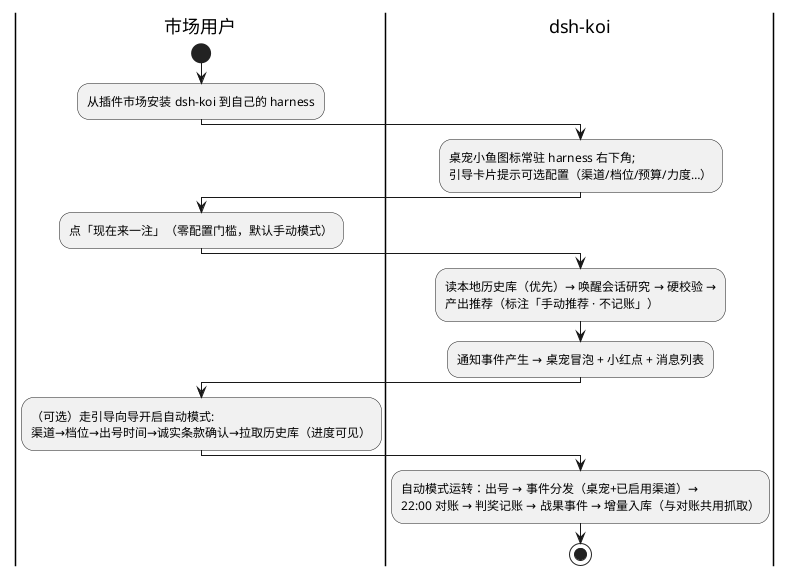

## §1 基本信息

### 1.1 项目背景

需求价值：dsh-koi 已完成 v1.1 上线（执行层闭环 + 修复包），但它是按「作者个人工具」设计的——QQ 私聊硬编码（`lib/push.mjs` 全文件、`lib/index.js:19,33-34,113-114`、`tools/koi.mjs:41,216-221`、`lib/scheduler.js:180,288`）、服务器专用（`lib/index.js:13`「桌面 Electron 版没适配」）、配置模板里留着作者 QQ 号残留（`lib/index.js:32-34`）。本需求集把插件改造为**市场就绪的自包含产品**：用户从插件市场下载后，装进自己的 harness（Windows 桌面 app 或自己的服务器）即可完整运行调度、数据、学习与桌宠 UI，与作者的服务器无关；通知渠道可插拔且凭证归用户；投注结构、角色阵容、token 预算、思考力度、输出详略全部可个性化配置。同时把学习闭环的「入库半环」（上传→摄入→卡片库）落地，为 M1 数据地基就绪后的回测引擎铺路。

需求描述：本需求集 = ①通知事件层与渠道适配器（桌宠内置渠道 + 扩展接口 + QQ 私有化剥离）②桌宠小组件（基础通知版）与桌面 profile 适配 ③每彩种运行模式三态（关/手动/自动，市场默认手动）与自动模式门控 ④配置面板个性化（渠道凭证/角色数量/预算权重/力度/详略/投注档位）⑤投注结构档位制与策略推荐 advisory ⑥学习入库半环（上传/摄入/卡片库/期望管理文案）⑦数据自给架构（官方自拉底座 + 增量挂对账 + 校验公共化）。它**不是**重写执行层——v1 冻结区 FZ-1~6 与全部既有测试保持零回退；也**不是**预测能力承诺——诚实条款贯穿，新增文案零概率宣称；也**不是**人设体系扩展——R9 人设预设已撤销，现有 `persona` 自由文本字段原样保留、零新增。

**RR 来源**：docs/14（2026-10-24 与主人逐条讨论的完整材料：12 项需求 + 19 项拍板 + 锁定项 + 待办池）。全部拍板已落定，本 IR 不再设「待主人评审确认」事项；阶段A 发现的新歧义已按无人值守默认纪律定值并登记 docs/decisions/市场版-A-默认决策记录.md（MA-01~MA-15）。

### 1.2 结构化信息

|维度|内容|
|-|-|
|Who|市场用户（在自家 harness 上运行插件的 DSH 用户，桌面 app 或自有服务器，双 profile 完整支持）；作者（自有服务器实例 + 私有 qq 适配器 + 市场维护者）；系统角色：dsh-koi（自包含产品）、可选私有/社区适配器（qq.js 仅作者实例，社区适配器经扩展接口挂载）|
|When|随 harness 运行而 tick（桌面 profile 非 7×24，自动模式要求开奖时段 harness 在运行，补跑窗口至 19:50）；每晚 22:00 对账（自动模式）；事件触发的通知/上传/配置变更；首次开启自动模式的一次性数据自拉（15–30 分钟）|
|What|可插拔通知（事件层统一重试/补发/心跳）、桌宠小组件、每彩种三态模式与「现在来一注」永久基础层、个性化配置面板、投注档位与策略建议、学习入库半环、数据自给与校验|
|Why|插件市场化：用户不愿交出 QQ/作者流量不可被共用/数据再分发有法律风险；同时产品化本身倒逼配置、文案、部署形态全面升级|
|Where|用户本地 harness（Windows 桌面 app 为主力形态，双 profile 支持）；无服务器依赖、无作者服务依赖|
|How Much|市场默认 token 周预算 150 万（用户自由调整，硬顶+降档链不变，作者实例延续 1000 万/周）；通知渠道 0 成本起步（桌宠内置）；数据自拉一次性约 430 请求、15–30 分钟|
|How|用户装完即用（默认手动，「现在来一注」零配置门槛）；一切个性化在面板配置（渠道凭证/角色/预算/力度/详略/档位），配置文件/CLI 等价；开自动走引导向导（四项门控）；QQ 不是必选项|

## §2 核心能力

### 2.1 场景分析

**主成功场景**（市场用户全旅程）

|编号|路径|类别|触发|步骤|
|-|-|-|-|-|
|S-101|主成功|业务|市场用户安装插件|桌宠图标出现在 harness 右下角 → 引导卡片提示配置 → 「现在来一注」立即可用（零配置门槛，市场新用户默认手动模式）|
|S-102|主成功|业务|用户开启自动模式|引导向导：通知渠道 → 投注档位 → 出号时间 → 诚实条款确认 → 拉取历史库（进度条，分钟级）→ 校验 → 下一期正式运转|
|S-103|主成功|业务|自动模式出号完成|通知事件产生 → 桌宠冒泡（+已启用渠道分发）→ 用户点开看号码（按详略档渲染）；全文在面板/档案|
|S-104|主成功|业务|22:00 对账|官方实时抓开奖 → 判奖记账 → 战果通知事件 → 桌宠冒泡 → 增量入库（与对账共用抓取）|
|S-105|主成功|业务|手动模式点「现在来一注」|抓近期开奖记录（读本地库优先）→ AI 参考学习 → 推荐号码（标注「手动推荐 · 不记账」，不对账不记账）|
|S-106|主成功|操作|用户调整角色阵容/预算/力度/详略/档位|配置面板编辑 → 实时成本估算 → 版本 stamp → 下一轮 tick 生效|
|S-107|主成功|业务|用户上传技巧文件|面板选择/拖入 → preprocessor 清洗 → 拆卡（语义去重）→ 卡片入库 → 状态可见；文案明示「结论可能证明技巧无效」|
|S-108|扩展|业务|用户查看「今日策略建议」|主持人输出结构偏好与理由（advisory，标「建议不记账」，判据预注册入档）→ 用户手动换档或不采纳；周报做「采纳建议 vs 默认档」对照（纯观测）|
|S-109|扩展|业务|作者实例运行|市场包 + 私有 qq.js 适配器 → QQ 私聊通知照旧；其余行为与市场版一致|
|S-110|异常|业务|全部启用渠道静默（自动模式对账日 22:30 判定时点，含桌宠在内的全部启用渠道对当日应有事件均无「已送达」记录）|心跳告警事件产生 → 落面板常驻红标（无渠道可达时的可见性兜底）+ 渠道恢复后补发并标注；「无事件产生」（出号/对账环节异常）与「有事件但送达全败」（渠道层异常=心跳语义）区分判定；仅在 harness 运行中实时判定，关机错过不补判、面板如实展示缺席；手动模式无定时承诺、不判定（MA-19）|
|S-111|异常|业务|官方数据源被拦/结构校验不过|探针报✗ + 拒用本期数据（绝不静默学习假数据）→ 重试/提示用户可选社区镜像（默认关闭项）|
|S-112|异常|业务|注册的渠道类型缺适配器文件|核心报清晰配置错误（不崩溃）：「渠道 X 的适配器缺失，请在渠道目录补入或停用」|
|S-113|异常|业务|配置值非法（预算为 0/档位越界/时间晚于开奖）|面板即时校验拒绝 + 说明；CLI/配置文件路径同样校验|
|S-114|异常|维护|桌面 harness 在开奖时段未运行|出号错过 → 补跑窗口（至 19:50）内开机则补跑；过线则按既有放弃+致歉语义（通知进桌宠）|
|S-115|备选|维护|用户从市场包升级|私有 qq.js 适配器与用户配置不受影响（目录隔离）；版本握手沿用 BC-010 精神|
|S-116|异常|业务|自动模式开启门控不满足（渠道未配/档位未选/时间未设/诚实条款未勾选任一）|向导阻止开启，逐项指明缺项并指引补齐；四项全满足方可开启（拍板16）|
|S-117|异常|操作|用户 DSH 未配置模型时点「现在来一注」/触发学习|报清晰配置错误并指引配置宿主模型（LLM 流量走用户 DSH 配置，拍板1）；自动模式按既有出号失败重试/致歉语义处理，不静默|
|S-118|异常|操作|上传文件格式不支持/超过大小限制|拒收并说明原因（支持的格式与上限明示），不进入摄入流水线|
|S-119|异常|业务|摄入流水线 LLM 环节失败（拆卡/判重不可用）|任务状态标「待补」并面板可见，恢复后自动重试；绝不静默丢弃文件、绝不静默重复入库|
|S-120|异常|业务|市场预算触顶（默认 150 万/周）|继承 BC-013 降档链：70%/90% 预警 → 逐级降档 → 兜底档收口 + 复盘/学习暂停；降档与触顶事件经事件层告知；自然周重置自动恢复|
|S-121|异常|维护|桌面 harness 跨天关机（错过对账）|重启后按 carry 语义补对账全部未结清条目（FR-006 继承在桌面 profile 的落点）；错过出号的当期按放弃+致歉语义入档|
|S-122|备选|业务|用户启用社区镜像（官方源持续受阻）|镜像默认关闭；启用须显式知情确认 → 从镜像拉取并标注数据来源；官方源恢复后回归官方直拉|
|S-123|备选|操作|用户整体关闭桌宠|通知事件仍分发至其他已启用渠道；再启用后冒泡恢复；无任何可用渠道时：事件状态面板可见（失败原因+队列），心跳按 S-110 口径触发并落面板常驻红标（可见性兜底不依赖任何渠道）|
|S-124|备选|维护|用户自建服务器部署（追求全天候）|与桌面同构安装（服务器 profile）；自动模式全天候运行；运行前提告知文案不再适用|
|S-125|备选|维护|作者实例从 v1.1 现网升级到市场包|市场包配置 schema 为新起点，按 docs/10 §6 规则3 破坏性变更流程执行（版本 minor+1 + 迁移命令）：既有 QQ 推送字段（push.target/napcatHttp 等）一次性迁入私有适配器自有配置；三 JSON 数据文件仍严格只加不改不删（DC-009 不豁免数据文件）；作者实例既有运行语义（自动模式、账本、档案）保持，不重置为市场默认 manual（MA-21）|

### 2.2 业务规则（增量；**继承 docs/12 BC-001~016 全部**，市场版最吃重的继承项：BC-001 诚实条款、BC-005 兜底透明、BC-006 账本唯一口径、BC-013 成本硬顶与降档链、BC-015 白名单纪律）

|编号|描述|原因|影响范围|
|-|-|-|-|
|BC-101|零内嵌凭证：插件代码与配置模板不含作者任何**功能运行凭证**（key/账号/通知渠道凭证，含 `index.js:32-34` 配置模板、`scheduler.js:180` 与 `koi.mjs:41` 代码内默认值）；LLM 调用一律走用户自己 DSH 的模型配置（插件层不做专属 key 覆盖，留接口属设计阶段）。**豁免边界（MA-18）**：捐献素材（FR-1021 收款码/文案）属用户可见、明示作者身份、与功能运行零挂钩、零外联（静态内嵌、不发起网络请求拉取）的展示内容，不属「功能凭证」，不在禁嵌范围|市场化的信任根基；作者流量隔离；R5 拍板与原则1 的字面张力以「功能凭证 vs 展示内容」划界|打包产物、配置模板、面板文案、LLM 调用路径、捐献入口|
|BC-102|通知事件层唯一：所有出站通知（预测/战果/致歉/告警/建议）先成为结构化事件，FR-005 统一重试/补发语义在事件层实现一次，渠道适配器只做传输；心跳泛化为「全部启用渠道均静默 = 异常」（仅自动模式生效）|FR-005 语义跨渠道复用；渠道增删不改业务|事件层、全部渠道适配器、调度器推送路径|
|BC-103|市场包零 QQ：市场发布的包物理不含 qq 适配器文件与 QQ 配置字段（push.target/napcatHttp 等）；QQ 仅以私有适配器形态存在于作者实例。剥离范围：推送通道、配置字段、deps 探针、面板文案、心跳措辞（代码现状证据：`push.mjs`、`index.js:19,113`、`koi.mjs:216-221`、`client.js:135,167`、`package.json` 描述）。QQ 私聊聊天属宿主 onebot 插件职责，不在 koi 市场版依赖内|主人拍板（R13）；「不交出 QQ」的用户信任|打包清单、配置 schema、deps/体检、面板与全部文案|
|BC-104|数据源白名单铁律：官方数据仅来自福彩官网（cwl.gov.cn）与体彩 webapi（webapi.sporttery.cn）两个官方一手源（代码现状即此二源：`fetch-draws.mjs:61,75`），永不接第三方彩票站；结构校验闸（期号格式 DC-006/日期合理性/号码值域/连续性）不过关即拒用。社区镜像属 BC-105 管辖的加速例外（同源数据再分发、默认关闭、知情选择、经同一校验、标注来源），不属本条「第三方彩票站」禁止范围（MA-28）|假数据防御；法律风险最小化（作者不分发数据）|数据抓取层、校验层、社区镜像开关|
|BC-105|数据自给：默认架构 = 用户官方自拉底座 + 增量挂 22:00 对账（零独立抓取）；任何「作者侧数据分发」（CDN 仓库/镜像）只能是默认关闭、用户知情选择的加速项；抓过即入本地库，**学习永不重复依赖网络**|法律风险归属清晰；R8 拍板15 改判；离线确定性|数据底座、增量同步、学习流水线、镜像开关|
|BC-106|角色围栏（FZ-7）：用户可配置角色数量与任务提示词，但硬校验、随机基线、归因代码化、推送契约、兜底标注在角色之外结构锁定，任何自定义提示词不可触及|防止用户配置侵蚀产品纪律|角色配置、编排器、配置面板|
|BC-107|成本透明：任何影响 token 消耗的配置（角色/预算/力度/详略）必须在配置页实时显示估算成本；力度与档位 stamp 进预测档案|用户自己的 key 自己做主；归因可分段|配置面板、预测档案、事件文案|
|BC-108|输出合规字段恒在：简洁/叨逼叨两档均保留兜底/加餐/补发/基线缺失标注与诚实基调句；叨逼叨摘要 ≤100 字（主持人输出 schema 的结构化 summary 字段，非事后删减）；详略为全局单档，不按渠道/彩种分档（拍板18）|详略是风格不是豁免|推送渲染、主持人输出 schema、事件文案|
|BC-109|策略建议不越权：「今日最佳策略」只能是 advisory（标注、不记账、不自动改正式结构）；判据预注册入档案（活跃因子战绩引用 + 号码集大小/成本权衡 + 推荐战绩观测），周报「采纳建议 vs 默认档」对照纯观测；措辞零概率宣称|BC-001 在新功能上的落点|策略推荐路径、周报、推送文案|
|BC-110|桌面运行如实告知：自动模式要求开奖时段 harness 处于运行状态——此约束必须出现在开启引导，不得以任何文案暗示「后台永远在跑」；补跑窗口（至 19:50）兜底一部分、关机/睡眠则错过的事实一并明示；想要全天候可自建服务器部署|桌面 harness 非 7×24 的物理事实；反虚假宣传|自动模式引导向导、产品文档、面板提示|
|BC-111|每彩种运行模式三态：关（现状语义）/手动（咨询语义：推荐不对账不记账）/自动（完整流水线：出号+对账+记账+全渠道通知）；「现在来一注」为永久基础层（加餐语义，任何模式下永不记账，自动模式下依然可用）；自动模式为可选加挂层，开启必须四项门控全满足；市场新用户默认手动|R8+R11 锁定项；市场用户零门槛起步|模式状态机、调度器、账本口径、引导向导|
|BC-112|学习期望诚实：上传/摄入/学习/推荐相关的一切文案必须明示「学习 = 严格回测检验，结论可能证明技巧无效」；力度旋钮配置页明示「影响分析质量与 token 成本，不影响中奖概率」；任何新增功能文案永不宣称改变中奖概率|BC-001 在市场版新功能（学习半环/力度/阵容）的统一落点（R2 拍板6、R7）|上传/摄入/结论页文案、配置面板、推送文案|
|BC-113|档位制不改记账口径：ledger 按当期实际投注结构记账（投入=档位价格×注数口径随档位走）；换档下期生效、账本按实际结构记；随机基线与当期正式预测同投注结构同注数对照（DC-002 继承）不因档位制改变；「只买每期正式预测」的唯一记分口径（BC-006）不变|R4 投注结构档位制的诚实落点|投注档位、判奖/基线同构、账本、周报对照|

### 2.3 数据约束（增量；docs/12 DC-001~013 继续有效）

|编号|类别|逻辑名称|描述|
|-|-|-|-|
|DC-101|实体|渠道配置|type（qq/panel/webhook/社区自定义…——webhook 为 schema 预留位，本轮不交付）、enabled、per-channel 凭证字段（schema 由适配器声明）；存放于用户本地配置；面板与日志展示一律脱敏|
|DC-102|实体|通知事件|kind（预测/战果/致歉/告警/建议）、级别、时效线（FR-005 分类终止线）、正文（按详略档渲染）、状态（待发/重试/已送达/补发队列/失败可见）；事件层持久化，语义对齐 FR-005；生命周期（MA-24 定值，均可配）：持久化保留 90 天滚动清理，桌宠近期消息列表窗口 = 最近 200 条事件；清理只作用于事件层，预测/战果正文全文永久在档案与面板详情，不受清理影响（NFR-104 常量级开销由此有界化）|
|DC-103|实体|角色配置|角色类型（数据官/策略师/质询者/主持人）、实例数、任务提示词、版本号；策略师可克隆；版本 stamp 进预测档案（FR-021 继承）|
|DC-104|值域|预算与权重|周度总预算（市场默认 1,500,000；作者实例延续 10,000,000，拍板12）；类别分项（出号/博弈/复盘/学习）；每角色权重（默认 1.0）与绝对值覆盖高级项（注入上限默认 4000、单角色调用上限）；判定沿用 DC-011 周度口径与降档链|
|DC-105|值域|力度档|枚举：follow-host（出厂默认，拍板14）/economy/standard/turbo；映射规则（参数直传或推理轮数/互评深度杠杆，同一模型不换型——Q7 拍板保持）随模型能力探测；档位 stamp 进预测档案|
|DC-106|值域|投注结构档|每彩种合法结构档表（含注数与每期价格），档位 = 用户配置；初始档集须覆盖 docs/14 R4 示例（排列三单式×1/×3/×5、双色球红7+蓝1/红8+蓝1/红9+蓝2、大乐透前6+后2/前7+后2/前8+后3），可扩展为 FZ-1 判奖引擎支持的任意合法结构；基线自动同构（DC-002 继承）|
|DC-107|值域|输出详略档|枚举：concise/chatty；全局单档（不分渠道不分彩种，拍板18）；作用于推送渲染，不影响面板全文与档案全文（DC-001 继承）|
|DC-108|实体|技巧卡片|沿用 docs/12 DC-003（含信任级：用户上传文件默认「中」，拍板7）+ preprocessor 清洗标记（是否剥图/OCR 去噪/断行修复）与入库状态（含「待补」态，S-119）|
|DC-109|值域|数据底座状态|每彩种：全量回填进度、最新期号、连续性校验结果、最后校验时间、（启用时）镜像来源标注；探针判据沿用 FR-008（>7 天 ✗）|
|DC-110|值域|运行模式与门控状态|每彩种 mode ∈ {off, manual, auto}（市场默认 manual）；自动模式门控四项状态（渠道≥1 可用/档位已选/出号时间已设/诚实条款确认勾选）+ 引导完成标志；每彩种出号时间（默认 17:30，配置校验须早于该彩种开奖时刻）；时间窗参数继承 v1 语义（predictAt/catchUpEnd 19:50/settleAt 22:00/settleGiveUp 23:30）按彩种参数化|

## §3 需求列表（编号 FR-1001 起；继承的 FR-001~054 语义继续有效）

### 3.1 功能性需求

|编号|类别|名称|描述|优先级|
|-|-|-|-|-|
|FR-1001|渠道层|通知事件层|结构化事件 + 统一重试/补发/心跳（FR-005 语义下沉：间隔 5 分钟、分类终止线、超线转补发队列并标注）；心跳判定口径（MA-19 操作化）：自动模式对账日 22:30 时点，当日应有事件（预测/战果/致歉/告警）在全部启用渠道（含桌宠送达状态）均无「已送达」记录 → 心跳告警；「无事件产生」（出号/对账环节异常，走面板 lastError）与「有事件但送达全败」（渠道层异常=心跳语义）区分判定；心跳告警在无渠道可达时落面板常驻红标（可见性兜底），渠道恢复后补发并标注；仅在 harness 运行中实时判定，关机错过不补判、面板如实展示缺席；手动模式无定时承诺、不判定。加餐显式例外继承：「现在来一注」推送失败不重试、号在面板展示（FR-005 例外，v1 语义）；事件持久化与面板可见（失败原因、队列状态）|P0|
|FR-1002|桌宠|桌宠渠道（基础通知版）|harness 右下角常驻小鱼（可整体关闭，关闭不影响其他渠道）；事件冒泡 + 红点 + 点击展开近期消息列表；消息源 = 通知事件层；浏览器/桌面系统通知为可选增强（授权后，拒绝授权不降级主功能）；具体前端挂载机制（DSH slots/浮层）由 design 阶段 Gemba 定|P0|
|FR-1003|渠道层|适配器扩展接口|渠道适配器契约：声明 type/配置 schema/send(event)；核心从渠道目录发现加载（内置+用户放入均可，作者 qq.js 即以此方式挂载）；按市场多租户标准一步到位（拍板3：配置与凭证完全用户侧）；当注册的渠道类型缺适配器文件时，系统应报清晰配置错误且不崩溃（S-112）|P0|
|FR-1004|渠道层|QQ 私有化剥离|市场包物理不含 qq 适配器与 QQ 配置字段（push.target/napcatHttp 等）；作者实例以私有适配器补丁运行（单包发布+补丁，拍板19）；deps 探针、面板文案、心跳措辞全面去 QQ 化（现状耦合点：`push.mjs`、`index.js:19,113`、`koi.mjs:41,216-221`、`client.js:135,167`、`package.json` 描述）；QQ 私聊聊天属宿主 onebot，市场版无此依赖。**作者实例升级迁移（S-125，MA-21）**：配置 schema 的 QQ 字段剥离按 docs/10 §6 规则3 破坏性变更流程执行（版本 minor+1 + 一次性迁移命令：QQ 字段迁私有适配器配置）；三 JSON 数据文件不受豁免、仍只加不改不删；作者实例既有运行语义（自动模式等）保持，不重置市场默认值|P0|
|FR-1005|渠道层|渠道凭证管理|每渠道 schema 声明凭证字段；存用户本地配置文件（拍板2），面板一律脱敏、日志零明文（NFR-106）；每渠道独立「测试」按钮；渠道≥1 可用为自动模式引导第一步门控|P0|
|FR-1006|配置|角色数量配置|数据官/策略师×N/质询者/主持人四类框架内数量可配、策略师可克隆（R3 锁定）；与降档链联动（用户档位=其配置阵容的满配）；配置页实时成本估算；配置版本化 stamp 进档案|P0|
|FR-1007|配置|角色任务提示词配置（编辑器+版本化+回滚）|随 M3 编排器交付；本轮仅交付 schema 与版本 stamp 接缝（R3 拍板）；受 FZ-7 围栏约束（BC-106）|P1|
|FR-1008|配置|每角色 token 分配|三层模型（周度总预算硬顶 → 活动类别分项 → 博弈类内每角色权重）+ 绝对值覆盖高级项（注入上限默认 4000、单角色调用上限）；70%/90% 预警线不变；市场默认 150 万/周、作者实例 1000 万/周；判定沿用周度口径与降档链（DC-011/BC-013 继承）；入口 = 面板为主 + 配置文件/CLI 等价|P0|
|FR-1009|配置|力度四档旋钮|follow-host（出厂）/economy/standard/turbo 统一四档（拍板13）；映射 = 模型能力探测：支持思考强度参数的模型直传参数；不支持的模型（如 DeepSeek chat）映射到推理轮数/互评深度等可用杠杆（同一模型不换型，Q7 拍板保持）——**每类模型至少一种可用杠杆使四档产生可观测的行为与成本差异**，具体映射手段属设计阶段（MA-16：v1.0.0 的「本轮先交付参数直传」收窄已撤销）；当部署形态下确无可用杠杆时，配置页必须如实显示「当前形态力度不生效」，不得宣称力度影响分析质量；档位 stamp 进每期档案；配置页明示「力度影响分析质量与 token 成本，不影响中奖概率」（前半句仅在有力杆生效时如实展示）|P0|
|FR-1010|配置|输出详略两档|concise（只号码+强制合规字段）/chatty（号码+≤100 字思考摘要，主持人输出 schema 的结构化 summary 字段，非事后删减）；合规字段恒在（BC-108）；「完整分析全文推送」取消——全文在面板（点开看）+ 档案（永久）；全局单档（拍板17/18）|P0|
|FR-1011|投注与策略|投注结构档位制|每彩种档位表（含注数与每期价格）+ 用户选档；换档下期生效，账本按实际结构记（BC-113）；判奖引擎（FZ-1，本就支持任意合法复式）与基线同构（DC-002）现成支持——FZ-1 不动，仅消费其通用性|P0|
|FR-1012|投注与策略|今日策略建议（advisory）|默认开启、推送/面板展示、标「建议不记账」、永不自动改变正式预测结构；「最好」= 预注册的结构性判据（拍板10：活跃因子战绩引用 + 号码集大小/成本权衡 + 推荐战绩观测），理由全文入档案；周报做「采纳建议 vs 默认档」对照（纯观测）；本轮交付单 agent 路径（判据计算与建议生成不走多角色编排），多角色深度判据随 M3 演进；面板可关；**战绩观测口径边界（MA-26）**：本条「推荐战绩观测」仅覆盖自动模式档位建议，不含手动层「现在来一注」（手动号是用户行为、非策略建议）|P1|
|FR-1013|学习|上传入口|面板上传/拖入为主 + 三个顺手入口（拍板4：QQ 扔文件/服务器目录投喂/CLI——QQ 扔文件仅存在于启用 QQ 宿主通道的部署形态，目录投喂面向服务器 profile，CLI 全形态）；格式 PDF/EPUB/TXT/MD（含强转 MD）；大小与格式校验（S-118 拒收并说明）|P1|
|FR-1014|学习|摄入与卡片库|preprocessor 清洗（剥图/OCR 噪声/断行修复，拍板 P3）→ 拆卡（语义去重）→ 入库（信任级默认「中」，拍板7）→ 状态页（含失败「待补」态）；jobs 队列 + 错峰守卫沿用（BC-012 继承）；回测引擎不在本轮（依赖 M1，第二波）|P1|
|FR-1015|合规文案|期望管理文案|上传页/结论页/学习相关推送的诚实文案规范：「学习 = 严格回测检验，结论可能证明技巧无效」（拍板6）+ 零概率宣称（BC-112）|P0|
|FR-1016|数据|数据自拉底座|首次开启自动模式：官方两源分批自拉（约 430 请求、15–30 分钟，分批错峰、断点续传、进度可见）+ 增量挂 22:00 对账（零独立抓取）+ 校验后入库；底座状态可查（DC-109）；抓过即入本地库，学习永不重复依赖网络（BC-105）。**依赖联动（MA-17）**：本条为 FR-1023 自动模式冷启动（S-102 向导第 5 步）的前置；若 C 阶段按 docs/14 §六「视容量」将本条移交第二波，自动模式的冷启动数据路径（替代方案或自动模式一并延后）必须由 C 一并裁决，不得留下悬空依赖|P0|
|FR-1017|数据|数据校验公共层|期号格式（DC-006）/日期合理性/号码值域/连续性（docs/14 R8 校验清单四项）+ 新鲜度探针沿用 >7 天判据（FR-008）；不过关即拒用（BC-104）；校验逻辑公共化（自拉底座、增量同步与手动按需抓取三方共用）。跨源交叉比对非本轮验收项——代码事实为同彩种仅单一官方源（`fetch-draws.mjs:61` 福彩管 ssq、`:75` 体彩管 dlt/p3），无从交叉；design 阶段可另行评估「同源多接口一致性检查」作为增强（MA-23）|P0|
|FR-1018|数据|可选社区镜像（默认关闭）|官方源受阻时用户可知情选择从作者仓库拉取；默认 off，启用须显式确认（S-122）；镜像数据经同一校验层并标注来源；官方源恢复后回归直拉|P2|
|FR-1019|桌面与打包|桌面 profile 适配|调度器进用户 harness 的 Node 进程、数据落用户本地 ~/.dsh/koi、通知走渠道层、模型用用户 DSH 配置；**显式废除 v1 NFR-009「桌面 Electron 不适配」**（现状证据 `index.js:13`）；进程内 tick、休眠/关机补跑与 carry 语义如 S-114/S-121；运行前提如实告知（BC-110）|P0|
|FR-1020|配置|配置面板信息架构|渠道凭证/角色数量/预算权重/力度/详略/投注档位六大区 + 实时成本估算 + 即时校验提示；配置文件/CLI 等价路径（同一份配置与校验规则）；非法值即时拒绝（S-113）|P0|
|FR-1021|合规文案|作者捐献入口|面板「彩票」卡片底部一行小字 + 折叠收款码；纯自愿、与功能零挂钩、不进推送、零外联、静态不做定时提醒；素材（收款码/链接）与文案（A/B/C）待办池（B1/B2）|P2|
|FR-1022|配置|LLM 配置继承|LLM 流量一律走用户自己 DSH 的模型配置（拍板1），插件层不提供专属 key 覆盖入口（接口预留属设计阶段）；当用户宿主未配置模型时，系统应报清晰配置错误并指引，不产生意义不明的失败（S-117）|P0|
|FR-1023|运行模式|每彩种运行模式三态与门控|每彩种关/手动/自动三态（BC-111）；市场新用户默认手动；手动 = 咨询语义（不对账不记账，推荐标注「手动推荐 · 不记账」）；「现在来一注」= 永久基础层（任何模式可用、永不记账）；自动模式开启走引导向导且必选项门控（拍板16：通知渠道≥1 可用 + 投注档位已选 + 出号时间已设 + 诚实条款确认勾选，任一缺失即阻止并指引，S-116）；每彩种独立出号时间（默认 17:30，校验早于该彩种开奖）；时间窗与重试/放弃/致歉语义继承 v1（DC-110）。表述统一（MA-27）：R8「harness 弹窗」与 R14「桌宠冒泡消息卡」为同一机制——出号分析完成事件经事件层由桌宠渠道渲染为冒泡消息卡，非两套独立交互。手动推荐留痕（MA-26）：手动号入预测档案（继承 docs/12 FR-052 加餐入档：加餐类别、剔出账本与 KPI 口径），面板可查历史手动号与开奖对照（纯观测、不产生主动对账通知）|P0|
|FR-1024|数据|手动模式按需数据获取|手动「现在来一注」时读本地库，不足或为空则按需从官方两源抓近期开奖（范围沿用 v1 出号所需近期窗口语义：historyCount 默认 30 期，`scheduler.js:183,228` 现状即此行为），经 FR-1017 同一校验后入本地库（「抓过即入本地库」适用，二次请求命中本地库不再发网络请求）；失败报清晰错误并可重试（S-117）。口径调和（MA-20）：BC-105「增量零独立抓取」约束的是自动模式增量同步；本条手动按需抓取是其显式例外，不构成对 BC-105 的违反|P0|

### 3.2 非功能性需求

|编号|类别|名称|描述|优先级|
|-|-|-|-|-|
|NFR-101|兼容性|双 profile 支持|web 与 desktop profile 均完整运行（调度/数据/学习/桌宠 UI）；安装-首用零 QQ 依赖（装完即用，默认手动）|P0|
|NFR-102|可交付性|市场包卫生|包内无作者凭证、无 qq 适配器、无作者 QQ 默认值与文案残留（代码现状证据：`index.js:32-34` 模板、`scheduler.js:180`、`koi.mjs:41` 默认值、`client.js:135,167` 文案、`package.json:4` 描述）；自动化扫描检查纳入验收（AC-102）|P0|
|NFR-103|可靠性|既有语义零回退|v1.1 全部测试零回退（基线：2026-10-24 本会话实测 `node --test "plugins/dsh-koi/tests/*.test.mjs"` 58 pass / 0 fail）；冻结区 FZ-1~6 与新增 FZ-7 语义不破；FR-005 语义在事件层等价重现|P0|
|NFR-104|性能|常量级开销|桌宠轮询/事件处理为常量级开销（不随历史数据量增长）；配置变更下一轮 tick 生效（30s 级，v1 tick 语义）；数据自拉不阻塞出号路径（错峰分批）|P1|
|NFR-105|兼容性|升级保留|用户升级（市场包覆盖安装）保留私有适配器与用户配置/数据（S-115，目录隔离）；schema 演进遵循 DC-009 只加不改不删|P1|
|NFR-106|安全性|凭证零明文|日志、错误信息、事件正文、面板任何位置不出现渠道凭证明文；凭证展示一律脱敏（FR-1005 的推广，含 CLI 输出与测试按钮回显）|P0|

## §4 验收方案

### 4.1 验收准则

|编号|关联能力|维度|描述|验收标准|
|-|-|-|-|-|
|AC-101|FR-1001/1002（S-103/110/123）|功能|事件层语义等价性（以 FR-005 参数集为准：5 分钟间隔、分类终止线、超线转补发队列并标注）+ 桌宠冒泡/红点/列表；心跳判定口径（S-110 操作化）；桌宠整体关闭后事件仍达其他渠道|制造渠道故障与恢复：重试/补发/标注与 v1.1 行为等价；心跳两侧断言成立——①「有事件但送达全败」（含桌宠）触发心跳告警且落面板常驻红标、渠道恢复后补发并标注；②手动模式不触发；③「无事件产生」走面板 lastError 而非心跳；桌宠三交互（冒泡/红点/列表）逐项可见|
|AC-102|FR-1003/1004、NFR-102（S-112/115）|可交付性|市场包自动化扫描零 QQ 痕迹（文件名/配置字段/文案/代码内默认值/包描述）；注册缺适配器文件的渠道 → 清晰配置错误不崩溃；模拟私有适配器（放入渠道目录）可被发现加载并经 mock 端点送达|扫描命令零命中；缺适配器报错含渠道标识与补入/停用指引；mock 适配器 test 事件送达成功|
|AC-103|FR-1005、DC-101（S-102/116）|安全|凭证脱敏展示 + 每渠道独立测试按钮 + 引导向导第一步（渠道≥1）门控|面板/日志/CLI 回显均无明文凭证；测试按钮逐渠道可用且结果可见；零渠道可用时自动模式开启被阻止|
|AC-104|FR-1008/1009（S-106/120）|功能|预算/权重变更 → 每角色额度换算与成本估算实时正确；力度档 stamp 进档案；力度映射完整性与如实显示（MA-16）；触顶降档演练（临时调低硬顶）|换算与估算数值正确（抽查对照手算）；档案含力度档字段；对无思考参数的 mock 模型：四档存在可观测行为/成本差异，或配置页如实显示「当前形态力度不生效」（二者必居其一，不得既无差异又宣称影响质量）；70%/90% 预警与降档事件按 BC-013 链路触发并经事件层告知|
|AC-105|FR-1010、BC-108（S-103）|功能|两档输出断言：concise 只含号码+合规字段；chatty 含 ≤100 字结构化 summary；合规字段（兜底/加餐/补发/基线缺失标注+诚实基调句）两档恒在；推送全文不含完整分析（全文仅面板+档案）|逐档断言长度与字段集合；summary 长度 ≤100 字；构造兜底/补发场景后合规字段在两档均出现|
|AC-106|FR-1011、BC-113（S-106）|功能|各档位判奖正确（复用 FZ-1 判奖引擎 + 新增档位用例覆盖初始档集示例档）；基线同构（同结构同注数）；换档下期生效；账本按实际结构记投入|新增档位判奖用例全绿（与官方规则一致）；基线与预测同构断言；换档当期账目仍按旧档、下期按新档|
|AC-107|FR-1013/1014/1015（S-107/118/119）|功能|四格式上传 → 清洗 → 拆卡（语义去重）→ 入库 → 状态可见；非法格式/超限拒收并说明；摄入 LLM 失败 → 「待补」态可见、恢复后自动重试；期望管理文案正向断言（MA-25）|四格式（PDF/EPUB/TXT/MD）全部产出卡片或明确不可解析原因；重复样例零重复入库；拒收与待补状态面板可见；上传页与结论页均出现「学习 = 严格回测检验，结论可能证明技巧无效」原文或等价语义文案|
|AC-108|FR-1016/1017（S-102/111/122）|功能|自拉底座：断点续传（中途终止后重启续拉）+ 进度可见 + 校验层拒用假数据（注入期号断档/值域越界/日期异常样例）；镜像默认关闭、启用需显式确认且数据带来源标注|续传不重复不遗漏（请求计数核对）；注入的每类假数据被拒用且有记录；镜像开启路径两侧断言成立|
|AC-109|FR-1019、BC-110（S-114/121/124）|功能|桌面 profile 冒烟：安装 → 桌宠出现 → 来一注（手动）→ 模拟出号窗口错过与补跑；自动模式引导含运行前提如实告知文案|桌面安装后零 QQ 依赖可用；补跑窗口内补跑成功、过线按放弃+致歉；引导文案含「开奖时段需 harness 运行」表述（无「后台永远在跑」暗示）|
|AC-110|FR-1023、BC-111、DC-110（S-101/105/113/116）|功能|三态模式与门控：新装默认手动；门控四项逐项构造缺失 → 开启被拒并指明缺项；手动推荐标注「不记账」且账本零新增；「现在来一注」在自动模式下可用且不入账本；出号时间晚于该彩种开奖时刻被校验拒绝|五项断言逐项成立；账本在手动操作后条目数不变|
|AC-111|FR-1012、BC-109/112（S-108）|功能|advisory：建议判据预注册入档案（判据内容先于建议产出落盘）；建议消息含「建议不记账」标注；周报含「采纳建议 vs 默认档」对照（纯观测）；建议与学习/力度相关文案零概率宣称|预注册时戳早于建议时戳；标注与对照齐备；文案抽查无「提高/增加中奖概率」类表述|
|AC-112|FR-1006、BC-106/FZ-7（S-106）|功能|角色围栏不可侵蚀：修改角色数量与自定义提示词后，硬校验/随机基线/归因代码化/推送契约/兜底标注行为不变；配置页实时成本估算随阵容变化|构造侵蚀性提示词样例（指示跳过校验/改动基线/改写归因）→ 产出路径行为与默认一致；成本估算数值随数量/权重变化正确|
|AC-113|FR-1022、NFR-106（S-117）|功能/安全|宿主未配置模型：手动/学习操作报清晰配置指引错误；自动模式按既有失败重试/致歉语义；凭证零明文扫描（日志/错误/事件正文/CLI）|错误信息含模型配置指引；日志与全输出扫描零凭证明文命中|
|AC-114|NFR-105、FR-1004/1018（S-115/122/125）|可靠性|市场包覆盖升级：用户配置/数据/私有适配器目录保留且功能续用（版本握手沿用 BC-010 精神）；社区镜像默认关闭状态在升级后保持；作者实例从 v1.1 升级（S-125）：QQ 字段一次性迁移、运行语义保持|市场用户：升级前后配置/数据/适配器文件 diff 为空（除版本号）、镜像开关状态不变；作者实例演练：迁移命令执行后 QQ 字段转入私有适配器配置并可正常推送、三 JSON 内容不受迁移影响（只加不改不删）、既有自动模式等运行语义不重置|
|AC-115|FR-1024、BC-105（S-105/117）|功能|手动模式按需数据获取：空库冷启动首点「现在来一注」→ 在线按需抓取 → 同一校验 → 入库 → 推荐产出；抓过即入库（二次请求零网络请求）；断网/源失败时清晰报错|冷启动：推荐正常产出且本地库新增近期开奖（范围=出号所需窗口）；二次请求网络计数=0；断网时按钮反馈清晰错误（含重试指引），面板历史展示不被阻断|

### 4.2 测试用例

|编号|关联准则|前置条件|操作步骤|预期结果（量化指标/判断条件）|
|-|-|-|-|-|
|TC-101|AC-101|渠道层就绪，桌宠可用，mock 渠道可注入故障|1) 触发一次预测事件；2) 对 mock 渠道注入故障至超终止线后恢复；3) 对账日后静默全部启用渠道至 22:30 后；4) 手动模式下同样静默；5) 关闭桌宠重复 1)|1) 桌宠冒泡+红点+列表逐项可见；2) 按 5 分钟间隔重试、超线转补发队列、恢复后补发并带补发标注；3) 心跳告警事件产生且可见；4) 无心跳告警；5) 事件仍达其余渠道|
|TC-102|AC-102|市场包构建产物|1) 运行包卫生扫描（qq 文件名/push.target 等字段/文案关键词/代码默认 QQ/包描述）；2) 注册一个缺适配器文件的渠道；3) 将 mock qq 型适配器放入渠道目录并发测试事件|1) 扫描零命中；2) 报「渠道 X 适配器缺失」类清晰错误，进程不崩溃；3) 适配器被发现加载，mock 端点收到事件|
|TC-103|AC-103|已配置 ≥1 渠道与凭证|1) 面板查看凭证字段；2) 逐渠道点「测试」；3) 清空全部渠道后尝试开启自动模式；4) 检查日志/CLI 回显|1) 展示为脱敏形态；2) 每渠道独立结果可见；3) 开启被阻止并指引配置渠道；4) 无明文凭证|
|TC-104|AC-104|预算/权重/力度配置可改；备无思考参数的 mock 模型|1) 修改总预算与某角色权重，观察额度换算与成本估算；2) 设力度档=turbo 后出一期；3) 切换至无思考参数 mock 模型遍历四档；4) 临时把硬顶调至当前已耗值|1) 换算数值与手算一致；2) 档案该期含力度档 stamp；3) 四档存在可观测行为/成本差异，或配置页如实显示「当前形态力度不生效」；4) 70%/90% 预警与降档事件按链路触发并经事件层告知|
|TC-105|AC-105|两档可切换，可构造兜底/补发场景|1) concise 档出一期；2) chatty 档出一期；3) 构造兜底号与补发场景各一期；4) 检查推送与面板/档案|1) 推送只含号码+合规字段；2) summary ≤100 字且为结构化字段；3) 两档合规标注均出现；4) 完整分析仅面板与档案可见，推送不含全文|
|TC-106|AC-106|档位表已含初始档集|1) 对每个示例档构造历史真实开奖的假想投注判奖；2) 出一期并核对基线结构；3) 换档后连续观察两期账目|1) 判奖与官方规则一致（用例全绿）；2) 基线与预测同结构同注数；3) 当期按旧档记、下期按新档记，投入随档位价格|
|TC-107|AC-107|四格式样例备齐（含重复样例、图片版 PDF、超大文件、不可解析样例）|1) 逐格式上传；2) 上传重复内容样例；3) 上传超限/非法文件；4) 注入摄入 LLM 故障后上传，再恢复；5) 检查上传页与结论页文案|1) 四格式产出卡片或明确不可解析原因，清洗标记入库；2) 重复卡片数=0；3) 拒收并说明原因；4) 状态「待补」可见，恢复后自动重试完成入库；5) 两页均含「学习 = 严格回测检验，结论可能证明技巧无效」原文或等价语义（正向断言）|
|TC-108|AC-108|数据源可 mock|1) 自拉中途终止进程后重启；2) 注入期号断档/值域越界/日期异常假数据各一批；3) 尝试直接启用镜像；4) 经显式确认启用镜像拉取|1) 断点续传完成且请求不重复；2) 各类假数据被拒用并留记录；3) 默认关闭、无法静默启用；4) 镜像数据过校验并带来源标注|
|TC-109|AC-109|Windows 桌面 harness 环境|1) 市场安装；2) 点「现在来一注」；3) 模拟开奖时段关机错过出号后在补跑窗口内重启；4) 走自动模式引导向导|1) 桌宠图标出现，全程零 QQ 依赖；2) 手动推荐返回并标注不记账；3) 补跑成功或过线按放弃+致歉；4) 引导含运行前提如实告知文案|
|TC-110|AC-110|新装市场包|1) 检查初始模式；2) 逐项构造门控缺失（无渠道/无档位/无时间/未勾选）尝试开启；3) 手动模式出一注后查账本；4) 自动模式下点「现在来一注」后查账本；5) 配置晚于开奖的出号时间|1) 三彩种均为 manual；2) 四种缺失均被阻止并指明缺项；3) 账本条目数不变且消息带「不记账」标注；4) 同 3；5) 校验拒绝并说明|
|TC-111|AC-111|advisory 功能开启|1) 触发一期建议并核对档案预注册记录；2) 查看建议消息与周报；3) 抽查建议/学习/力度相关文案|1) 判据落盘时戳早于建议产出时戳；2) 建议带「建议不记账」标注、周报含对照节；3) 无概率宣称类表述|
|TC-112|AC-112|角色配置可编辑|1) 增加策略师数量并调整权重，观察成本估算；2) 注入侵蚀性提示词（指示跳过硬校验/改基线/改归因）后出一期|1) 估算随阵容变化正确；2) 硬校验/基线/归因/推送契约/兜底标注行为与默认完全一致（围栏外无效应）|
|TC-113|AC-113|可清空宿主模型配置的测试环境|1) 无模型配置时点「现在来一注」；2) 无模型配置时上传文件触发摄入；3) 全量扫描日志/错误/事件正文/CLI 输出中的凭证关键词|1) 清晰配置指引错误（非静默/非无意义失败）；2) 同 1；3) 明文命中数=0|
|TC-114|AC-114|已配置用户数据/私有适配器的安装；备一套含 v1.1 QQ 配置的作者实例测试环境|1) 以新版市场包覆盖安装（市场用户路径）；2) 对比升级前后用户配置/数据/适配器目录；3) 升级后触发一次适配器渠道事件；4) 检查镜像开关状态；5) 作者实例路径：执行迁移命令后检查 QQ 字段去向、推送可用性、三 JSON 完整性与运行模式|1) 升级完成；2) 除版本号外 diff 为空；3) 私有适配器续用成功；4) 镜像保持默认关闭；5) QQ 字段已迁入私有适配器配置且推送正常、三 JSON 无删改、自动模式保持|
|TC-115|AC-115|全新空库环境（本地无任何开奖数据）；可断网的测试环境|1) 首点「现在来一注」并监视网络请求；2) 成功后再点一次并监视网络请求；3) 断网后再点一次|1) 在线按需抓取完成、经校验入库、推荐产出且标注「手动推荐 · 不记账」；2) 网络请求计数=0（本地库命中）；3) 清晰错误反馈与重试指引，面板不崩溃|

### 4.3 交付物定义

|交付物|描述|
|-|-|
|dsh-koi 市场包|市场发布产物：渠道层核心 + 桌宠基础版 + QQ 剥离打包 + 详略两档 + 配置面板六大区 + 档位制 + 三态模式与门控 + advisory 单 agent 路径（D 轮范围以 docs/17 确认书裁决为准，docs/14 §六 推荐不含学习半环/自拉底座的保底承诺）|
|私有 qq.js 适配器补丁|作者实例专用、不随市场包发布；经渠道扩展接口挂载|
|零残留配置模板|清理作者 QQ/napcat 默认值后的出厂配置（含渠道/模式/预算/档位/力度/详略默认值）|
|学习闭环与数据自拉底座|上传/摄入/卡片库 + 官方自拉底座（视 D 容量纳入，否则显式移交第二波——由 C 阶段裁决，不为凑数硬塞；**联动约束（MA-17）：自拉底座若移交第二波，FR-1023 自动模式冷启动处置必须由 C 一并裁决，不得悬空**）|
|自动模式引导向导与告知文案|四项门控流程 + 桌面运行前提如实告知 + 期望管理文案（FR-1015/BC-110/112）|
|市场包卫生自动化检查|NFR-102/AC-102 的扫描工具，纳入验收流水线|
|市场版用户文档|安装（双 profile）、渠道配置、模式说明、升级与数据保留说明|

## §5 附录

### 5.1 拍板与来源
全部 19 项拍板见 docs/14 §三（主人 2026-10-24 确认「全按推荐」）；锁定项见 docs/14 §四（R3/R8+R11/R14 + 五层防御沉淀待办池）；本 IR 不设待主人评审事项；阶段A 默认决策见 docs/decisions/市场版-A-默认决策记录.md（MA-01~MA-15）。

### 5.2 与既有文档的关系

|文档|角色|
|-|-|
|docs/14|本 IR 的 RR 来源（拍板权威）|
|docs/05–12|v1/v1.1 既有事实与需求基线（BC/DC/FR 编号与冻结区继续有效）|
|docs/11|**v1.1 与认知层（dsh-koi-mind）的设计权威，本阶段不动**；市场版设计权威归 docs/16；两文档冲突处以「继承 + 增量」表述（如 FR-005 重试语义在事件层重现、BC-013 降档链沿用仅默认预算值不同、NFR-009 被显式废除）|
|docs/13|上一轮实施方案确认书（历史轮次，不约束本轮）|
|docs/16（阶段B 产出）|市场版 SDD，以本 IR 为权威需求输入|
|docs/17（阶段C 产出）|市场版实施方案确认书（范围裁决）|
|本文档（docs/15）|本轮设计（docs/16）的权威需求输入|

### 5.3 继承关系一览（防设计阶段重新发明）

|继承对象|市场版处置|
|-|-|
|BC-001~016 / DC-001~013 / FR-001~054 / FZ-1~6（docs/12、docs/10）|全部继承有效；本 IR 仅做增量（BC-101~113 / DC-101~110 / FR-1001~1023 / FZ-7 角色围栏）|
|FR-005 推送重试|语义在事件层等价重现（FR-1001），参数集不变|
|BC-013 成本硬顶|链路不变；市场默认 150 万/周（作者实例 1000 万/周不变，拍板12）|
|NFR-009「桌面不适配」（docs/12）|**显式废除**（FR-1019），废除表述本身进需求以防回潮|
|BC-010 版本握手|精神沿用至市场包升级路径（S-115/AC-114）|
|BC-015 白名单纪律|从「学习站点白名单」扩展至「数据源白名单铁律」（BC-104）|
|NFR-001~010（docs/12）|**逐条处置（MA-22）**：NFR-001 送达率——按形态与运行态限定，仅对「开奖时段 harness 运行中」的期数计分（桌面关机错过不计分母，沿用 docs/12 NFR-001 通道故障期不计分母的豁免逻辑扩展），服务器 profile 维持全量口径；NFR-002 资源约束——作者服务器实例继续全量有效，市场用户机器不外推具体资源目标、错峰/互斥行为默认继承；NFR-003 token 预算——参数化继承（市场默认 150 万/周，拍板12）；NFR-004 故障隔离——继承；NFR-005 v2 DoD——属认知层验收、随 docs/11 体系走，不约束市场版 D 轮；NFR-006 攻击面——继承并扩展（渠道凭证面新增 NFR-106）；NFR-007 冻结区——继承（FZ-1~6 + FZ-7）；NFR-008「22:30 无私聊=异常」——措辞被 FR-1001 心跳泛化取代（「无私聊」→「全部启用渠道静默」）；NFR-009——显式废除（FR-1019）；NFR-010 流水线 25 分钟/查询 ≤100ms——自动模式出号链路继承，性能口径作参考值|

### 5.4 需求边界（本轮显式不做）

1. **R9 人设预设**：已撤销——`persona` 自由文本字段原样保留（v1 已有，零新增）；
2. **回测引擎**：依赖 M1 数据地基，第二波（学习闭环只做入库半环）；
3. **通用 webhook 适配器**：待办池第二波（DC-101 仅留 schema 预留位）；
4. **桌宠扩展特性**：换肤/停售倒计时/每日播报/奖级特效/接近度播报——待办池；
5. **养鱼自由模式（R12 变更）**：待办池；届时须过 BC-015 并与官方自拉底座对齐；
6. **捐献素材与文案**：待办池（B1 收款码/爱发电、B2 文案三选）——入口框架（FR-1021）先行；
7. **完整分析全文推送**：R10 取消——全文只在面板+档案；
8. **按渠道/彩种分档详略**：拍板18 全局一档，不做；
9. **交流模式五层防御**：设计沉淀至待办池（供养鱼模式复用），本轮不实施。

### 5.5 待办池
见 docs/14 §五（养鱼自由模式、桌宠扩展特性、webhook、捐献素材、M1+回测引擎）。

### 5.6 修订记录（v1.0.0，2026-10-24 阶段A 查漏补缺定稿）

> 本轮由需求分析阶段（aet-req-analysis，无人值守）对编排层初稿 v0.9.0 做系统性复查：Gemba 实读 dsh-koi 源码（QQ 耦合点逐处定位：`index.js:13,19,32-34,113-114`、`scheduler.js:180,288`、`koi.mjs:41,216-221`、`client.js:135,167`、`package.json:4`、`fetch-draws.mjs:61,75` 两官方源）与既有基线 docs/05/06/07/10/11/12 逐条比对；测试基线实测 `node --test "plugins/dsh-koi/tests/*.test.mjs"`（DSH runtime node）→ **58 pass / 0 fail**。技能模板经 `assemble-template.mjs req-analysis` 装配核对；sdd_advance 工具本环境不存在，评审环节按任务指示以一轮自查替代（结论登记于 docs/decisions/市场版-A-默认决策记录.md MA-01）。全部改动点：

**结构与模板符合性**

1. frontmatter：version v0.9.0 → v1.0.0、update_time 更新、draft_note → final_note（MA-15）。
2. §2.1 补 plantuml 主成功场景图（模板要求，v0.9.0 缺）（MA-02）。
3. BC 表补「影响范围」列、FR 表补「类别」列（模板符合性）（MA-04/07）。
4. §4 由单表扩为模板三节：4.1 验收准则（五列结构）、4.2 测试用例 TC-101~114（新增）、4.3 交付物定义（新增）（MA-13）。

**场景（§2.1）**

5. 新增 S-116 自动门控缺失被阻、S-117 宿主无模型配置清晰指引、S-118 上传非法文件拒收、S-119 摄入 LLM 失败待补重试、S-120 市场预算触顶降档、S-121 桌面跨天关机 carry 补对账、S-122 社区镜像知情启用、S-123 桌宠整体关闭备选、S-124 自建服务器全天候部署（共 9 个异常/备选路径）（MA-03）。
6. S-101/S-105 补「默认手动 / 不对账不记账」语义显式化；S-108 补判据预注册与周报对照；S-110 补手动模式不产生心跳告警的边界。

**业务规则（§2.2）**

7. 新增 BC-111（三态模式与永久基础层语义，R8+R11 锁定项）、BC-112（学习期望诚实，BC-001 在市场新功能的统一落点）、BC-113（档位制不改记账口径）（MA-05）。
8. BC-103 补剥离范围明细与 onebot 边界；BC-104 白名单落具体两官方域名（可判定化，代码佐证）；BC-105 补「抓过即入本地库，学习永不重复依赖网络」；BC-101 补拍板1「留接口属设计阶段」与代码残留点位。
9. §2.2 表头补继承声明（点名列出市场版最吃重的继承项）。

**数据约束（§2.3）**

10. 新增 DC-110（每彩种 mode 三态 + 门控四项状态 + 每彩种出号时间与时间窗参数化）（MA-06）。
11. DC-104 补作者实例 1000 万/周注记；DC-106 补初始档集示例（docs/14 R4）与「可扩展为 FZ-1 支持的任意合法结构」；DC-107 补全局单档（拍板18）；DC-108 补「待补」态；DC-101 补 webhook 为 schema 预留位说明。

**功能/非功能需求（§3）**

12. 新增 FR-1022（LLM 配置继承，拍板1 落点 + S-117）、FR-1023（每彩种运行模式三态与门控，R8+R11 锁定项在 v0.9.0 FR 表缺位——本轮最重要查漏）（MA-10/11）。
13. FR-1006/FR-1009 优先级 P1 → P0（与 FR-1020 P0 六大区含角色/力度配置自洽）；FR-1012 P2 → P1（对齐 docs/14 §六 C 阶段推荐：advisory 单 agent 路径纳入 P0 执行层包）（MA-08/09）。
14. FR-1001 心跳限定自动模式；FR-1004 补剥离明细与代码证据、onebot 边界；FR-1013 补三辅助入口按部署形态可用注记；FR-1009 补轮数杠杆随编排器演进注记；FR-1012 补「本轮单 agent 路径」范围句。
15. 新增 NFR-106（凭证零明文）；NFR-102 补代码证据点位与自动化扫描落点；NFR-103 基线定值 58 例（本会话实测）（MA-12）。

**验收方案（§4）**

16. AC-101~109 全部改写为五列可执行结构（关联能力/维度/描述/验收标准），断言具体化（心跳两侧断言、summary ≤100 字、预注册时戳先后、diff 为空等）。
17. 新增 AC-110（三态与门控）、AC-111（advisory 预注册+对照+零概率宣称）、AC-112（FZ-7 围栏侵蚀尝试）、AC-113（LLM 未配置指引+凭证零明文）、AC-114（升级保留+镜像默认关闭）。
18. 新增 TC-101~114，逐 AC 对应，含负向测试（非法文件/侵蚀提示词/假数据注入/缺适配器/无模型配置）。

**附录（§5）**

19. §5.2 补 docs/16/17 链条与 docs/11 权威分工的「继承+增量」示例；新增 §5.3 继承关系一览（含 NFR-009 显式废除防回潮）；新增 §5.4 需求边界九条（R9 撤销、全文推送取消等显式落纸）。
20. 占位符核查：全文无 `[[PH:...]]` 未定值占位符——所有数值均有来源（docs/14 拍板 / docs/12 继承 / 代码实测行号），无需默认定值项。

### 5.7 修订记录（v1.0.1，2026-10-24 独立产品经理复核处置）

> 独立产品经理复核对 v1.0.0 提出 13 条意见（medium 7 / low 6），逐条核实后 **13 条全部采纳**；逐条处置登记于 `docs/decisions/市场版-A-默认决策记录.md`「独立产品经理复核处置」节（决策编号 MA-16~MA-28）。改动点：

1. **FR-1009 力度映射收窄撤销**（medium）：恢复拍板13 完整映射要求——每类模型（支持/不支持思考参数）至少一种可用杠杆使四档产生可观测行为差异；确无杠杆时配置页必须如实显示「当前形态力度不生效」（MA-16）；AC-104/TC-104 补断言与步骤。
2. **FR-1016/FR-1023 依赖联动显式化**（medium）：FR-1016 为自动模式冷启动前置；若 C 按「视容量」移交第二波，自动模式冷启动处置必须由 C 一并裁决（MA-17）；交付物表同步。
3. **BC-101 豁免边界**（medium）：禁嵌范围定义为「功能运行凭证」，捐献素材（FR-1021）以「明示作者身份、零挂钩、零外联静态内容」豁免（MA-18）。
4. **心跳口径操作化 + 兜底可见性**（medium）：FR-1001/S-110 定义「静默」判定判据（无事件 vs 送达全败、桌宠计入、22:30 时点、关机不补判）、无渠道可达时面板常驻红标兜底、恢复后补发标注；S-123 改写可验收；「仅自动模式生效」的收窄补登记 MA-19；AC-101/TC 断言同步。
5. **手动模式按需数据获取**（medium）：新增 FR-1024（P0，空库冷启动在线抓取→同一校验→入库→二次零网络请求；抓取窗口沿 v1 historyCount=30 现状语义，`scheduler.js:183,228`）+ AC-115/TC-115；BC-105「零独立抓取」与手动按需抓的张力以「自动模式增量的显式例外」调和（MA-20）；FR-1001 显式声明加餐例外继承。
6. **作者实例升级路径**（medium）：新增 S-125 + FR-1004 迁移句（QQ 字段剥离按 docs/10 §6 规则3 破坏性变更流程：minor+1 + 迁移命令；三 JSON 不豁免；运行语义不重置）（MA-21）；AC-114/TC-114 扩作者实例演练。
7. **NFR-001~010 继承逐条处置**（medium）：§5.3 补 NFR 行——NFR-001 按形态/运行态限定、NFR-008 被 FR-1001 取代、NFR-009 废除、其余继承或参数化（MA-22）。
8. **删除「两源交叉抽样」**（low）：代码事实同彩种单源（`fetch-draws.mjs:61,75` 各管不同彩种）无从交叉；FR-1017 改为 docs/14 四项校验 + design 阶段可评估同源多接口增强（MA-23）。
9. **事件生命周期定值**（low）：DC-102 补持久化 90 天滚动清理 + 桌宠列表窗口 200 条（可配），清理不影响档案全文，NFR-104 常量级开销由此有界（MA-24）。
10. **FR-1015 正向文案断言**（low）：AC-107/TC-107 补「学习 = 严格回测检验，结论可能证明技巧无效」原文或等价语义在上传页与结论页出现的正向断言（MA-25）。
11. **手动推荐留痕与 advisory 口径边界**（low）：FR-1023 补手动号入档（继承 FR-052 加餐类别、剔出账本/KPI）与面板纯观测查询；FR-1012 补「推荐战绩观测仅覆盖自动模式档位建议」（MA-26）。
12. **弹窗/冒泡双表述统一**（low）：FR-1023 显式声明 R8「harness 弹窗」= R14「桌宠冒泡消息卡」的同一事件渲染，非两套交互（MA-27）。
13. **BC-104 与社区镜像互引**（low）：BC-104 显式注明镜像属 BC-105 管辖的加速例外、非「第三方彩票站」禁止范围（MA-28）。

**v1.0.1 新增数值的溯源**：事件保留 90 天 / 列表窗口 200 条为本轮 PM 复核触发的新定值（无上游来源，按默认纪律定值并登记 MA-24，均可配）；FR-1024 抓取窗口 30 期沿 v1 代码现状（`scheduler.js:183` historyCount 默认 30）。其余改动未引入无来源数值，全文仍无 `[[PH:...]]` 占位符。
