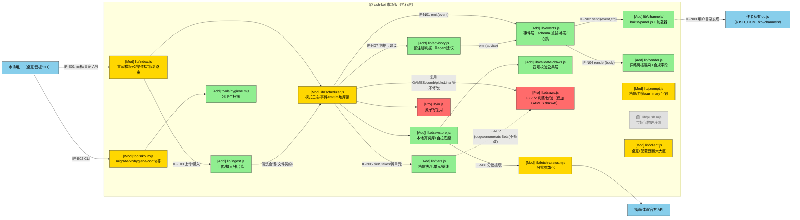
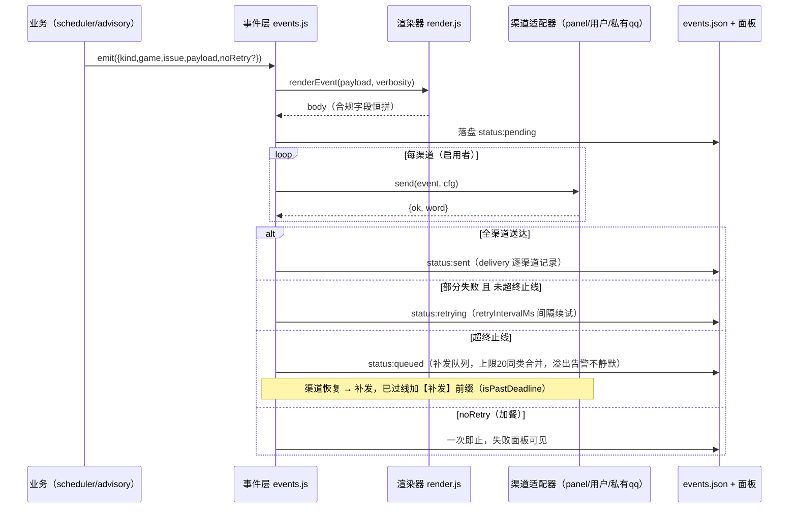
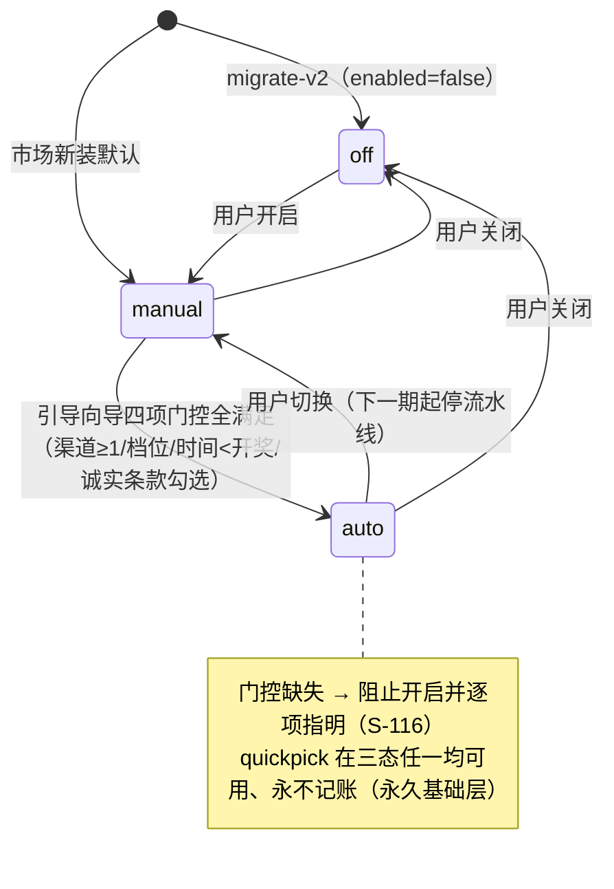
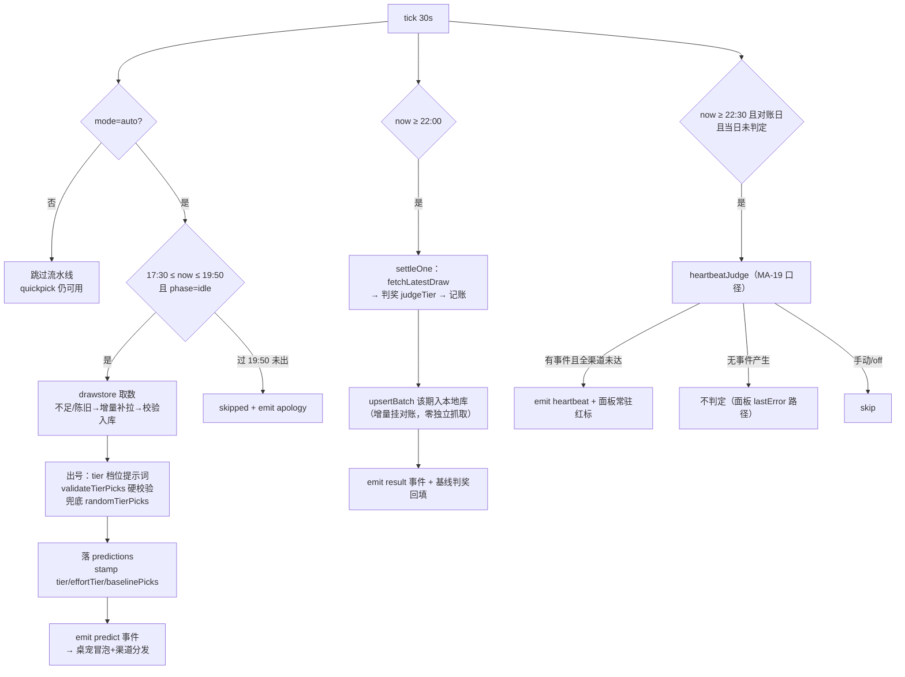

## §1 设计概要

### 1.1 实现思路

**总思路：改造不重写，事件层为纲。** 以 docs/15 v1.0.1 为唯一需求权威，把市场版拆成「一条主轴 + 八个挂件」：

1. **主轴 = 通知事件层（lib/events.js + lib/channels/）**：所有出站通知先成为结构化事件（DC-102 schema），FR-005 重试/补发/心跳语义在事件层实现一次——**直接复用** scheduler.js 已导出的纯函数族（`retryIntervalMs` / `deadlineForKind` / `isPastDeadline` / `enqueueRepush`，`scheduler.js:105-153`，实测可导入）；渠道适配器只做传输（type/配置 schema/send 三件套契约）；QQ 推送整体后撤为作者私有适配器（市场包物理不含 `push.mjs`）。调度器内 5 处 `pushText` 调用点改为 `eventBus.emit`（§2.2.1）。
2. **挂件**：桌宠（client.js 独立 React root，dsh-m `mountPanel` 模式实证复刻）、三态模式（config `modes` + 门控四项）、投注档位（新 lib/tiers.js，**拆单元**消费 FZ-1 判奖引擎，judge/enumerateBets 零修改实测验证）、配置面板六大区（settings.section 扩展 + config API）、数据自拉底座（koi/draws/ 本地库 + 校验公共层）、详略两档渲染（lib/render.js）、学习入库半环（koi-ingest/ + 卡片库）、打包卫生（tools/hygiene.mjs + 作者迁移 migrate-v2）。

数据流一句话：**业务产出（出号/对账/告警/建议）→ 事件层（schema 化 + 渲染 + 统一重试）→ 渠道适配器（桌宠/用户渠道/私有 qq）送达 → 事件状态面板可见（失败原因/队列/心跳红标兜底）**。

文档分工：docs/11 保持 v1.1 + 认知层（dsh-koi-mind）设计权威不动；本文为**市场版设计权威**；与 docs/11 冲突处按 docs/15 §5.2「继承 + 增量」表述（例：FR-005 语义从 scheduler 内联实现迁至事件层等价重现；BC-013 降档链沿用、市场默认预算 150 万/周）。docs/09/10 已就地升版联动（§8.5）。

### 1.2 设计决策

|编号|决策项|类别|内容|理由|
|-|-|-|-|-|
|D-001|事件层下沉 FR-005，纯函数族原位复用|架构|出站通知全部事件化；重试/终止线/补发/心跳在 lib/events.js 实现一次，逻辑体直接 import scheduler.js 既有纯函数（零拷贝；`retryIntervalMs` 因读 `cfg.push.retryMinutes` 而 v2 配置已迁 `time.retryMinutes`，事件层调用处以形参 shim `{push:{retryMinutes:cfg.time?.retryMinutes}}` 适配——**语义复用 + 参数面 shim**，函数本体零改写，等价性已实测 7 分钟→420000ms/缺省→300000ms）；渠道只做传输|BC-102「事件层唯一」；复用已测试代码（58 例中的 C10 族）比重写安全；渠道增删不改业务|
|D-002|渠道适配器 = ESM 插件文件 + 双目录发现|接口|契约 `{ type, configSchema, send(event,cfg), test(cfg) }`；发现 = `lib/channels/builtin/`（内置桌宠）∪ `$DSH_HOME/koi/channels/`（用户/作者私有 qq.js）；缺文件报清晰配置错误不崩溃（S-112）|FR-1003 拍板3 多租户一步到位；目录隔离天然满足 S-115 升级保留（市场包覆盖安装不触碰用户目录）|
|D-003|桌宠走「独立 React root + document.body」挂载|前端|无全局浮层 slot 可用（Gemba 实读 4 个已知 slot 均为区域位，§8.4）；复刻 dsh-m `mountPanel` 实证模式：`require("react-dom")` createRoot + 自建容器 + ensureCss；右下角 fixed、前缀类名隔离、可整体关闭|dsh-m 同款已在 DSH 0.2.1-rc.2 web/desktop 双 profile 实跑；不依赖未验证的宿主能力|
|D-004|档位制 = 拆单元消费 FZ-1|数据|蓝双选/排列三多注拆为多个现有 judge 可直接消化的 picks 单元（单蓝/单组三位数），逐单元判奖后聚合 grades/money/floating；`judge/enumerateBets/stakesOf/comb/validatePicks/randomPicks` 全部零修改（A2.1 实测 33 断言含 r9b2 拆 2 单元=168 注逐位手算一致）|FZ-1/FZ-2 语义不变的唯一无损路径；新 lib/tiers.js 承载全部档位感知逻辑（tierStakes/validateTierPicks/randomTierPicks）|
|D-005|QQ 剥离 = 市场包物理删除 + 作者适配器外置|交付|`lib/push.mjs` 从市场包删除；其逻辑（NapCat HTTP + assertLoopback FZ-4 语义）reshape 为私有 `qq.js` 适配器模板，**仅存 docs/16 附录文档形态**（不入包、不入 files[] 白名单目录）；作者实例升级走 migrate-v2 一次性迁移|BC-103 物理不含的最强形式；模板放文档杜绝误打包（工具目录在 files 白名单内，放 tools/ 有发布泄漏风险）|
|D-006|配置 schema v2 破坏性变更，走 docs/10 §6 规则3|数据|koi.config.json 升 schemaVersion:2（channels/modes/budget/effort/verbosity/tiers 六区），包版本 0.2.0→0.3.0；`tools/koi.mjs migrate-v2` 一次性迁移（QQ 字段→私有适配器配置；enabled→mode；repushQueue→事件存储）；三 JSON 数据文件不受豁免仍只加不改不删|S-125/FR-1004/MA-21 明文要求；规则3 是唯一合规通道|
|D-007|成本与力度：估算路径 + 杠杆表|DFx|koi 自持轻量计量 koi/token-usage.json（chars/4 保守估算，activity∈predict/learning/advisory，自然周重置）；力度四档映射杠杆表——reasoningEffort 参数直传（D 阶段 spike 验证宿主 prompt 通道）+ 材料量/正文字数/自检段三维杠杆（任意模型可观测差异，满足 MA-16）；无杠杆形态配置页如实显示|ADR-13 双路径思想的市场版落地（宿主 usage 接口不可见，估算先行）；「至少一种可用杠杆」由材料量杠杆结构性保证|
|D-008|围栏 FZ-7 = 结构性隔离（非提示词约束）|安全|硬校验/随机基线/归因判据/推送契约/兜底标注全部在角色输出**之后/之外**的结构层执行（validateTierPicks 后置闸、randomTierPicks 独立路径、advisory 判据代码算、renderer 独占正文、via=fallback 恒标注）；单 agent 路径角色提示词根本不进产出链|BC-106「不可触及」只有在结构上不可绕过才成立；AC-112 侵蚀测试对象是结构层而非提示词自觉|

## §2 架构设计

### 2.1 架构变更

#### 2.1.1 变更总览

图例：🟢新增 [Add] / 🟡修改 [Mod] / 🔴保护 [Pro]（有调用但本轮禁改语义）/ ⚪不涉及 [Unt]。IF 编号见 §6.2。



被复用不修改的模块：`lib/stats.js`（数据包，档位/力度只改入参不改函数）、`cordis.patch.yml`（挂载声明不变）。`push.mjs` 从市场包删除后，`scheduler.js:22` / `index.js:19` 对它的 import 一并移除（调用点改事件层）。

#### 2.1.2 模块变更

|模块|变更|职责|接口|依赖|约束|
|-|-|-|-|-|-|
|lib/events.js|新增|事件 schema（DC-102）、统一重试/补发/心跳、事件持久化与 90 天滚动清理、加餐 noRetry 例外|IF-N01/02/04|io、scheduler 纯函数族、channels 加载器|FR-005 参数集不变（5 分钟/分类终止线/上限 20 同类合并）；FZ-5 相位机不触碰|
|lib/channels/|新增|适配器契约与双目录发现加载；builtin/panel.js 桌宠渠道（send=标记面板可见）|IF-N02/N03|—|缺适配器报清晰错误不崩溃（S-112）；凭证不入日志（NFR-106）|
|lib/tiers.js|新增|档位表（DC-106 初始 9 档）、tierStakes/validateTierPicks/randomTierPicks/specText/拆单元聚合 judgeTier|IF-N05|draws（comb/judge 只调用）|FZ-1/FZ-2 零修改（A2.1 实测）；换档下期生效（BC-113）|
|lib/render.js|新增|事件正文渲染：concise/chatty 两档、合规字段恒拼（兜底/加餐或手动/补发/基线缺失标注+诚实基调句）|IF-N04|—|BC-108；summary ≤100 字为结构化字段（非删减）；推送不含全文|
|lib/drawstore.js|新增|本地开奖库 koi/draws/\<game\>.json（读/写/最近 N 期）、自拉底座（分批/断点续传/进度）、增量挂对账入库、手动按需抓取|IF-N06|fetch-draws、validate-draws|BC-105 抓过即入本地库；二次请求零网络（FR-1024）；错峰不阻塞出号（NFR-104）|
|lib/validate-draws.js|新增|四项校验：期号格式（DC-006）/日期合理性/号码值域/连续性；新鲜度探针沿用 isStaleDraw|—|—|不过关即拒用（BC-104）；自拉/增量/手动三方共用（FR-1017）|
|lib/advisory.js|新增|判据预注册（先落盘）、单 agent 建议生成、采纳对照观测|IF-N07|drawstore、tiers、事件层|BC-109 标注不记账；预注册时戳早于建议（AC-111）；零概率宣称|
|lib/ingest.js|新增（若 C 纳入）|上传入口（四格式/大小校验）、jobs 队列、preprocessor 会话清洗、拆卡+语义去重、卡片库 koi/cards.json|IF-E03|session、事件层|BC-012 错峰；失败「待补」不静默（S-119）；期望文案（FR-1015）|
|lib/scheduler.js|修改|①出号/对账/告警的 5 处 pushText 调用点改 eventBus.emit；②games.enabled→modes.\<k\>.mode 三态（off/manual/auto）+ 门控校验；③runPredictFlow 数据源改 drawstore（本地优先、按需抓取）；④settleOne 对账成功后增量入库；⑤每彩种 predictAt 覆盖；⑥预测条目 stamp（tier/effortTier/baselinePicks）；⑦settleText 改读 entry 自带 spec/bets/cost（`scheduler.js:329` 现读 stakesOf 固定结构，非默认档战果文案会错——改读出号时已写入条目的规格字段，`scheduler.js:262` 同款扩散）；⑧无模型错误分类短路（classifyHostError，§2.2.2-7）|—|events/tiers/drawstore/render/advisory|FZ-5 相位与转移语义不动；FZ-3 只加字段；quickpick 在 off 模式从「拒绝」改「允许」（FR-1023 永久基础层，行为增量显式声明）|
|lib/index.js|修改|①首写配置模板 v2（零 QQ：channels:[]/modes 默认 manual/budget/effort/verbosity）；②status 的 NapCat 探测改 channels[].status；③test-push 语义改事件层测试事件（形状不变，FZ-6）；④新增只读/配置路由（§6.1）|IF-E01|scheduler、events、channels|FZ-6 既有 4 条 API 形状只加不改；信任栅栏姿势不变|
|lib/client.js|修改|①桌宠组件（独立 root 挂载）；②配置面板六大区 + 实时成本估算 + 即时校验；③引导卡片；④模式/门控 UI；⑤事件列表/心跳红标|IF-E01|自家 API|dsh.client 平台声明不变（web；desktop 经 dsh-web-app 同 UI，§8.4）|
|lib/prompt.js|修改|①specText 档位感知（tiers.specText 注入）；②picks JSON 契约加 `summary` 字段（chatty 摘要 ≤100 字）；③力度杠杆参数化（historyTail/字数档/自检段）|—|tiers|文件契约其余不动；schemaVersion 语义不变|
|lib/fetch-draws.mjs|修改|fetchHistory 支持分页起点（`startIssue`/`pageNo` 参数化），供底座分批|IF-N06|—|两官方源 URL 与头不变（BC-104；`fetch-draws.mjs:61,75`）|
|lib/draws.js|保护+微增|GAMES 各彩种**加** `drawAt:'HH:MM'` 结构化字段（开奖时刻，供 predictAt 校验）；FZ-1/FZ-2 函数零触碰|IF-R01/R02|—|加字段属 FZ-3 合规加法；judge/enumerateBets/stakesOf/comb/validatePicks/randomPicks 逐字不动|
|tools/koi.mjs|修改|新增 `migrate-v2`/`hygiene`/`config get|set`/`channels list|test`/`mode`/`backbone status|pull`/`events list`；`push`/`deps` 的 NapCat 硬编码改渠道层|IF-E02|lib 全家|与宿主共用同一份配置/校验/数据（FR-1020 等价路径）|
|tools/hygiene.mjs|新增|市场包扫描：qq 文件名/push.target 等字段/文案关键词/代码默认 QQ/包描述 → 零命中退出 0|IF-E04|—|AC-102 验收门直接引用（NFR-102）|
|package.json|修改|version 0.3.0；description 去 QQ 重写；files 不含 push.mjs；**D 阶段 spike 项**：`dsh.client.inject` 现为 `[]` 而 dsh-m 声明三宿主包——若模块加载器对 `require("react-dom")` 的解析依赖 inject 声明（未验证），需补 `@deepseek-ai/dsh-client-runtime` 等条目|—|—|BC-103；docs/10 §6 规则3；inject 补条属加法|

### 2.2 模块详情

#### 2.2.1 通知事件层（lib/events.js + lib/channels/）— FR-1001/1003/1005

- 负责职责：所有出站通知（预测/战果/致歉/告警/建议/心跳）先成为结构化事件；FR-005 统一重试/补发语义在此实现一次；渠道适配器只做传输；心跳判定（MA-19 口径）；事件持久化与面板可见性。
- 功能性设计：
  1. **事件 schema（DC-102）**：`{ id:'evt-<ts>-<rand>', kind:'predict|quickpick|result|apology|alert|advice|heartbeat', level:'info|warn|error', game, issue, at, deadline, body, fullRef, status:'pending|retrying|sent|queued|failed', delivery:[{channel,ok,at,attempts,lastErr}], attempts, lastTryAt, lastErr, noRetry? }`（kind 含 quickpick——加餐/手动层独立 kind，noRetry 恒 true）。存储 `koi/events.json`（`{schemaVersion:1, entries:[…]}`，io.js 原子写）。（FR-1001、DC-102）
  2. **emit 主循环**：`emit(event)` → render.body 生成（§2.2.5）→ 逐启用渠道 `adapter.send(event, cfg)` → 全渠道送达 = status:sent；部分失败按 `retryIntervalMs({push:{retryMinutes:cfg.time?.retryMinutes}})`（复用 `scheduler.js:105`，**形参 shim 适配 v2 的 time.retryMinutes**，等价性实测：7→420000ms、缺省→300000ms）重试至 `deadlineForKind(kind)`（复用 `scheduler.js:111`，kind 扩展映射：advice/heartbeat → 次日 12:00，沿 docs/11 §3.2 B-26 精神）；超线转补发队列（`enqueueRepush` 语义复用，上限 20/同类合并/溢出告警不静默）；补发送达时已过线加【补发】前缀（`isPastDeadline` 复用）。（FR-1001、BC-102）
  3. **加餐例外继承**：quickpick 事件（kind='quickpick'）`noRetry:true`——发送一次，失败可见于面板，号在面板展示（FR-005 v1 例外原文，FR-1001 显式声明）；quickpick **不列入心跳「当日应有事件」集合**（加餐无定时承诺，与 MA-19 口径的「预测/战果/致歉/告警」集合一致）。
  4. **渠道适配器契约（FR-1003）**：`lib/channels/<type>.js` ESM default export：`{ type:string, configSchema:object(声明式字段表：名称/类型/必填/掩码标记), send:async(event, cfg)=>({ok,word}), test:async(cfg)=>({ok,word}) }`。发现加载 `loadAdapters()`：扫描 `lib/channels/builtin/*.js`（打包内置，市场版仅 panel.js）∪ `$DSH_HOME/koi/channels/*.js`（用户目录，作者 qq.js 于此挂载，S-115 升级隔离）。**cfg 组装规则（IF-N03，PM 复核意见3 补）**：`resolveChannelCfg(channels[i]) = 合并(channels[i] 非凭证字段, 侧车 $DSH_HOME/koi/channels/<type>.config.json)`，**侧车优先且凭证字段一律只存侧车**——统一用户渠道与迁移产生的作者渠道的凭证来源（凭证不进主配置文件，NFR-106；面板经 config API 掩码读写侧车，主配置 channels[] 条目只存 `{type,enabled}`）。**缺适配器**：启动/status 时对注册 type 未命中者置 `channels[i].error='适配器缺失，请在渠道目录补入或停用'`，进程不崩溃、其余渠道照常（S-112/AC-102）。
  5. **桌宠渠道（builtin/panel.js）**：`send()` = 标记 `delivery[panel].ok=true`（事件对桌宠/面板可见即视为送达）；无网络 IO；`test()` 恒 `{ok:true}`。（FR-1002、S-123：桌宠关闭时该渠道不启用，事件照发其他渠道）
  6. **心跳判定（FR-1001/MA-19 操作化）**：tick 内当 `now ≥ '22:30'` 且当日尚未判定且为对账日：对每个 auto 模式彩种取当日应有事件（**predict/result/apology/alert，显式排除 quickpick**）；`heartbeatJudge(events, enabledChannels, mode)`（A2.1 V8 实测四断言）——①有事件且全部启用渠道（含桌宠送达状态）均无「已送达」→ 产生 heartbeat 告警事件 + `state.heartbeatRed=true`（面板常驻红标，可见性兜底不依赖任何渠道）；渠道恢复补发并标注后清除；②无事件产生 → 不判定（面板 lastError 路径）；③手动/off 模式 → skip；④仅 harness 运行中实时判定（tick 驱动天然满足），关机错过不补判，`state.heartbeatCheckedAt` 如实记录缺席。
  7. **生命周期（MA-24）**：每 tick 顺带滚动清理 `at` 早于 90 天的事件（常量级：单次过滤）；桌宠消息列表窗口 = 最近 200 条（API limit 参数）；清理不触碰 predictions/ledger 全文（DC-102）。
  8. **迁移接缝**：v1.1 `state.repushQueue` 一次性迁入事件存储待发队列（migrate-v2 一并执行）；此后 state.json 不再写 repushQueue（读取容忍旧字段）。
- 非功能设计：事件处理常量级开销（NFR-104：单事件 O(启用渠道数)，清理 O(entries) 有界于 90 天窗口）；凭证零明文——send/test 的 cfg 仅在内存传递，日志/事件正文/错误串一律走 `maskCredentials(cfg)`（NFR-106/FR-1005）。
- 风险与缓解：①渠道 send 抛错 → try/catch 单渠道失败不影响其他渠道，错误串截断 120 字符（沿 v1 pushErr 姿势）；②events.json 并发写（tick 与 API ack）→ 统一走 io.js 原子写 + 调度器单写者约定（面板只读，ack 状态由客户端游标承担）；③适配器第三方代码质量 → 契约校验（缺 type/send 即拒绝加载并报清晰错误）+ send 超时 15s 包裹（沿 fetch TIMEOUT 姿势）。

#### 2.2.2 三态模式与调度器改造（lib/scheduler.js）— FR-1023/BC-111/DC-110

- 负责职责：每彩种关/手动/自动三态状态机；自动模式四项门控；「现在来一注」永久基础层；每彩种出号时间；换档下期生效。
- 功能性设计：
  1. **配置面（DC-110）**：`modes.<game> = { mode:'off|manual|auto', tier:'<tierId>', predictAt:'17:30', gates:{channelOk,tierOk,timeOk,honestyAck}, wizardDone }`。读兼容：无 modes 段时 `games.<k>.enabled` 换算（true→auto、false→off）——migrate-v2 落盘后此兼容仅作读取兜底。（FR-1023）
  2. **tick 分派**：`off` → 出号段/对账段跳过（同 v1 enabled:false 语义）；`manual` → 同 off 的流水线跳过 + quickpick 可用；`auto` → v1 完整流水线（出号→事件→对账→记账→全渠道通知）。FZ-5 相位机（idle→predicted→settled/failed/skipped + carry）逐字不动——三态只是相位机外的**门**。
  3. **quickpick 永久基础层**：v1 `quickpick()` 的 `gameEnabled` 拒绝检查改为「mode 为三态任一均放行」（`scheduler.js:589` 现状对 off 拒绝——**显式行为增量**，FR-1023「任何模式可用」）；产出标 `kind:'quickpick'`（账本天然不计，`draws.js:280` 过滤）+ 事件 kind='quickpick'（noRetry 恒 true）+ 手动模式下正文标「手动推荐 · 不记账」、自动模式下沿 v1「加餐 · 不记账」；手动号入 predictions（继承 FR-052 加餐类别），面板纯观测查询（MA-26）。
  4. **门控（S-116/拍板16）**：`setMode(game,'auto')` 前 `checkGates()` 四项——①启用渠道 ≥1（含桌宠）；②tier 已选且合法；③predictAt 已设且 < `GAMES[game].drawAt`（新增结构化字段，`draws.js:15-39` 加列；`drawTimeText` 保留展示用）；④honestyAck 勾选。任一缺失 → 面板/CLI 均拒绝并逐项指明缺项 + 指引（BC-110 运行前提文案在向导第 4 步恒展示）。校验规则三入口共用一份 `validateConfig()`（面板/CLI/配置文件，FR-1020/S-113）。
  5. **换档下期生效（BC-113）**：tier 变更只写 config，不触碰当日 state/games 相位；下一期 `runPredictFlow` 读当刻 config 的 tier → 出号即按新档；账本按当期实际结构记（§2.2.4）。
  6. **预测推送段改造**：v1 tick 内预测推送重试游标段（`scheduler.js:491-514`）与 `pushOrQueue/queueRepush`（`scheduler.js:291-318`）删除，改 `events.emit({kind:'predict',…})`；`pushedAt/pushErr` 字段保留由事件层送达状态回填（面板兼容读）。
  7. **无模型错误分类短路（FR-1022/S-117，PM 复核意见7 补）**：`classifyHostError(err) → {kind:'no-model'|'other', hint}`——promptAgent 捕获的异常按可配置错误模式表（初始含 no model/未配置模型/provider 缺失类关键词，表初值为空+D 阶段实测校准，宿主错误串不可本地验证——§8.2 未验证项⑥）分类；命中 no-model 类：**quickpick 路径直接返回 job.error=「宿主未配置模型，请先在 DSH 设置中配置模型（入口：设置→模型），配置后重试」，跳过打回重写与随机兜底**（手动模式无「必须出号」承诺，清晰失败优于静默 5 分钟后兜底号）；自动模式出号沿既有失败重试/致歉语义但 attempts 记录带 no-model 标注（AC-113 闭环：错误信息含模型配置指引）。
- 非功能设计：配置每 tick 现读（v1 语义），模式/档位变更下一轮 tick 生效（≤30s，NFR-104）。
- 风险与缓解：①off 模式 quickpick 放行与 v1 行为差异 → 文档与面板文案明示「关 = 不自动出号，来一注仍可用」；②作者实例迁移漏 enabled 换算 → migrate-v2 幂等可重跑 + 迁移报告输出。

#### 2.2.3 桌宠前端组件（lib/client.js）— FR-1002/NFR-101

- 负责职责：harness 右下角常驻小鱼；事件冒泡 + 红点 + 近期消息列表；可整体关闭；首次引导卡片。
- 功能性设计：
  1. **挂载机制（Gemba 实证，§8.4）**：`apply(ctx)` 内 `ctx.effect(() => mountPet(ctx))`——`mountPet()` 复刻 dsh-m `mountPanel`（dsh-m/lib/client.js:6036-6062 同款）：`ensureCss()`（`<style id="koi-pet-css">` 注入 document.head）→ `require("react-dom")`（dsm 实证可 require，interop 处理 `.default`）→ `createRoot(document.getElementById('koi-pet-root') ?? 新建 div 挂 document.body)` → render(KoiPet)。无已知全局浮层 slot，故不走 slots 注册（4 个已知 slot 均为区域位：settings.section/sidebar.footer.action/sidebar.workspaces/tool.call.toolview）。（FR-1002「具体挂载机制由 design 阶段 Gemba 定」的落点）
  2. **样式隔离**：全部类名前缀 `koi-pet-`；配色消费 DSH CSS 变量（`--dsw-alias-*`，koi section CSS `client.js:25-38` 先例）；`position:fixed; right:16px; bottom:16px; z-index:2147483000`（dsh-m 面板同值先例）；容器 `pointer-events:none` + 交互子元素 `pointer-events:auto`（不挡宿主 UI）。
  3. **数据与交互**：轮询 `GET /dsh-koi/api/events?since=<lastId>&limit=200`（30s，koi status 轮询同周期先例 `client.js:81`；NFR-104 常量级——窗口有界）；新事件 → 冒泡消息卡（按全局详略档渲染的 body）+ 红点计数（未读 = since 游标差，localStorage 持久）；点击 → 展开最近 200 条列表（DC-102 窗口）；「查看全文」跳设置→彩票的对应期条目（全文仅面板+档案，FR-1010）。
  4. **可关闭**：config `pet.enabled`（默认 true）；false → `root.unmount()` + 容器移除；事件照常分发其他渠道（S-123）；再启用冒泡恢复。**无任何可用渠道时的可见性兜底**：设置→彩票节恒在（不依赖桌宠），显示事件队列失败原因 + `heartbeatRed` 常驻红标（心跳兜底语义）。
  5. **引导卡片（S-101）**：首装（config 首写后 `wizardDone` 未置位）桌宠冒泡引导卡：配置渠道/档位/预算/力度入口（锚点跳设置节）+「现在来一注」零门槛提示；关闭不打扰（只冒一次，重复入口在设置节）。
  6. **浏览器/桌面系统通知**：可选项（授权后 `Notification` API；拒绝授权不降级主功能）——FR-1002 边界内增强，默认关。
  7. **降级路径（PM 复核意见8 补，正文级设计）**：`require("react-dom")` 不可解析或 createRoot 缺失时的分级降级——**第一级（最低可见性保证，必做）**：桌宠容器静默移除（dsh-m mountPanel 同款姿势：`container.remove()`，无纯 DOM 渲染——dsh-m 实读并无此分支，v1.0.0 §8.2② 引证失实已修正），但 **panel 渠道与事件链路完全不受影响**：通知仍以「设置→彩票节」内的事件横幅 + 心跳红标 + 事件列表（/api/events 驱动）送达，渠道层 panel.send 仍标记送达——桌宠 UI 缺席 ≠ 通知丢失；**第二级（增强，可选尝试）**：纯 DOM 冒泡（无 React，直接 createElement 定时器渲染最近一条事件标题）——D 阶段实现时按余量取舍。前置排险：D 冒烟前静态确认宿主模块加载器对 react-dom 的解析是否依赖 `dsh.client.inject` 声明（koi 现为 []、dsh-m 声明三宿主包——若依赖则 package.json 补条目，§2.1.2 已列 spike 项）。
- 非功能设计：轮询/渲染常量级（窗口 200 条上限）；卸载清理（ctx.effect disposer：unmount + 移除容器；style 标签保留无副作用）。
- 风险与缓解：①宿主 UI 布局升级挤压右下角 → 容器位置可配（config `pet.corner`），影响面仅样式；②与其他浮层插件 z-index 同段冲突（dsh-m 面板同值 2147483000）→ 桌宠为常驻小件、面板为临时全屏层，实际重叠瞬时；如冲突将 pet 降 100（可配，MB-19 登记）；③desktop profile 渲染差异 → desktop bundle 含 @deepseek-ai/dsh-web-app（同 UI 栈，§8.4 证据），D 阶段 AC-109 冒烟覆盖。

#### 2.2.4 投注档位制（lib/tiers.js）— FR-1011/DC-106/BC-113

- 负责职责：档位表定义与校验；档位感知的注数/校验/随机/提示词；拆单元判奖聚合；随机基线同构。
- 功能性设计：
  1. **档位表（DC-106 初始档集，A2.1 V2 实测注数/价格）**：

     | tierId | 结构 | 注数 | 每期价格 |
     |-|-|-|-|
     | p3-x1 / p3-x3 / p3-x5 | 直选单式 ×1/×3/×5 | 1/3/5 | 2/6/10 元 |
     | ssq-r7b1 / ssq-r8b1 / ssq-r9b2 | 红7+蓝1 / 红8+蓝1 / 红9+蓝2 | 7/28/168 | 14/56/336 元 |
     | dlt-f6b2 / dlt-f7b2 / dlt-f8b3 | 前6+后2 / 前7+后2 / 前8+后3 | 6/21/168 | 12/42/336 元 |

     表内置于 tiers.js（可扩展为 FZ-1 支持的任意合法结构：`{game, red?, blue?, front?, back?, units?}`）；**出厂默认档 = 各彩种最小档（ssq-r7b1 14 元 / dlt-f6b2 12 元 / p3-x1 2 元，MB-29 修订——服务市场新用户的低门槛起步，向导第 2 步引导升档）；作者实例连续性由 migrate-v2 携带配置保障（v1 无 tier 概念，迁移按 v1 复式结构反查档表写入 ssq-r8b1/dlt-f7b2，§2.2.10-4②）**。
  2. **拆单元判奖（A2.1 V3/V3b 实测）**：`unitsOf(tier, picks)` 把档位 picks 拆为现有 judge 直接可吃的单元列表——ssq 蓝双选 → 每蓝一单元（红池共享）；p3 ×N → N 个三位数单元；dlt 长池单单元（`enumerateBets` 组合天然按池长展开，f8b3=168 注实测）。`judgeTier(tier, picks, result, gradeMoney)` = 逐单元 `judge()` 后聚合 `{bets, grades, money, floating}`（grades 相加、floating 或）。**FZ-1 零修改**（r9b1 逐位手算一致、r9b2 聚合一致，§8.2）。
  3. **档位感知校验/随机**：`validateTierPicks(tier, raw)`——复刻 validatePicks 的规则风格（个数/去重/范围/整数 + 排序规范化）但参数取自 tier（FZ-2 的 `validatePicks` 原函数零触碰，`scheduler.js:236` 的调用点改走 tier 版，tier 缺省时等价旧规格）；`randomTierPicks(tier)` 同构随机兜底（FZ-2 `randomPicks` 零触碰）。
  4. **随机基线同构（DC-002 市场版落点，MB-18）**：auto 模式每期正式预测落 predictions 时同刻生成 `baselinePicks: randomTierPicks(当期档位)`（独立随机路径）；对账时 `judgeTier(baseline)` 回填 `baselinePrize/baselineGrades`。predictions 条目**只加字段**（FZ-3 合规）；周报对照 = 面板「预测 vs 基线」纯观测节（对照表数据源）。
  5. **账本按实际结构记（BC-113）**：settleOne 记账沿用 `cost: entry.cost`（出号时按当刻档位写入 predictions 的 bets/cost/spec，tier 版 stakesOf 产出）——账本口径零改动，换档自然「当期旧档、下期新档」（AC-106）。**战果文案同口径（PM 复核意见6 补）**：`settleText` 现读 `stakesOf(gameKey)` 固定结构（`scheduler.js:329`，非默认档战果推送会显示错误注数/价格）——改读 entry 自带 `spec/bets/cost`（出号时已随 `scheduler.js:262` 同款扩散写入 predictions 条目，无需另存）。
- 非功能设计：tiers 全部纯函数，单测直连（沿 v1.1 C-06 纪律）。
- 风险与缓解：①档位扩展写错结构 → validateTierPicks 拒绝 + 档表自检（units×betsPerUnit 与组合数互证）；②judge 聚合遗漏 floating → 聚合器单测断言（r9b2 单元 B 无浮动、单元 A 有 → 或聚合）。

#### 2.2.5 输出详略渲染（lib/render.js）— FR-1010/BC-108/DC-107

- 负责职责：事件正文按全局单档（concise/chatty）渲染；合规字段恒在；推送不含全文。
- 功能性设计：
  1. `renderEvent({kind, game, issue, picksLine, message, summary, via, flags})` → body 字符串。concise = 标题行 + 号码行 + 合规字段；chatty = 追加 `summary`（主持人输出 schema 的结构化字段，picks 契约新增 `"summary":"≤100字"`，prompt.js 修改点；AI 未写 → chatty 档如实显示「（无摘要）」而非事后截删，BC-108「非事后删减」）。
  2. **合规字段恒拼（BC-108）**：`via==='fallback'` →「（兜底号）」；quickpick/手动 → 「加餐 · 不记账」/「手动推荐 · 不记账」；补发 → 【补发】前缀（事件层）；`baselinePicks` 缺失 →「（基线缺失）」标注；尾句诚实基调（预测类「开奖是独立随机事件，本内容不改变中奖概率」、战果类沿 v1「图个乐」句式）。
  3. 全文（message 完整正文）只在面板详情（predictions 条目）与档案（predictions.json 永久）；body 生成即丢弃长文引用（`fullRef` 指针供面板跳转）。
- 风险与缓解：summary 超长 → 渲染器校验长度并标注「摘要超长已拒发」+ 事件层告警一次（不静默截断——BC-108 结构化字段语义）。

#### 2.2.6 数据自拉底座与校验公共层（lib/drawstore.js + lib/validate-draws.js）— FR-1016/1017/1024/DC-109

- 负责职责：本地开奖库；首次自拉底座（分批/断点续传/进度可见）；增量挂 22:00 对账；手动按需抓取；四项校验公共化。
- 功能性设计：
  1. **本地库**：`koi/draws/<game>.json` `{schemaVersion:1, entries:[{issue,date,red,blue|front,back|digits,prizeGrades?}]}` 升序存（去重键 issue）；`getRecent(game, n)` / `upsertBatch(game, batch)`（先 `validateDraws` 后入库，逐条拒用假数据并记 `rejected` 清单）。
  2. **校验公共层（FR-1017，A2.1 V9/V10 实测规则）**：`validateDraws(game, entries)` 四项——期号格式（ssq `^\d{7}$` / 体彩 `^\d{5}$`，DC-006）；日期合理性（≤今日且可解析）；号码值域（红 1-33/蓝 1-16/前 1-35/后 1-12/位 0-9）；连续性（同年相邻 -1、跨年重排不算断档；单调性破坏报错）。新鲜度探针沿用 `isStaleDraw`（>7 天 ✗，FR-008）。**同源多接口一致性检查**为设计阶段可评估增强（MA-23）——本轮不做，落待办。三方共用：底座自拉、增量入库、手动按需。
  3. **自拉底座（S-102 向导第 5 步 / FR-1016）**：`backfill(game)` 分批抓取（批大小 100 起步、失败自适应折半重试；批间 sleep 错峰——白天非禁算窗口执行，不阻塞出号路径 NFR-104）；**回拉目标深度与 done 判据（PM 复核意见14 补，MB-30）**：默认**全量历史至最早可得**（与 mind M1 全量回填口径一致，docs/11 §3.3「约 1.3 万期」），可配 `backfill.targetIssues`（null=全量）提前收口；done 判据 = 分页返回空页或批内期数 < 批大小；进度分母 = 目标期数（全量时取首批返回的最早期号与起始期号推算，接口侧总数可得时直读）。断点续传：`koi/databackbone.json` `{schemaVersion:1, game, done, fetchedIssues, targetIssues, lastBatchAt, progress}` 中途终止重启续拉、请求不重复（AC-108 计数核对：fetchHistory 调用计数 = 落库新增 + 拒用数）；进度经 status API 透出（面板进度条）。**请求量口径修正（PM 复核意见14）**：docs/14 R8「约 430 请求」为按小批的估计上限；本设计批 100 时约 ⌈总期数/100⌉ ≈ 130–160 请求量级（总期数量级 1.3–1.5 万期）——两口径均为估计值，未实测（§8.2④）。
  4. **增量挂对账（BC-105 零独立抓取）**：settleOne 已有 `fetchLatestDraw` 抓取（`scheduler.js:352`）成功后，`upsertBatch` 该期经校验入本地库（同一抓取双消费，FR-013/AC-017 语义）；期号跳跃核实段（`scheduler.js:358-360`）的 fetchHistory 结果同样入库。
  5. **手动按需抓取（FR-1024，MA-20 显式例外）**：`runPredictFlow` 数据源改 `drawstore.getRecent(game, historyCount)`——库足（≥ historyCount 条且最新期非陈旧）→ 零网络；不足/为空 → `fetchHistory(game, historyCount)`（沿 v1 窗口语义，默认 30 期）→ 校验 → 入库 → 产出；失败报清晰错误可重试（S-117）；二次请求命中本地库网络计数 = 0（AC-115）。自动模式出号同样走本地库优先（17:30 时前夜对账已增量入库；若本地最新期陈旧 → 先增量补拉再出号）。
  6. **底座状态（DC-109）**：status API 透出每彩种 `{backfillDone, latestIssue, continuityOk, lastCheckedAt, mirrorSource?}`；社区镜像（FR-1018，P2）：`mirror.enabled` 默认 off，启用须显式确认（S-122）；镜像数据经同一 validateDraws + `mirrorSource` 标注；官方源恢复回归直拉。镜像抓取器本轮仅留接口位（fetch-draws 的 source 参数化），发布渠道待办池。
- 非功能设计：drawstore 读写均原子（io.js）；出号路径网络依赖从「每次必抓」降为「库空/陈旧才抓」（BC-105 学习永不重复依赖网络——出号与学习共用本地库）。
- 风险与缓解：①官方接口改版 → fetch-draws 单层隔离不变（v1 设计）；②底座中途断电 → checkpoint 原子写，续拉幂等（upsert 去重）。

#### 2.2.7 配置面板与成本估算（lib/client.js 设置节 + config API）— FR-1020/BC-107/FR-1006/1008/1009

- 负责职责：六大区信息架构；实时成本估算；即时校验；配置文件/CLI 等价路径。
- 功能性设计：
  1. **六大区**（settings.section 内分区渲染，样式沿 koi-card 体系）：①渠道凭证（channels 列表：适配器声明的 configSchema 动态渲染字段、凭证掩码回显、每渠道「测试」按钮 `POST /api/channels/test`、增删）；②角色数量（数据官/质询者/主持人固定 1、策略师 1–4 可克隆；任务提示词编辑框只读展示「随 M3 编排器开放」——FR-1007 接缝 + FZ-7 围栏声明文案）；③预算权重（weeklyCap、类别分项、每角色权重默认 1.0、绝对值覆盖高级项折叠：注入上限默认 4000/单角色调用上限）；④力度（四档单选 + 恒显「力度影响分析质量与 token 成本，不影响中奖概率」+ 当前杠杆生效状态如实显示）；⑤详略（concise/chatty 单选，全局单档）；⑥投注档位（每彩种档位下拉，展示注数/价格，「换档下期生效」提示）。
  2. **实时成本估算（BC-107，PM 复核意见2/16 补全）**：服务端 `costEstimate(config)` 分三块——①出号：单次 = 输入（dataPack 字符数/4，随 historyTail 与档位规格文案变化）+ 输出（字数档上限/4），周 = Σ 开奖日历（GAMES.drawDays）× 单次；②advisory：`advisory.enabled` × 每开奖日一次 × 同口径估算；③learning（若 C 纳入）：每文件一次摄入+判重的粗粒度估算。**角色因子双显示（MB-22）**：市场单 agent 路径实际消耗不随阵容变化——面板如实显示两组数：**「当前形态实际估算」（不随阵容）** 与 **「M3 满配投影」（每策略师一次提案调用 × 权重 + 互评轮，随阵容/权重变化）**，后者标注「随 M3 编排器生效」；降档链联动同口径：市场版降档作用于 effort 档（§2.2.7-5），「用户档位=其配置阵容的满配」联动随 M3 生效。面板显示单次/每周 token 与周预算占比，随任一区改动即时重算（status API 附加字段 `costEstimate`，FZ-6 加法）。估算口径 chars/4 保守（docs/11 §4.4 先例）并标注「估算值」。**AC-112 口径提请（MB-22）**：TC-112「增加策略师数量观察成本估算变化」在市场单 agent 形态下的可验收面 = M3 满配投影随阵容变化正确 + 当前形态如实标注「不随阵容」——此口径修订提请 C 阶段在 docs/17 显式背书。
  3. **即时校验（S-113）**：保存前全量 `validateConfig()`——预算 >0、tier ∈ 档表、predictAt 早于 drawAt、枚举合法；非法即时拒绝 + 逐项说明；配置文件路径同样过校验（非法字段回退默认 + lastError 面板可见）；CLI `config set` 同规则。
  4. **保存链路**：`POST /dsh-koi/api/config {patch}` → 服务端校验 → 合并 → io.js 原子写 koi.config.json → 下一轮 tick 生效（v1 现读语义，≤30s）。
  5. **预算计量（FR-1008/DC-104，D-007）**：`koi/token-usage.json` `{schemaVersion:1, week:'2026-W43', entries:[{at, activity:'predict|learning|advisory', tokens, est:true}]}`——每次 promptAgent 前后按提示词+产出估算入账；自然周（ISO 周一）切换自动归档重置；70%/90% → alert 事件预警；100% → 降档链（effort turbo→standard→economy→follow-host → 学习/advisory 暂停 → 兜底档出号零 LLM），降档与触顶事件经事件层告知（S-120/BC-013）。默认市场 150 万/周、作者实例配置 1000 万/周（拍板12）。
  6. **力度映射（FR-1009/DC-105，D-007 杠杆表，PM 复核意见1 重构）**：

     | 档 | reasoningEffort 参数直传（D 阶段 spike 验证宿主通道） | historyTail（材料量） | 正文字数要求 | 自检段 |
     |-|-|-|-|-|
     | follow-host（出厂） | 不传（宿主默认） | 10（v1 原样） | 300–600（v1 原样） | 无 |
     | economy | 传低档（若可用） | 6 | 150–300 | 无 |
     | standard | 传中档（若可用） | 12 | 300–600 | 无 |
     | turbo | 传高档（若可用） | 14 | 400–800 | 有（提示词加自检清单段） |

     **四档结构互异由三维杠杆自身保证**（follow-host↔standard 差在 tail 10↔12，实测三元组 dup=0）——参数直传仅作叠加增强，spike 失败（如 DeepSeek chat 无思考参数）不损四档可观测差异（MA-16/AC-104 步骤3 的确定性保证）；**兜底判断修正（v1.0.1）**：杠杆恒在 ≠ 四档互异——互异性来自杠杆表取值互异这一设计约束，非「有杠杆」本身；后续调整杠杆取值须保持四档三元组（tail/字数/自检）两两不同。确无任何杠杆的形态 → 配置页如实显示「当前形态力度不生效」（防御性兜底，本设计下不触发）。`effortTier` stamp 进当期 predictions 条目（AC-104）。
- 非功能设计：凭证展示一律服务端掩码后下发（面板/CLI 永不接收明文，NFR-106）；成本估算 O(1) 查表 + 字符计数。
- 风险与缓解：估算与真实计费偏差 → 标注估算口径 + 周对账提示（用户侧自查），不宣称精确。

#### 2.2.8 今日策略建议 advisory（lib/advisory.js）— FR-1012/BC-109

- 负责职责：单 agent 路径的档位建议；判据预注册；采纳对照观测。
- 功能性设计：
  1. **预注册（AC-111 时戳断言）**：每开奖日出号完成后、建议生成前，代码计算判据并落 `koi/advisory/<game>-<date>.json` `{preregisteredAt, criteria:{tierCosts(档表全档注数/价格), ledgerPerTier(账本按实际档位的累计投入/奖金), recentAdviceHitRate(近 30 期建议档位若被采纳的假想战绩，代码回算), factorNote:'活跃因子战绩引用随 M3 接入'}}`——判据内容先于建议产出落盘。
  2. **生成**：单次 LLM 调用（判据 JSON + 档表 + 当期预算余量入提示词）→ 文件契约交卷 `{recommendedTier, reasonFull}`（沿 ADR-1 文件契约模式，绝不解析自由文本）；事件 kind=advice，正文恒带「建议不记账」标注；`reasonFull` 全文入 advisory 档案文件；**永不自动改正式档位**（advisory 输出与 modes.tier 写路径物理隔离——建议文件只读面板展示，换档必经用户操作）。面板可关（config `advisory.enabled` 默认开）。
  3. **对照观测（纯观测）**：对账时记录 `koi/advisory-outcomes.json`（当期用户实际档 vs 建议档、两者实际/假想判奖结果）；面板「采纳建议 vs 默认档」对照表（周维度聚合）。**口径边界（MA-26）**：观测仅覆盖自动模式档位建议，不含手动层「现在来一注」。多角色深度判据随 M3（docs/11 体系承接）。
  4. **文案红线**：建议/学习/力度相关文案零概率宣称（BC-112；advisory 理由模板禁用词表：提高/增加/提升中奖概率）。
- 风险与缓解：LLM 建议越权（建议文含「已替你换档」类表述）→ 渲染器追加固定句「建议不会自动生效，换档请手动操作」恒拼。

#### 2.2.9 学习入库半环（lib/ingest.js，若 C 纳入范围）— FR-1013/1014/1015/DC-108

- 负责职责：上传入口；preprocessor 清洗；拆卡与语义去重；卡片库与状态页；期望管理文案。
- 功能性设计：
  1. **上传（FR-1013）**：面板上传/拖入为主（`POST /dsh-koi/api/ingest`，raw body + `?name=`，**该路由独立 body 上限 20MB**——路由级覆盖全局 16KB 默认，MB-13 登记；格式白名单 .pdf/.epub/.txt/.md；超限/非法格式拒收并说明（S-118））；三个顺手入口按形态：QQ 扔文件（仅启用 QQ 宿主通道的部署，走 onebot 会话→投喂目录监控，本轮仅文档说明）、服务器目录投喂（`$DSH_HOME/koi-ingest/watch/` 目录监控，服务器 profile）、CLI `koi.mjs ingest <file>`（全形态）。
  2. **摄入流水线（FR-1014）**：jobs 队列 `koi-ingest/jobs.json` `{id, name, size, status:'queued|running|pending-llm|done|rejected', error, cards?}`（状态面板可见，含「待补」态 S-119）；**preprocessor = 会话 agent 文件契约**（MB-13：不引宿主内 PDF 解析依赖——唤醒锦鲤会话读文件，任务：剥图/OCR 去噪/断行修复 → 清洗后 MD + 拆卡 `{cards:[{name, rule, games, computable}]}` + `clean:{strippedImages,ocrNoise,fixedBreaks}` 标记，写约定文件，调度侧校验 schema）；语义去重两级漏斗（docs/11 §4.7 同构的 JSON 版）：词法粗筛（卡片名/规则分词 Jaccard top-K=10）→ LLM 批量判重（重复→拒入库回指既有卡 ID；相似→入库记 similarOf）；判重失败 → `pending-llm` 待补自动重试，绝不静默重复入库。
  3. **卡片库（DC-108）**：`koi/cards.json` `{schemaVersion:1, cards:[{id, name, source, sourceType, games, rule, computable, trustLevel:'mid'(默认，拍板7), clean, status, createdAt}]}`；回测引擎不在本轮（依赖 M1）。
  4. **期望文案（FR-1015/BC-112）**：上传页与结论页固定文案「学习 = 严格回测检验，结论可能证明技巧无效」（正向断言 AC-107 第 5 步）；摄入 LLM 失败 → 待补状态可见（S-119）。
- 风险与缓解：20MB PDF 会话读取超时 → 摄入任务超时上限 10 分钟后转 pending-llm 待补；文件契约校验失败给一次重写机会（沿出号流水线姿势）。

#### 2.2.10 QQ 剥离、打包卫生与作者迁移 — FR-1004/BC-101/103/NFR-102/S-115/125

- 负责职责：市场包零 QQ/零内嵌凭证；包卫生自动化扫描；作者实例 v1.1→市场包升级迁移。
- 功能性设计：
  1. **耦合点清除（A1 全量清单 §8.3，逐文件映射处置）**：`lib/push.mjs` 删除；`index.js:19,113-115,135-146`、`scheduler.js:22,180,286-289`、`koi.mjs:41,201-209,216-221`、`client.js:135,167`、`package.json:4` 按 §8.3 表逐点改造；首写模板（`index.js:29-42`）改 v2 零 QQ 默认值（MB-16，**以 §5.3 为唯一权威**：`channels:[{type:'panel',enabled:true}]`（panel 内置渠道出厂启用——S-101 首装引导卡经桌宠冒泡承载、事件冒泡与自动向导门控①均依赖它，v1.0.0 本处「channels:[]」为笔误已修正）+ 三彩种 mode:'manual' + 最小档 + budget 150 万 + effort follow-host + verbosity concise + pet.enabled true）。
  2. **作者私有 qq.js（D-005）**：模板全文收录于本文 §8.6 附录（文档形态，不入仓库包目录）；实体 = 现 push.mjs 的 `post/assertLoopback/pushPrivate/napcatAlive` reshape 为适配器契约（type:'qq'，configSchema:{target,napcatHttp(掩码)}，send→send_private_msg，test→get_login_info）；**FZ-4 回环断言语义原样保留**（作者实例安全不变量）；放置 `$DSH_HOME/koi/channels/qq.js` + 凭证 `$DSH_HOME/koi/channels/qq.config.json`（独立于 koi.config.json，凭证不混入主配置）。
  3. **打包卫生（NFR-102/AC-102）**：`tools/hygiene.mjs` 扫描包目录（排除 tests 夹具与 hygiene 自身白名单行）——模式集：文件名 `/qq/i`；字段 `push.target|napcatHttp|napcatAlive`；文案关键词 `NapCat|私聊|1017099872`；包描述 QQ 表述；代码内 QQ 号默认值（数字串）。零命中退出 0（A2.1 V11 已验证模式集在现库命中全部 6 个耦合文件、剔除模板默认行后 QQ 号零命中——扫描器有效性实证）。package.json `files` 白名单维持 lib/tools/cordis.patch.yml/README.md/tests（push.mjs 删除后自然不含）。
  4. **作者迁移（S-125/FR-1004/MA-21，docs/10 §6 规则3；PM 复核意见4/9/15 修订）**：包版本 0.2.0→0.3.0（minor+1）；`koi.mjs migrate-v2` 幂等命令：①读 v1.1 koi.config.json → `push.{target,napcatHttp}` 迁 **侧车** `koi/channels/qq.config.json`（schema 恰为 {target,napcatHttp}，凭证经 IF-N03 组装规则并入 cfg）+ channels 注册 `{type:'qq',enabled:true}`（并提示放入 qq.js 适配器文件）；`push.retryMinutes` → **time.retryMinutes**（重试参数归 time 段，非适配器凭证——v1.0.0 §2.2.10-4① 写「迁入 qq.config.json」有误已修正）；`time.predictAt` → 各彩种 `modes.<g>.predictAt`（非默认 17:30 时显式携带，防静默重置）；catchUpEnd/settleAt/settleGiveUp 留 time 段不动；②`games.<k>.enabled` → `modes.<k>.mode`（true→auto 语义保持，不重置 manual，MA-21）+ 按 v1 复式结构反查档表写入 tier（ssq-r8b1/dlt-f7b2/p3-x1，作者账本连续性由迁移保障，MB-29）；③`state.repushQueue` → 事件存储待发队列（**豁免注记（PM 复核意见15）：repushQueue 为瞬态队列字段非业务数据，迁移=内容搬家、原字段保留读取容忍，非删除数据——此口径与 DC-009「只加不改不删」的字面张力提请 C 阶段在 docs/17 显式背书**）；④写 schemaVersion:2 + 迁移报告（逐项清单）；三 JSON 业务数据（predictions/ledger 条目）零触碰；作者实例预算改 1000 万/周为配置值非代码默认。
  5. **市场包升级保留（S-115/NFR-105/AC-114）**：市场覆盖安装只替换包目录；`$DSH_HOME/koi/channels/`（私有适配器）、`koi.config.json`、三 JSON、draws/、events.json 等用户数据目录天然隔离（升级前后 diff 为空断言）；版本握手沿用 BC-010 精神（schemaVersion 单调 + ensureSchemaVersion 拒高版本写，io.js:32 既有）。
- 风险与缓解：①作者忘放 qq.js → 渠道层「适配器缺失」清晰报错指引（S-112 兜底同一机制）；②扫描器误报（如 README 提及历史）→ 白名单文件级配置 + 报告逐条列出人工复核。

#### 2.2.11 桌面 profile 适配 — FR-1019/NFR-101/BC-110/S-114/121/124

- 负责职责：双 profile 完整运行；休眠/关机补跑与 carry 语义；运行前提如实告知。
- 功能性设计：
  1. **代码层零专门化**：调度器/数据/渠道全部跑在 DSH 宿主 Node 进程（inject 服务双 profile 同构）；路径约定 `DSH_HOME 优先、兜底 ~/.dsh`（`index.js:23`）在 Windows 桌面自然落到用户目录；`index.js:13`「桌面 Electron 版没适配」注释与语义显式废除（FR-1019/NFR-009 防回潮——文案一并删除）。
  2. **休眠与补跑（S-114/S-121）**：v1 语义已结构性支持——错过出号窗口：开机后 tick 发现 `now > catchUpEnd` 且 phase=idle → skipped + 致歉（`scheduler.js:485-489`）；补跑窗口内（≤19:50）开机 → 正常出号（idle→predicted 转移照跑）；错过对账：carry 全量扫描未结清条目跨天顺延（C8 语义 `scheduler.js:433`）。心跳关机错过不补判（§2.2.1）。
  3. **差异清单（web vs desktop profile）**：

     | 维度 | web profile | desktop profile |
     |-|-|-|
     | 载体 | 服务器 DSH 守护进程（7×24） | 桌面 app 内嵌 daemon（app 开启时段，BC-110） |
     | 数据/配置 | $DSH_HOME/koi* | 同约定（Windows 用户目录） |
     | 渠道 | 桌宠 + 用户渠道（+作者私有 qq） | 桌宠为主渠道（无 NapCat 除非自建） |
     | 模型 | 用户 DSH 配置（拍板1） | 同 |
     | 心跳 | 22:30 运行中判定 | 同；关机缺席如实展示（heartbeatCheckedAt） |
     | 部署 | dsh plugin add / 市场安装 | 市场安装（dsh-m 实证双 profile 安装通路） |
     | 运行前提告知 | 向导文案恒在 | 向导文案恒在 + 「想要全天候可自建服务器」（S-124 同构） |

  4. **自拉底座在桌面**：错峰分批（§2.2.6）天然适配桌面——首次向导第 5 步拉底座时 app 必然开着（用户在场），15–30 分钟窗口内完成或断点续传。
- 风险与缓解：桌面 app 长时间睡眠后 tick 补偿密集执行 → tick 单飞（ticking 守卫既有）+ 各段幂等（state 落盘），无重复风险。

### 2.3 功能影响

```text
- 锦鲤市场版
  - 通知送达管理
    - 出号推送/战果/致歉/告警/建议     [改] 全部经事件层统一重试/补发（FR-005 语义下沉）
    - 心跳监测                        [改] 「无私聊=异常」泛化为「全部启用渠道静默」（NFR-008 取代）
    - 渠道送达                        [增] 可插拔适配器 + 桌宠渠道 + 私有 qq 外置
  - 桌宠交互
    - 右下角常驻/冒泡/红点/列表       [增] 独立 React root 挂载
    - 引导卡片                        [增] 首装一次性
  - 运行模式
    - 每彩种三态与门控                [增] off/manual/auto + 四项门控 + 引导向导
    - 现在来一注                      [改] 永久基础层（off 也放行）+ 本地库优先
  - 投注与策略
    - 投注结构档位制                  [增] 档表 9 档起步 + 拆单元判奖 + 换档下期生效
    - 随机基线对照                    [增] predictions 加字段（纯观测）
    - 今日策略建议                    [增] 预注册判据 + 单 agent + 不记账
  - 配置与成本
    - 配置面板六大区                  [增] 渠道/角色/预算/力度/详略/档位
    - 实时成本估算                    [增] 服务端估算 + 面板展示
    - token 预算与降档                [增] koi 侧轻量计量 + 周度降档链
  - 数据底座
    - 本地开奖库                      [增] koi/draws/ + 抓过即入库
    - 首次自拉底座                    [增] 分批/断点续传/进度可见
    - 增量挂对账                      [改] settleOne 双消费入库
    - 校验公共层                      [增] 四项校验三方共用
  - 学习半环（若 C 纳入）
    - 上传/摄入/卡片库                [增] 四格式 + 待补语义 + 期望文案
  - 输出
    - 详略两档渲染                    [增] concise/chatty + 合规字段恒在
    - 全文推送                        [删] 取消（全文仅面板+档案）
  - 交付与升级
    - 市场包                          [改] 零 QQ/零凭证 + 卫生扫描门
    - 作者实例升级                    [增] migrate-v2 一次性迁移
```

|功能|变更|变更点|对应需求|
|-|-|-|-|
|出站通知|改|事件化 + 统一重试/补发/心跳|FR-1001、BC-102|
|渠道适配器|增|契约 + 双目录发现 + 缺文件清晰报错|FR-1003、S-112|
|渠道凭证管理|增|schema 声明 + 掩码 + 独立测试|FR-1005、NFR-106|
|桌宠小组件|增|独立 root 挂载 + 冒泡/红点/列表|FR-1002、NFR-101|
|QQ 剥离|改|push.mjs 删除 + 全耦合点清除 + 私有适配器外置|FR-1004、BC-103、NFR-102|
|角色配置|增|数量可配 + 成本估算 + FZ-7 围栏|FR-1006/1007、BC-106|
|token 分配|增|三层模型 + 轻量计量 + 周度降档链|FR-1008、DC-104、BC-013|
|力度四档|增|杠杆表映射 + stamp + 如实显示|FR-1009、DC-105|
|详略两档|增|concise/chatty + 合规字段恒在|FR-1010、BC-108、DC-107|
|投注档位制|增|档表 + 拆单元 + 换档下期生效|FR-1011、DC-106、BC-113|
|策略建议|增|预注册 + 单 agent + 纯观测对照|FR-1012、BC-109|
|学习半环|增（条件）|上传/摄入/卡片库/期望文案|FR-1013/1014/1015、DC-108|
|数据自拉底座|增|分批/断点/进度 + 增量挂对账|FR-1016、BC-105、DC-109|
|校验公共层|增|四项校验三方共用|FR-1017、BC-104|
|社区镜像|预留|默认 off + 知情确认 + 来源标注|FR-1018|
|桌面 profile|改|废除不适配注释 + 差异清单 + 如实告知|FR-1019、BC-110|
|配置面板|增|六大区 + 成本估算 + 即时校验 + 等价路径|FR-1020、S-113|
|捐献入口|预留（P2）|面板底部一行 + 折叠收款码框架|FR-1021、BC-101 豁免边界|
|LLM 配置继承|增|无模型配置清晰指引|FR-1022、S-117|
|三态模式|增|off/manual/auto + 门控 + 永久基础层|FR-1023、BC-111、DC-110|
|手动按需数据|增|本地库优先 + 按需抓取 + 二次零网络|FR-1024、AC-115|

## §3 核心流程

### 3.1 事件分发与统一重试（FR-1001/FR-005 等价重现）



### 3.2 三态模式与门控状态机（FR-1023/BC-111）



### 3.3 自动模式全日流程（增量挂对账 + 心跳）



### 3.4 自动模式引导向导（S-102/S-116）

五步：①通知渠道（≥1 可用，含桌宠；凭证配置+测试）→ ②投注档位（档表选择，显示注数/价格）→ ③出号时间（默认 17:30，校验早于该彩种开奖）→ ④诚实条款（BC-001 继承 + BC-110 运行前提如实告知「开奖时段需 harness 运行，关机/睡眠会错过；补跑窗口至 19:50 兜底一部分」+ 勾选确认）→ ⑤拉取历史库（FR-1016 底座，进度条分钟级；**MA-17 联动：若 C 将底座移交第二波，本步替代方案由 C 一并裁决，不得悬空**）→ 完成置 `wizardDone`、mode=auto。

## §4 算法设计

### 4.1 档位拆单元判奖聚合（FR-1011）

**目标**：任意合法投注结构档复用 FZ-1 判奖引擎且语义零漂移。

**核心逻辑**：

```
unitsOf(tier, picks):
  ssq 蓝多选 → 每蓝一个单元 {red(池共享), blue(单值)}；蓝单选 → 单单元
  dlt → 单单元 {front, back}（enumerateBets 按池长组合展开，天然支持长池）
  p3 ×N → N 个单元 {digits}
judgeTier(tier, picks, result, gradeMoney):
  for unit in unitsOf(tier, picks): jᵢ = judge(game, unit, result, gradeMoney)   # FZ-1 原函数
  return { bets: Σjᵢ.bets, grades: 逐级求和, money: Σjᵢ.money, floating: ∨jᵢ.floating }
tierStakes(tier): ssq→comb(red,6)×blue×2元；dlt→comb(front,5)×comb(back,2)×2元；p3→units×2元
```

**输入**：tier（档表行）、picks（档位规格号码）、result（官方开奖）、gradeMoney（官方奖级表，可空）。**输出**：聚合判奖结果。**复杂度**：O(注数)，r9b2=168 注毫秒级（实测）。

**边界条件与异常处理**：picks 不符档位规格 → validateTierPicks 先拒（不进判奖）；gradeMoney 缺省 → 浮动奖按 0 计 + floating 标注（FZ-1 语义）；蓝双选两单元蓝值相同 → 校验拒绝（重复号）。

### 4.2 力度杠杆映射与成本估算（FR-1009/BC-107）

**目标**：四档力度在任意模型产生可观测行为/成本差异；配置实时估算 token。

**核心逻辑**：杠杆表（§2.2.7-6）三维——材料量（historyTail 6/10/12/14 四档互异）、输出字数档（150-300/300-600×2/400-800）、自检段（turbo 独有）；reasoningEffort 参数直传为第四维（宿主通道 D 阶段 spike，可用则叠加，不可用不损互异性）。`costEstimate(config)` = ①出号 Σ彩种(开奖日/周 × (dataPackChars(tail)/4 + 字数上限/4)) + ②advisory（enabled × 每开奖日一次）+ ③learning（若纳入，每文件粗估）；dataPackChars 由本地库实算（空库时按 30 期×平均行宽估）；角色因子双显示见 §2.2.7-2（当前形态实际 / M3 满配投影）。

**边界**：宿主无参数通道 → 三维杠杆互异仍保证四档可观测差异（实测三元组 dup=0，MA-16 确定性满足）；配置页杠杆状态显示与实际注入一致性由 stamp（effortTier 进档案）+ AC-104 断言闭环。

### 4.3 心跳判定（FR-1001/MA-19）

**核心逻辑**：见 §2.2.1-6 与 A2.1 V8（`heartbeatJudge(events, enabledChannels, mode)` 四断言实测：全败→heartbeat、manual→skip、无事件→no-events、桌宠送达→ok）。**边界**：桌宠计入启用渠道集合；判定时点 22:30 单次（当日幂等守卫 `heartbeatCheckedAt`）；补发成功后清除红标并 emit 恢复事件。

### 4.4 自拉底座断点续传（FR-1016/AC-108）

**核心逻辑**：`backfill(game)` 循环：`fetchHistory(game, batch=100, startIssue=checkpoint.lastIssue)` → `validateDraws` → `upsertBatch`（去重）→ checkpoint 原子写 `{lastIssue, fetchedIssues, targetIssues, progress}` → sleep（错峰）。**done 判据（MB-30）**：分页返回空页或批内期数 < 批大小（默认拉至最早可得；targetIssues 可配收口）——进度分母有界、「不遗漏」有基准。**断点语义**：重启后从 lastIssue 续拉；`upsertBatch` 幂等去重保证「不重复不遗漏」（请求计数 = 新增 + 拒用，AC-108 核对式）。**边界**：接口分页上限未知（§8.2 未验证项③）→ 批大小运行时自适应（失败折半至 10 再失败报错）；跨年重排由连续性校验放行。

### 4.5 advisory 判据预注册（FR-1012/AC-111）

**核心逻辑**：判据 = 纯代码计算的结构性数据（档表成本、账本按档聚合、近 30 期建议假想战绩回算）→ 先落盘（preregisteredAt）→ 才允许 LLM 生成建议（reasonFull 入档案）。时戳先后由文件 mtime/字段双证（AC-111 断言）。**边界**：账本为空（新用户）→ 判据退化为档表成本权衡 + 「样本不足」如实标注，不编造战绩。

## §5 数据模型

### 5.1 新增数据文件（全部 koi 独占写；FZ-3 三 JSON 契约不动，仅加字段）

| 文件 | schema 要点 | 写方 | 生命周期 |
|-|-|-|-|
| koi/events.json | `{schemaVersion:1, entries:[DC-102 事件]}` | 事件层 | 90 天滚动清理；桌宠窗口 200 条（MA-24，可配）|
| koi/draws/\<game\>.json | `{schemaVersion:1, entries:[{issue,date,号码,prizeGrades?}]}` 升序 | drawstore | 永久累积（增量挂对账）|
| koi/databackbone.json | `{schemaVersion:1, per-game:{done,fetchedIssues,targetIssues,lastBatchAt,progress,rejected[]}}` | drawstore | 底座一次性 + 状态常驻（DC-109）|
| koi/token-usage.json | `{schemaVersion:1, week, entries:[{at,activity,tokens,est}]}` | scheduler/advisory/ingest | 自然周归档滚动 |
| koi/advisory/\<game\>-\<date\>.json | `{preregisteredAt, criteria, recommendedTier?, reasonFull?}` | advisory | 永久（判据档案）|
| koi/advisory-outcomes.json | `{schemaVersion:1, entries:[{game,issue,advisedTier,actualTier,bothOutcome}]}` | advisory 对账挂钩 | 永久（纯观测）|
| koi/cards.json（若 C 纳入） | `{schemaVersion:1, cards:[DC-108]}` | ingest | 永久 |
| koi-ingest/jobs.json（若 C 纳入） | `{jobs:[{id,name,size,status,error}]}` | ingest | 完成态滚动保留最近 50 条 |
| koi/channels/qq.config.json（作者） | `{target,napcatHttp}` 私有适配器凭证 | migrate-v2/用户 | 永久（S-115 隔离）|

### 5.2 既有三 JSON 增量字段（只加不改不删，FZ-3 合规）

| 文件 | 新增字段 | 说明 |
|-|-|-|
| predictions.json | `entries[].tier` / `effortTier` | 当期档位与力度 stamp（BC-107/AC-104）|
| predictions.json | `entries[].baselinePicks` / `baselinePrize` / `baselineGrades` | 随机基线同构对照（DC-002 市场版落点，MB-18）|
| predictions.json | `entries[].summary` | AI 结构化摘要（chatty 档用，≤100 字；AI 未写则缺省）|
| predictions.json | `entries[].manual` | 手动层标记（quickpick 且 mode=manual；MA-26 留痕口径）|
| predictions.json | `entries[].configStamp` ⚠C | 角色阵容与配置版本 stamp（FR-1006/FR-021/DC-103 继承项；MC-17 补——v1.0.1 §5.2 与 §2.2.2-⑥ 原仅列 tier/effortTier/baselinePicks，FR-1006「配置版本化 stamp 进档案」无字段级落点，属阶段B遗留缺口，由阶段C 勘误补齐；内容格式 D 定，推荐含策略师数量与配置版本号摘要）|
| state.json | `heartbeatRed` / `heartbeatCheckedAt` | 心跳红标与判定缺席记录（MA-19）|
| state.json | `repushQueue` | 不再写（迁移至事件存储）；读取容忍 |
| ledger.json | 无新增 | 档位制不改记账口径（BC-113；cost 随当期实际结构）|

### 5.3 koi.config.json v2（破坏性变更，docs/10 §6 规则3；migrate-v2 迁移）

```jsonc
{
  "schemaVersion": 2,
  "_说明": "市场版配置。channels 凭证按适配器 schema；modes 每彩种三态；budget/effort/verbosity 全局。",
  "channels": [ { "type": "panel", "enabled": true } ],          // 桌宠内置渠道默认启用；用户渠道由面板/CLI 添加
  "modes": {
    "ssq": { "mode": "manual", "tier": "ssq-r7b1", "predictAt": "17:30",
             "gates": { "channelOk": true, "tierOk": true, "timeOk": true, "honestyAck": false }, "wizardDone": false },
    "dlt": { "mode": "manual", "tier": "dlt-f6b2", "predictAt": "17:30", "gates": {}, "wizardDone": false },
    "p3":  { "mode": "manual", "tier": "p3-x1",    "predictAt": "17:30", "gates": {}, "wizardDone": false }
  },
  // ⚠ v1.0.1：出厂默认档 = 各彩种最小档（MB-29：ssq-r7b1 14 元 / dlt-f6b2 12 元 / p3-x1 2 元）；
  //   作者实例迁移写入 v1 现状结构（ssq-r8b1/dlt-f7b2/p3-x1）。gates 示例为向导前状态（channelOk 因 panel 出厂启用即为 true）。
  "time": { "catchUpEnd": "19:50", "settleAt": "22:00", "settleGiveUp": "23:30", "retryMinutes": 5, "heartbeatAt": "22:30" },
  "budget": { "weeklyCap": 1500000, "warn1": 0.7, "warn2": 0.9,
              "categories": { "predict": null, "learning": null, "advisory": null },   // 分项上限：null=仅记录不分项硬顶，周总量硬顶优先生效（DC-104 三层模型的市场单 agent 简化；M3 编排器接入后博弈分项生效）
              "roleWeights": { "strategist": [1.0] },
              "overrides": { "injectionCap": 4000, "perCallCap": null } },
  "roles": { "strategists": 1, "prompts": {} },                  // prompts 为 M3 接缝（FR-1007），受 FZ-7
  "effort": { "tier": "follow-host" },                            // follow-host|economy|standard|turbo
  "verbosity": "concise",                                          // concise|chatty（全局单档）
  "advisory": { "enabled": true },
  "pet": { "enabled": true, "corner": "br", "zIndex": 2147483000 }, // zIndex 冲突降级档可配（MB-19）
  "events": { "retentionDays": 90, "listWindow": 200 },            // 事件生命周期（MA-24，与 §6.3 对齐）
  "backfill": { "targetIssues": null },                             // null=全量历史（MB-30 done 判据）
  "mirror": { "enabled": false, "acknowledged": false },           // FR-1018 默认关闭
  "historyCount": 30, "historyTail": 10, "persona": "", "holidays": [],
  "mind": { "enabled": false }                                     // 认知层总开关保留（docs/11 体系）
}
```

零 QQ：无 push.target/napcatHttp 字段（BC-103）；作者实例经 migrate-v2 迁出。作者预算 1000 万为迁移后的配置值。

### 5.4 实体关系（增量）

事件 → predictions（fullRef 指针，面板跳转全文）；draws/<game> ← fetch（底座/增量/手动三源，统一过 validateDraws）；advisory 判据 → advisory-outcomes（issue 关联）；cards ← ingest jobs（DC-108 信任级默认 mid）。均为文件级松耦合，无跨文件外键强制（沿 v1 JSON 姿势；强不变量归 mind SQLite 体系，docs/11 权威不动）。

## §6 接口设计

### 6.1 外部接口（面板 HTTP API 增量；既有 4 条形状不变 = FZ-6）

|名称|变更|描述|请求方式|请求参数|返回参数|错误码|
|-|-|-|-|-|-|-|
|/dsh-koi/api/status|改（只加字段）|面板轮询|GET|—|增 `modes`、`channels:[{type,enabled,status,error,masked}]`、`events:{pending,queued,failed,heartbeatRed}`、`costEstimate`、`backbone`、`tiers`（当前档）、`verbosity`、`effort:{tier,leverActive}`；**FZ-6 既有字段降级语义（MB-25）**：`push` = `{ok:任一启用渠道 ok, detail:'推送已迁移至渠道层，见 channels'}`（恒定降级文案，字段保留不删）；`pushTargetMasked` = 掩码读 channels 中首个 qq 型渠道侧车 target（无则 ''，与 v1 空配置行为逐位一致）；`games.<k>.enabledToday` = `mode!=='off' && 当日开奖`（manual 下=「今日开·手动待命中」，面板按 mode 渲染文案）|200 永返|
|/dsh-koi/api/events|增|桌宠/面板事件列表|GET|`since?,limit=200`|`{ok, events:[DC-102 窗口内], lastId}`|200|
|/dsh-koi/api/config|增|读（掩码）/写配置|GET / POST|POST `{patch}`|GET 掩码配置；POST `{ok}` 或 `{ok:false, errors:[逐项]}`|400 非法值（S-113）|
|/dsh-koi/api/channels/test|增|单渠道测试|POST|`{index}`|`{ok, detail}`（掩码回显）|404 无此渠道|
|/dsh-koi/api/mode|增|三态切换/向导状态|POST|`{game, mode?, tier?, predictAt?, gates?}`|`{ok}` / `{ok:false, missing:[门控缺项]}`（S-116）|400|
|/dsh-koi/api/backbone|增|底座状态/启动|GET / POST|—|`{per-game 进度}`；POST 启动拉取|409 已在拉|
|/dsh-koi/api/ingest|增（若 C 纳入）|上传|POST|raw body + `?name=`（≤20MB）|`{ok, jobId}`（S-118 拒收说明）|413 超限/415 格式|
|/dsh-koi/api/test-push|改（形状不变）|测试事件|POST|—|`{ok, detail}`（语义=经事件层发测试事件至启用渠道）|—|
|CLI koi.mjs `migrate-v2`|增|作者迁移|—|`[--dry-run]`|迁移报告|—|
|CLI koi.mjs `hygiene`|增|包卫生扫描|—|`[path]`|零命中退出 0（AC-102）|1 命中|
|CLI koi.mjs `config get/set`|增|配置等价路径|—|`<path> [value]`|同 validateConfig 规则|—|
|CLI koi.mjs `channels/mode/backbone/events`|增|面板等价|—|见命令帮助|—|—|

安全：全部路由沿用回环 Host + `connection.requestRejection` 双栅栏 fail-closed（v1 姿势不变）；`/api/ingest` 独立 body 上限。

### 6.2 内部接口

|名称|变更|描述|调用方→提供方|契约要点|
|-|-|-|-|-|
|IF-N01 emit|新增|业务→事件层|scheduler/advisory/ingest → events|事件对象 DC-102；noRetry 例外|
|IF-N02 send|新增|事件层→适配器|events → channels|`{ok,word}`；15s 超时包裹；异常单渠道隔离|
|IF-N03 loadAdapters / resolveChannelCfg|新增|适配器发现与 cfg 组装|events → 双目录 + 侧车|契约校验（type/send 必备）；**cfg = 合并(channels[i] 非凭证字段, 侧车 <type>.config.json)，侧车优先、凭证字段只存侧车**（§2.2.1-4，PM 复核意见3）；缺文件清晰错误（S-112）|
|IF-N04 renderEvent|新增|事件层→渲染器|events → render|详略单档；合规字段恒拼；不含全文|
|IF-N05 tiers API|新增|档位服务|scheduler/prompt/client → tiers|tierStakes/validateTierPicks/randomTierPicks/unitsOf/judgeTier/specText|
|IF-N06 drawstore API|新增|本地库|scheduler/ingest → drawstore|getRecent/upsertBatch/backfill/status；validateDraws 前置|
|IF-N07 advisory API|新增|建议|scheduler → advisory|preregister→generate→outcome 三段|
|IF-R01 纯函数族|复用|FR-005 语义|events → scheduler 导出|deadlineForKind/isPastDeadline/enqueueRepush 零修改直用；retryIntervalMs **语义复用 + 形参 shim**（`{push:{retryMinutes:cfg.time?.retryMinutes}}`，函数本体零改写，等价性实测）|
|IF-R02 judge/enumerateBets|复用|判奖|tiers → draws|FZ-1 零修改（长池/拆单元实测）|
|IF-R03 io.js|复用|原子写|全部 → io|readJson/writeJsonAtomic/ensureSchemaVersion|
|IF-M01 prompt 组装|改|提示词|scheduler → prompt|specText 档位化 + summary 字段 + 力度杠杆参数|

### 6.3 配置接口（§5.3 全量；关键新增项溯源）

|名称|变更|描述|类型|默认值|取值范围|
|-|-|-|-|-|-|
|channels[]|增|渠道注册与凭证|array|`[{type:panel,enabled:true}]`|适配器 schema 校验|
|modes.\<g\>.mode|增|三态|enum|manual（市场）/迁移保 auto|off/manual/auto|
|modes.\<g\>.tier|增|档位|string|ssq-r7b1/dlt-f6b2/p3-x1（出厂最小档，MB-29；§5.3 权威。⚠C 勘误 2026-10-24 阶段C：本行原残留 MB-08 旧值「ssq-r8b1/dlt-f7b2/p3-x1」与 §2.2.4-1/§5.3 矛盾，已按 MC-09 改正；ssq-r8b1/dlt-f7b2/p3-x1 仅为作者实例 migrate-v2 迁移写入值，见 §2.2.10-4②）|档表枚举|
|modes.\<g\>.predictAt|增|出号时间|HH:MM|17:30|< 该彩种 drawAt（校验）|
|budget.weeklyCap|增|周预算|number|1500000（拍板12）|>0；作者 10000000|
|budget.warn1/warn2|增|预警线|number|0.7/0.9（BC-013）|(0,1)|
|effort.tier|增|力度档|enum|follow-host（拍板14）|四档|
|verbosity|增|详略|enum|concise|concise/chatty（拍板17/18）|
|pet.enabled|增|桌宠开关|bool|true|—|
|mirror.enabled|增|社区镜像|bool|false|启用须 acknowledged（S-122）|
|time.heartbeatAt|增|心跳时点|HH:MM|22:30|—|
|events.retentionDays / listWindow|增|事件生命周期|number|90/200（MA-24）|>0|
|pet.zIndex / corner|增|桌宠层叠与角落|number/string|2147483000/'br'|冲突时降档可配（MB-19）|
|backfill.targetIssues|增|底座回拉目标期数|number\|null|null（全量，MB-30）|null 或 >0|

## §7 DFx 设计

### 7.1 可用性 / 可靠性（失败模式总表，市场版增量）

|故障/风险场景|触发|应对策略|取舍/决策|
|-|-|-|-|
|渠道 send 失败/抛错|网络/凭证错|事件层分类重试至终止线→补发队列→恢复补发+【补发】；失败原因面板可见|FR-005 参数集不变；加餐例外不重试|
|注册渠道缺适配器文件|用户配置错/升级丢失|清晰配置错误（含渠道标识与补入/停用指引），进程不崩溃|S-112；事件层照常服务其他渠道|
|全部渠道静默|渠道层异常|22:30 心跳判定→heartbeat 事件+面板常驻红标（可见性兜底不依赖渠道）；恢复补发后清除|MA-19；无事件产生走 lastError 区分|
|无任何可用渠道|用户全关|事件状态面板可见（失败原因+队列）；心跳仍按口径触发|S-123|
|官方源被拦/校验不过|网络/改版|探针 ✗ + 拒用本期数据（绝不静默学习假数据）+ 重试；用户可选社区镜像（默认关）|S-111/BC-104；fetch-draws 单层隔离|
|假数据注入（期号断档/值域越界/日期异常）|镜像或接口异常|validateDraws 四项逐一拒用并记 rejected 清单|AC-108|
|底座中途终止|断电/关机|checkpoint 原子写 + upsertBatch 幂等去重 → 续拉不重复不遗漏|AC-108 计数核对|
|宿主未配置模型|新用户|手动/学习操作报清晰配置指引错误（含配置入口）；自动模式沿出号失败重试/致歉语义|FR-1022/S-117|
|摄入 LLM 失败|会话不可用|任务「待补」面板可见，恢复自动重试；绝不静默丢弃/重复入库|S-119|
|预算触顶|配置预算耗尽|70/90% 预警→力度降档→学习/advisory 暂停→兜底档出号；自然周重置；事件层告知|BC-013 市场版链|
|上传超限/非法格式|用户误操作|拒收并说明（支持格式与上限明示）|S-118|
|换档当期已出号|用户盘中换档|档位仅下一期生效；当期账目按旧档|BC-113/AC-106|
|market 包覆盖升级|用户升级|用户目录（channels/config/数据）与包目录隔离，diff 为空|S-115/AC-114|
|作者实例升级漏迁移|v1.1→市场包|migrate-v2 幂等可重跑+迁移报告；未迁移时读兼容（enabled 换算）兜底|S-125/MA-21|
|并发写 events/config|tick 与 API|io.js 原子写 + 调度器单写者；配置面板写走单一 POST|沿 C3 语义|
|进程崩溃/重启|任意|state 恢复 + 事件持久化补发跨重启；carry 全量扫描|v1 语义继承|

### 7.2 性能（NFR-104 常量级分解）

|指标|目标值|模块分解|分解假设|备注|
|-|-|-|-|-|
|桌宠轮询开销|常量级|events API limit=200 窗口过滤 O(200)；30s 周期|窗口上限即上界|MA-24 有界化|
|事件清理|常量级摊销|每 tick 过滤 90 天窗口|entries ≤ 窗口内事件数|原子写复用|
|配置变更生效|≤30s|tick 现读（v1 语义）|—|NFR-104|
|自拉不阻塞出号|错峰分批|批间 sleep；底座仅向导触发|白天非禁算窗口|BC-012 精神|
|判奖/聚合|毫秒级|judgeTier O(注数)≤168 注|A2.1 实测|—|
|成本估算|O(1) 查表|status API 附加字段|本地库字符计数缓存|—|

### 7.3 安全性

|高风险项|类型|风险分析|应对策略|
|-|-|-|-|-|
|渠道凭证明文外泄|数据保护|日志/错误/事件正文/CLI/面板回显面|凭证仅内存传递；maskCredentials 全出口；服务端掩码后下发（NFR-106/AC-113）；qq.config.json 独立存放|
|NapCat 无 token（作者实例）|依赖安全|回环外暴露风险|私有 qq.js 保留 assertLoopback（FZ-4 语义原样）；市场包无此面|
|面板暴露|授权认证|远程访问|回环 + requestRejection 双栅栏 fail-closed（v1 不变）；ingest 路由独立 body 上限|
|作者 QQ 残留|交付卫生|市场包含作者标识|hygiene.mjs 扫描门（AC-102）+ files 白名单 + push.mjs 物理删除；BC-101 豁免仅捐献静态展示|
|提示词注入（用户 persona/角色提示词）|数据保护|侵蚀性指令绕过纪律|FZ-7 结构性围栏：硬校验/基线/归因/渲染/兜底标注全部在角色输出之外（AC-112 侵蚀测试）|
|第三方适配器代码|依赖安全|用户自装渠道质量|契约校验 + send 超时包裹 + 单渠道异常隔离；市场不含第三方适配器|

### 7.4 其他

|目标|类型|应对策略|取舍/决策|
|-|-|-|-|
|可测试性|—|新模块全纯函数（tiers/events 判定/validate-draws/costEstimate）+ 既有 58 例零回退基线 + 新增市场版测试族（D 阶段 TC-101~115 落地）|沿 C-06 纪律|
|可维护性|—|FZ-1~6 零语义变更 + FZ-7 新增；事件层单点维护重试语义|解冻须走 docs/10 §2 流程|
|可升级性|—|schema 只加不改不删 + schemaVersion 单调 + migrate-v2；市场包/用户数据目录隔离|DC-009/NFR-105|
|易用性|—|装完即用（默认手动+来一注零门槛）；桌宠引导卡；配置三入口等价（面板/文件/CLI）|S-101/FR-1020|
|兼容性|—|双 profile 同构（dsh-web-app 共用 UI 栈）；v1.1 测试与语义零回退（NFR-103 基线 58 例）|§8.2 实测|

## §8 附件

### 8.1 冻结区与围栏对照（FZ-1~6 零语义变更 + FZ-7 新增）

|冻结区|市场版触碰面|合规性|
|-|-|-|-|
|FZ-1 judge/enumerateBets/stakesOf/comb|**只调用不修改**；tiers 拆单元消费（长池/多单元实测 §8.2）|✓ 零语义变更|
|FZ-2 validatePicks/randomPicks|原函数零触碰；档位感知走平行新函数（validateTierPicks/randomTierPicks）|✓ 规则同源、参数档位化|
|FZ-3 数据文件布局与三 JSON 契约|三 JSON 仅加字段（§5.2）；新增数据文件属布局加法|✓ 只加不改不删|
|FZ-4 push.mjs assertLoopback|push.mjs 移出市场包；断言语义在私有 qq.js 模板中原样保留（作者实例）|✓ 安全不变量随适配器迁移|
|FZ-5 调度器相位机与转移语义|相位/转移逐字不动；三态是相位机外的门；推送重试段删除改事件层（游标字段回填兼容）|✓ 相位语义零变更|
|FZ-6 面板 4 条 API 形状|全部保留（test-push 语义改事件层、形状不变）；新路由全增量；status 既有 `push/pushTargetMasked` 字段**保留 + 降级语义**（MB-25：push.detail=渠道层指引文案、pushTargetMasked=掩码读 qq 型渠道侧车，值域与 v1 连续；enabledToday 三态取值定义见 §6.1）——不删字段不改类型，字段语义延续|✓ 只加不改（降级语义在 docs/10 §5.3 已补注记）|
|FZ-7（新增，BC-106）角色围栏|硬校验/随机基线/归因判据/推送契约/兜底标注在角色输出之外的结构层；roles.prompts 仅 M3 接缝|✓ 结构性隔离（D-008/AC-112）|

### 8.2 A2.1 可行性验证记录（effort=High 必做；本会话 DSH runtime node 实测）

运行环境：`C:/Users/10170/.dsh/dsh-runtimes/dsh-primary-runtime/dependencies/node/bin/node.exe`（v24.21.0，runtime.json 实读）。

|项|命令与结果|
|-|-|
|测试基线（NFR-103）|`node --test "plugins/dsh-koi/tests/{draws,stats,judge-golden,v11-fixes}.test.mjs"`（cwd=D:/QQ工作区）→ **58 pass / 0 fail**（与 docs/15 基线一致，零漂移）|
|设计主张验证|`node %TEMP%/koi-mkt-verify.mjs`（本会话脚本，直连 lib/draws.js 与 lib/scheduler.js 导出）→ **33 pass / 0 fail**，覆盖：V2 档表 9 档注数/价格组合数学（含 v1 现状档等价断言）；V3 FZ-1 长池消费（dlt f8b3=168 注、ssq r9b1=84 注 judge 逐位手算一致 {3:4,4:30,5:40,6:10}=18450 元）；V3b 拆单元聚合（r9b2 拆 2 单元=168 注、蓝中/蓝不中单元判奖聚合=19550 元）；V4 FZ-2 硬编码证实（红 7/红 9/前 6 均被旧校验拒绝→档位需平行校验器）；V5 FR-005 纯函数族可导入复用（retryIntervalMs/deadlineForKind/isPastDeadline/enqueueRepush 四断言）；V8 心跳判定四断言（MA-19 口径）；V9/V10 连续性/期号格式/值域/日期校验规则（含跨年重排放行）；V11 QQ 耦合扫描器模式实证（6/6 已知耦合文件命中；剔除模板默认 QQ 行后零命中）|
|判读方式声明|sop-verification 要求子代理委派，本环境无委派工具，按其 patch 条款「委派不可能时直接验证」执行；红队三判据自查：Fact——全部模块描述逐行对照源码（行号引用见正文）；Omission——触发入口穷举（tick/面板 API 8 条/CLI/客户端挂载/跨天重建/升级迁移，§7.1）；Feasibility——关键机制均有实测或既有代码证据；**条件通过**，未验证项如下|
|未验证项（如实声明）|① DSH 宿主 sessionController.prompt 是否接受 reasoningEffort 类参数（宿主源码不在本仓库，且现网服务器禁触）→ D 阶段 spike；**力度三维杠杆取值互异已保证四档可观测差异（三元组 dup=0 实测），spike 失败不构成 FR-1009 违约**（PM 复核意见1 处置后口径）；② dsh-client-modules 加载器对 `require("react-dom")` 的可用性以 dsh-m 打包实证为准（本机未装 dsh-web-app 前端包，.pnpm store 空；**且 react-dom 解析是否依赖 dsh.client.inject 声明未验证**——koi 现为 []、dsh-m 声明三宿主包，D 冒烟前静态确认，必要时 package.json 补条目），koi client.js D 阶段上机冒烟（AC-109）；**降级路径已入正文 §2.2.3-7（v1.0.0 §8.2② 曾称「dsh-m 同款 fallback 纯 DOM 渲染」系引证失实——dsh-m mountPanel 兜底分支实为 container.remove() 静默移除，已修正；koi 降级=设置节事件横幅+列表的最低可见性保证，纯 DOM 冒泡为可选增强）**；③ 官方接口分页上限未知 → 底座批大小运行时自适应（§4.4）；④ 请求量与耗时估计值（docs/14「约 430 请求」按小批估算上限；本设计批 100 约 130–160 请求量级）未经实测；⑤ 学习半环的 preprocessor 会话清洗效果（PDF/EPUB 解析质量）依赖 D 阶段实测，且整体是否纳入本轮由 C 裁决（MA-17 联动）；⑥ 宿主无模型配置时的错误串特征不可本地验证（宿主源码不可见）→ classifyHostError 模式表初值为空 + 可配置，D 阶段实测校准（§2.2.2-7）|

### 8.3 QQ 耦合点清单与剥离映射（A1 全量 Gemba，市场版 D 实施对照表）

|文件:行（现状）|耦合内容|市场版处置|
|-|-|-|
|lib/push.mjs（全文件 53 行）|NapCat 私聊推送 + 回环断言 + 在线探测|**删除**；逻辑 reshape 入私有 qq.js 模板（§8.6；assertLoopback 原样）|
|lib/index.js:19|`import { napcatAlive } from './push.mjs'`|删；渠道层探针替代|
|lib/index.js:32-34|首写模板 `push:{target:'1017099872',napcatHttp:…}` + `_说明` QQ 文案|v2 模板零 QQ（§5.3；硬约束点名项）|
|lib/index.js:113-115|status 内 NapCat 探测与「QQ 983605373」类回显|channels[].status（适配器 test，掩码）|
|lib/index.js:135-146|test-push 走 pushPrivate|形状不变，语义=事件层测试事件|
|lib/scheduler.js:22|`import { pushPrivate }`|删|
|lib/scheduler.js:180|DEFAULTS.push 作者 QQ 默认值|DEFAULTS v2（channels/modes）|
|lib/scheduler.js:283-289|header()/pushText() QQ 推送路径|render + events.emit|
|lib/scheduler.js:291-318|queueRepush/pushOrQueue（NapCat 定向）|事件层统一（纯函数复用）|
|lib/scheduler.js:491-514|预测推送重试段|事件层接管；游标字段回填兼容|
|lib/client.js:135|「私聊推送（QQ xxx）/推送通道」文案|channels 状态渲染（零 QQ 措辞）|
|lib/client.js:167|「配置（…推送 QQ）在服务器 …」指引|面板配置入口文案（六区）|
|tools/koi.mjs:41|cfg() 默认含作者 QQ|v2 默认（零 QQ）|
|tools/koi.mjs:201-209|`push --text` NapCat 直发|删（改 `channels test` / events 通道）|
|tools/koi.mjs:216-221|deps 的 NapCat 探针|channels[].status 汇总（deps 命令保留其余项）|
|tools/koi.mjs:173-177|settle --push 走 pushPrivate|改 emit result 事件|
|package.json:4|description「QQ 私聊推送」|市场版描述重写（零 QQ 表述）|
|package.json files|含 lib（push.mjs 在内）|push.mjs 删除后自然不含；hygiene 扫描兜底|

### 8.4 桌宠挂载 Gemba 证据（任务点名必读项的实读结论）

任务指定必读 `node_modules/@deepseek-ai/dsh-client-modules/lib/client.js`：**该文件在本机不存在**（全盘检索 D:/QQ工作区、~/.dsh、AppData 均无 dsh-client-modules 目录；desktop profile `.pnpm` store 为空——dsh-web-app 前端包尚未在本机展开，远程服务器被现网保护禁触）。**替代 Gemba 证据链**（等效达成「实读 DSH 前端挂载机制」目的）：

1. **模块协议**：`window.__ModuleLoader__.load({id, factory})` + factory(require) → `{inject:['slots'], apply(ctx)}`——三个在跑插件实证（koi `lib/client.js:12-14,174-189`、鲸鱼 `lib/client.js` 同款、dsh-m `lib/client.js`）。
2. **slots API 面**：`ctx.slots.inject(slotName, () => ctx.slots.register({name,id,key?,order,label}, Component))`；`ctx.effect(fn, label)` 生命周期；已知 slot：`settings.section`（鲸鱼 order 6 / koi order 7）、`sidebar.footer.action`（dsh-m order 9）、`sidebar.workspaces`、`tool.call.toolview`（dsh-m/lib/client.js:6238-6266 实读）。**无全局浮层 slot** → 桌宠走独立 root（D-003）。
3. **独立 root 挂载先例**：dsh-m `mountPanel()`（dsh-m/lib/client.js:6036-6062 逐行实读）：ensureCss（`<style id>` 注入 head）→ `require("react-dom")`（`.default` interop + createRoot/render 双兼容）→ `document.body.appendChild(container)` → render；关闭 = `root.unmount()` + `container.remove()`。z-index 先例 2147483000（dsh-m CSS 实测值）。
4. **加载链路**：client 模块经 package.json `exports["./client"]` 解析（缺失 = MissingClientBundleError 静默跳过——koi 曾因此丢侧栏，commit 545f491 修复，.zcode 项目记忆 2026-10-24 15:00 条目佐证）；`dsh.client.platform:"web"` 声明；**desktop profile bundle 含 @deepseek-ai/dsh-web-app**（desktop package.json `dsh.profile.bundles` 实读）→ 同一 web UI 栈跑在桌面壳内，一份 client.js 双 profile 复用（NFR-101 结构性依据；D 阶段 AC-109 上机冒烟收口）。
5. **市场安装通路**：dsh-m（DSH Marketplace）实证 npm 包插件的市场发现/安装/升级/双 profile 适配（README + registry 缓存实读）——市场版发布通道与升级保留（S-115）的生态依据。

### 8.5 docs/09/10 联动刷新清单（以 docs/15 为准；就地升版 + 修订注记）

|文档·条目|冲突/缺口|本轮处置|
|-|-|-|
|docs/10 §2 冻结区表|缺 FZ-7（BC-106 角色围栏）|补 FZ-7 行（市场版新增，语义见 §8.1）|
|docs/10 §3 变更带|push.mjs 移出市场包超出「v1.1/v2.0 允许」表述|增市场版变更带行（剥离属 docs/10 §6 规则3 破坏性变更，0.2.0→0.3.0 + migrate-v2）|
|docs/10 §5.1 配置契约|push.target/napcatHttp 为市场版已删字段|加市场版 v2 注记（QQ 字段迁私有适配器配置；schemaVersion:2）|
|docs/10 §5.1 数据文件|市场版新增 events/draws/token-usage 等文件|加「市场版新增数据文件」小节（指向本文 §5.1）|
|docs/09 INT-5 NapCat|市场版核心不再直连 NapCat|加市场版注记（NapCat=私有适配器事务；市场包渠道层零 QQ）|
|docs/09 INT-4 面板 slots|新增桌宠独立 root 挂载与 8 条新路由|加市场版注记（挂载机制指向本文 §8.4）|
|docs/09 INT-7 文件布局|新目录（koi/channels/、koi/draws/、koi-ingest/）|扩布局表|
|docs/09（新增）INT-13|双 profile 集成（desktop 同构）|新增条目|
|docs/10 §5.3 面板 API 契约 ⚠（v1.0.1 PM 复核意见5 补）|status 的 push/pushTargetMasked/enabledToday 字段在市场版失去 v1 数据源|docs/10 §5.3 已补市场版注记（降级语义见本文 §6.1/MB-25）|
|docs/10 §5.6 CLI 契约 ⚠（v1.0.1 PM 复核意见13 补）|push 命令退役、deps 探针语义改渠道层、新命令集未注记|docs/10 §5.6 已补市场版注记（命令清单与退役声明）|

（docs/09/10 的就地修改随本阶段一并落盘，见两文文件头修订注记。）

### 8.6 作者私有 qq.js 适配器模板（文档形态，不入包；FZ-4 语义原样）

```js
// 放置：$DSH_HOME/koi/channels/qq.js   凭证：$DSH_HOME/koi/channels/qq.config.json { target, napcatHttp }
// 契约：lib/channels 加载器双目录发现（§2.2.1-4）；本文件不随市场包分发（BC-103/拍板19）
const TIMEOUT = 10_000
function assertLoopback(base) {                       // ← push.mjs:13-18 原样（FZ-4 安全不变量）
  let host = ''
  try { host = new URL(base).hostname } catch { throw new Error(`NapCat 地址不合法：${base}`) }
  if (!['127.0.0.1', 'localhost', '::1', '[::1]'].includes(host))
    throw new Error(`NapCat 地址必须是本机回环（现在是 ${host}）—— 3000 端口的 API 没有鉴权，绝不能发往别处`)
}
async function post(base, p, body) { /* push.mjs:20-33 原样（10s 超时 fetch）*/ }
export default {
  type: 'qq',
  configSchema: { target: { type: 'string', required: true, mask: 'head3tail2' },
                  napcatHttp: { type: 'string', required: true, mask: false } },
  async send(event, cfg) {
    assertLoopback(cfg.napcatHttp)
    const j = await post(cfg.napcatHttp, '/send_private_msg', { user_id: Number(cfg.target), message: event.body })
    return { ok: j?.retcode === 0 || j?.status === 'ok', word: j?.wording ?? j?.message ?? '' }
  },
  async test(cfg) {                                     // ← napcatAlive 语义（get_login_info）
    assertLoopback(cfg.napcatHttp)
    const j = await post(cfg.napcatHttp, '/get_login_info', {})
    return j?.retcode === 0 && j?.data?.user_id
      ? { ok: true, word: `在线：${j.data.nickname}` } : { ok: false, word: `retcode=${j?.retcode}` }
  },
}
```

### 8.7 需求追溯矩阵（FR/NFR → 设计落点）

|需求|设计落点|需求|设计落点|
|-|-|-|-|
|FR-1001|§2.2.1/§3.1/§4.3|FR-1013|§2.2.9（条件纳入）|
|FR-1002|§2.2.3/§8.4|FR-1014|§2.2.9|
|FR-1003|§2.2.1-4/§6.2 IF-N02/N03|FR-1015|§2.2.9-4|
|FR-1004|§2.2.10/§8.3/§8.6|FR-1016|§2.2.6-3/§4.4|
|FR-1005|§2.2.1-4/§2.2.7-1①/§6.1|FR-1017|§2.2.6-2（A2.1 V9/V10）|
|FR-1006|§2.2.7-1②/§2.2.7-2|FR-1018|§2.2.6-6（接口位）|
|FR-1007|§2.2.7-1②（M3 接缝）|FR-1019|§2.2.11|
|FR-1008|§2.2.7-5/§4.2|FR-1020|§2.2.7/§6.1|
|FR-1009|§2.2.7-6/§4.2（杠杆表）|FR-1021|面板底部框架位（P2，BC-101 豁免）|
|FR-1010|§2.2.5|FR-1022|§7.1（S-117 行）/无 key 覆盖入口（D-007）|
|FR-1011|§2.2.4/§4.1|FR-1023|§2.2.2/§3.2/§3.4|
|FR-1012|§2.2.8/§4.5|FR-1024|§2.2.6-5（A2.1 支撑）|
|NFR-101|§2.2.3/§2.2.11/§8.4|NFR-104|§7.2|
|NFR-102|§2.2.10-3（A2.1 V11）|NFR-105|§2.2.10-5/§7.1|
|NFR-103|§8.2 基线实测|NFR-106|§2.2.1/§7.3|

AC-101~115 逐条落点：AC-101→§3.1/§4.3；AC-102→§2.2.10-3/§8.3；AC-103→§6.1 channels/test；AC-104→§2.2.7-5/6+§4.2（四档互异由杠杆表结构性保证，PM 复核意见1 后无参数模型下确定性可过）；AC-105→§2.2.5；AC-106→§2.2.4-2/5；AC-107→§2.2.9；AC-108→§4.4（done 判据/进度分母已定义，MB-30）；AC-109→§2.2.11+§8.4 未验证项②；AC-110→§3.2/§2.2.2-4；AC-111→§4.5；AC-112→D-008/§7.3 + §2.2.7-2 角色因子双显示（口径修订提请 C 背书，MB-22——市场单 agent 形态可验收面 = M3 满配投影随阵容变化 + 当前形态如实标注）；AC-113→§7.3 凭证行 + §2.2.2-7 无模型错误分类（机制已补，PM 复核意见7）；AC-114→§2.2.10-4/5；AC-115→§2.2.6-5（A2.1 支撑）。

### 8.8 修订记录（v1.0.0，2026-10-24 阶段B）

1. 按 aet-req-design 技能四阶段产出：A1 Gemba 实读（docs/15 v1.0.1 + 代码库 11 模块 + 4 测试文件 + DSH 生态证据链 §8.4）；A2 草案 + A2.1 实测验证（§8.2：基线 58 + 主张 33，全过）；A3 模板装配生成（`assemble-template.mjs req-design`）；A4 复审——sdd_advance 工具本环境不存在，按任务指示以一轮结构化自查替代（自查项：九大覆盖面逐项函数级落点 ✓、FZ-1~7 对照 ✓、FR/NFR/AC 追溯矩阵完备 ✓、占位符核查——全文无数值占位符，全部数值可溯源（docs/14 拍板/docs/15 继承/代码行号/§8.2 实测/MB 默认登记）✓、与 docs/11 权威分工无冲突 ✓）。
2. 覆盖面①~⑨（任务点名）分别落位 §2.2.1（事件层+渠道）、§2.2.3+§8.4（桌宠）、§2.2.11（桌面 profile）、§2.2.7（配置面板）、§2.2.6（数据底座+校验）、§2.2.4（档位制）、§2.2.5（详略渲染）、§2.2.9（学习半环）、§2.2.10（打包卫生）。
3. docs/09/10 冲突以 docs/15 为准就地升版刷新（§8.5 清单；两文加修订注记）。
4. 无人值守默认决策 MB-01~20 登记 `docs/decisions/市场版-B-默认决策记录.md`；关键默认：事件载体文件与生命周期参数、渠道双目录、桌宠独立 root 与降级路径、档位拆单元、默认档=v1 现状、力度杠杆表定值、上传上限 20MB、基线加字段落点、周报对照面板化、私有适配器模板文档化。
5. 本文档不修改 docs/11（v1.1/认知层权威）；市场版实施范围（学习半环/自拉底座是否纳入 D 轮）由阶段C（docs/17）裁决，MA-17 联动约束已写入 §3.4。

### 8.9 修订记录（v1.0.1，2026-10-25 独立产品经理复核处置）

> 独立 PM 复核对 v1.0.0 提出 16 条意见（high 2 / medium 8 / low 6），逐条核实后 **16 条全部采纳**，处置登记于 `docs/decisions/市场版-B-默认决策记录.md`「独立产品经理复核处置」节（MB-21~36）。改动点：

1. **力度杠杆表重构（high，意见1）**：follow-host=纯 v1 现状（tail 10）、standard 改 tail 12——四档三元组（tail/字数/自检）两两互异由结构保证（实测 dup=0），reasoningEffort 直传降为叠加增强，spike 失败不违 FR-1009/MA-16；「杠杆恒在=力度恒生效」的兜底判断修正为「互异性来自杠杆取值互异这一设计约束」（§2.2.7-6/§4.2）。
2. **成本估算角色因子与 AC-112 口径（high，意见2）**：costEstimate 补角色双显示——「当前形态实际估算（不随阵容）」+「M3 满配投影（随阵容/权重）」明示生效形态；降档链「满配=阵容」联动标注随 M3；AC-112/TC-112 口径修订提请 C 阶段背书（§2.2.7-2/§8.7，MB-22）。
3. **渠道 cfg 组装规则（medium，意见3）**：IF-N03 定义 resolveChannelCfg——侧车 <type>.config.json 优先、凭证字段只存侧车，统一用户渠道与作者 qq 渠道凭证来源，S-109 断链修复（§2.2.1-4/§6.2，MB-23）。
4. **retryMinutes shim 与迁移映射补全（medium，意见4）**：retryIntervalMs 形参 shim（等价性实测）；迁移映射补 push.retryMinutes→time.retryMinutes、time.predictAt→modes.\<g\>.predictAt（非默认防重置）；v1.0.0「retryMinutes 迁 qq.config.json」自相矛盾处修正（D-001/§2.2.10-4/IF-R01，MB-24）。
5. **FZ-6 降级语义（medium，意见5）**：status 的 push/pushTargetMasked 字段保留 + 值域连续的降级语义、enabledToday 三态取值定义；docs/10 §5.3 补注记（§6.1/§8.1/§8.5，MB-25）。
6. **settleText 档位口径（medium，意见6）**：scheduler 改造清单补⑦——settleText 改读 entry 自带 spec/bets/cost（§2.1.2/§2.2.4-5，MB-26；v1.0.0 与 A2.1 均遗漏，如实承认）。
7. **无模型错误分类（medium，意见7）**：classifyHostError 短路机制——quickpick 命中 no-model 类错误直接返回配置指引、跳过兜底；模式表初值空 + D 校准（§2.2.2-7/§8.2⑥，MB-27）。
8. **桌宠降级路径正文化 + 引证修正（medium，意见8）**：§2.2.3-7 新增分级降级（设置节事件横幅/列表为最低可见性保证，纯 DOM 为可选增强）；修正 v1.0.0 对 dsh-m fallback 的失实引证（实为 container.remove() 静默移除）；react-dom 解析是否依赖 dsh.client.inject 列入 D 静态确认（§8.2②，MB-28）。
9. **出厂默认档改最小档（medium，意见9）**：ssq-r7b1/dlt-f6b2/p3-x1（新用户低门槛）；作者连续性由 migrate-v2 反查档表写入 v1 结构（§2.2.4-1/§5.3/§2.2.10-4②，MB-29 修订 MB-08）。
10. **首写模板矛盾修正（medium，意见10）**：§2.2.10-1「channels:[]」笔误改 panel 出厂启用（S-101 引导链路前提），§5.3 为唯一权威。
11. **DC-102 kind 补 quickpick（low，意见11）**：枚举补 quickpick（noRetry 恒 true）；心跳应有事件集合显式排除（§2.2.1-1/3/6）。
12. **配置模板与 §6.3 对齐（low，意见12）**：§5.3 补 events/pet.zIndex/backfill.targetIssues 字段（单一权威）。
13. **docs/10 §5.6 CLI 契约联动（low，意见13）**：push 退役/deps 语义/新命令注记已落盘（§8.5 补行）。
14. **底座 done 判据与请求口径（low，意见14）**：目标深度默认全量（mind M1 同口径）、done=空页或短批、targetIssues 可配；请求口径修正（批 100 约 130–160 请求量级，docs/14 的 430 为小批估计上限）（§2.2.6-3/§4.4，MB-30）。
15. **repushQueue 豁免提请（low，意见15）**：瞬态字段内容搬家非删数据的口径，与 DC-009 字面张力的豁免声明提请 C 阶段背书（§2.2.10-4③）。
16. **成本估算补 advisory/learning（low，意见16）**：周估算覆盖建议（默认开）与学习摄入，BC-107 覆盖面补全（§2.2.7-2/§4.2）。

**v1.0.1 补充实测**：retryMinutes shim 等价（time.retryMinutes=7 → 420000ms、缺省 → 300000ms）、力度四档三元组互异（dup=0）——DSH runtime node 本会话执行，命令与输出记录于决策记录 PM 处置节。
